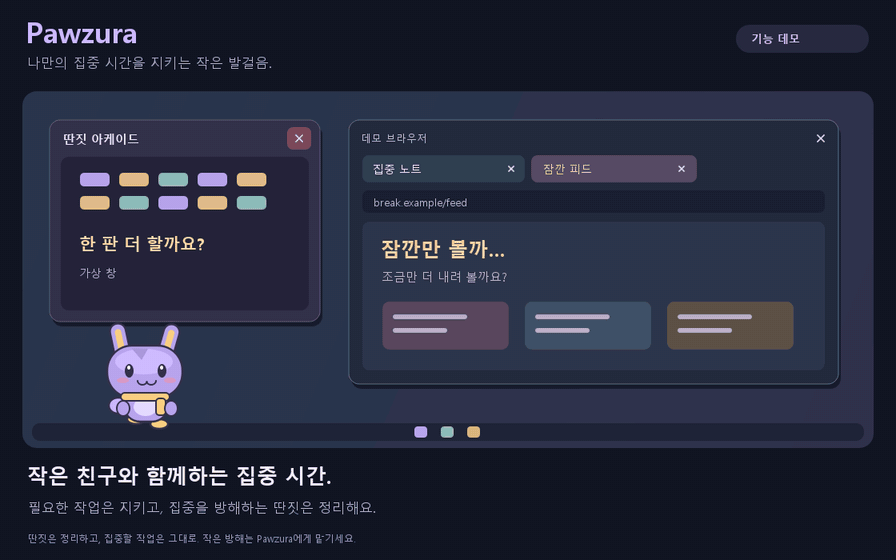

# Pawzura · 파우주라

[English](README.md) | **한국어**

Windows 작업표시줄 위에서 모니터를 오가며 걷고 커서·클릭에 반응하는 작은 SD 캐릭터 앱입니다. 선택형 프로그램·사이트 허용 목록으로 집중을 돕고, 미허용 프로그램 창을 닫기 전에 점프해 깨무는 동작을 보여줍니다.

Windows 10 (1809+) / Windows 11 · x64 · 소스 실행 Python 3.12–3.15 · MIT

*집중을 방해하는 프로그램 창과 탭은 정리하고, 허용한 작업은 그대로 유지합니다. [MP4 보기](artifacts/demo/pawzura-demo-ko.mp4) · [제작 방식](doc/ko/DEMO.md).*

> [!WARNING]
> **처음에는 미리보기 모드를 켜고 사용하세요.** 프로그램 허용 목록과 제어할 각 브라우저의 사이트 허용 목록을 완전히 채우고 검증하기 전까지는 미리보기 모드 해제를 권장하지 않습니다. 해제하면 미허용 창·탭이 닫혀 저장하지 않은 작업이 손실될 수 있습니다. **해제 후 발생하는 위험은 사용자가 부담하며, 법률이 허용하는 범위에서 작성자와 관리자는 그로 인한 손실·손해 및 기타 결과에 책임을 지지 않습니다.**

## 바로 시작

1. [Releases](https://github.com/hobby-programmer-5000/pawzura/releases)에서 **Windows 단일 EXE** 또는 **Windows ZIP**을 내려받으세요.
2. 단일 EXE를 더블 클릭하거나 **ZIP 전체를 풀고** `Pawzura/Pawzura.exe`를 실행하세요. [배포 형식과 중복 실행 안내](doc/ko/SINGLE-EXE.md).
3. **General → Preview bite animation**으로 체험하세요. 처음에는 **감시 OFF·미리보기 ON**입니다.

앱 기본 언어는 영어입니다. **General → Language → 한국어 → Save settings**로 바꾸세요. 소스로 쓰려면 빌드 대신 **run.bat**를 더블 클릭하세요.

**실행 전 확인:** 서명되지 않은 빌드라 **Windows SmartScreen**이 표시될 수 있습니다. 공식 배포 파일과 체크섬을 확인한 뒤, 제공되는 경우에만 **추가 정보 → 실행**을 선택하세요. [실행 안내](doc/ko/GETTING_STARTED.md).

**AI 설계에는 실행 중인 Ollama와 충분한 가용 RAM·VRAM이 필요합니다.** Qwen 도형: 캐릭터 → **명령 복사** → PowerShell → `success` 대기 → 생성. GPU 그림: **창작 그림 만들기…** → 모델 라이선스 확인 → **실행환경·선택 모델 준비**. [그림 준비](doc/ko/CREATIVE-ART.md) · [Qwen 명령](doc/ko/ADVANCED-MODELS.md). 기본·임의 캐릭터는 모델이 필요 없습니다.

## 브라우저 제어는 선택 기능입니다

**사이트 제어에는 Pawzura 브라우저 확장 설치가 필수입니다.** 프로그램만 제어하려면 **브라우저 → 사이트 제어 OFF**로 두세요. 탭만 제어하려면 **집중 지킴이 켜기**는 체크한 채 **일반 → 프로그램 제어 켜기**를 해제하고 저장하세요. 탐색 후 탭을 닫고, 탭 애니메이션은 작업표시줄 근처의 별도 표식에서 보여줍니다.
**허용 주소는 프로토콜과 포트가 일치해야 합니다.** HTTP와 HTTPS는 별도 규칙입니다. 포트를 생략하면 HTTP는 80, HTTPS는 443을 사용합니다. 다른 포트를 허용하려면 `http://127.0.0.1:3000`처럼 명시하세요. `127.0.0.1`만 입력하면 이 IP의 모든 HTTP·HTTPS 포트를 허용합니다.

사이트를 제어하려면 브라우저 선택 후 **확장 설치·연결…**을 누르세요. 열린 확장 관리 화면의 **개발자 모드**(Chrome: `chrome://extensions` 오른쪽 위 스위치)를 켜고, **압축해제된 확장 프로그램을 로드합니다**에서 복사된 폴더를 선택하세요. **Ctrl+Shift+I로 여는 개발자 도구와 다릅니다.** 설치를 마친 뒤 연결 화면을 여세요. [단계별 사용법과 버튼 위치](doc/ko/BROWSERS.md).

## 3D 움직임은 별도로 준비해야 합니다

**그림 생성이나 실행환경 준비만으로 3D 움직임이 만들어지지는 않습니다.** 선택형 실험 기능이며 최소 **8 GB VRAM**의 NVIDIA CUDA GPU가 필요합니다.

1. **설정 → 캐릭터 → 창작 그림 만들기…**를 열고 라이선스 확인란을 체크하세요. 기존 그림은 자동으로 불러오므로 다시 그릴 필요가 없습니다.
2. **창 안쪽을 아래로 내려 그림과 ‘그림 손발 움직임 설정…’ 아래**의 **3D 움직임 준비 · 8GB · 포즈 추정 보조**를 누르세요. 위쪽 **1. 실행환경·선택 모델 준비**와 다른 버튼입니다.
3. 완료 후 **이 캐릭터 사용 → 메인 창에서 설정 저장**을 누르세요. 준비만 마쳐서는 바탕화면 캐릭터가 바뀌지 않습니다. [자세한 3D 사용법·문제 해결](doc/ko/3D-MOTION.md).

| 할 일 | 문서 |
| --- | --- |
| 실행·한국어 변경·트레이 사용 | [처음 사용하기](doc/ko/GETTING_STARTED.md) |
| Chrome/Edge/Firefox 연결과 입력 예시 | [브라우저 연결](doc/ko/BROWSERS.md) |
| 캐릭터 이동·고정·복구와 업무·여가 목록 분리 | [프로필과 복구](doc/ko/PROFILES-AND-RECOVERY.md) |
| 캐릭터 생성·저장·복원·삭제 | [그림과 라이선스](doc/ko/CREATIVE-ART.md) · [캐릭터 보관함](doc/ko/CHARACTER-LIBRARY.md) |
| 소스 실행·EXE 빌드·검사 범위와 제한 | [설정과 빌드](doc/ko/BUILD.md) · [검증 기록](doc/ko/VALIDATION.md) |
| 라이브러리·모델 라이선스 | [제3자 고지](doc/ko/THIRD-PARTY-NOTICES.md) |

| 제품 기획·관리 | AI 구현 지원 |
| --- | --- |
| [hobby-programmer-5000](https://github.com/hobby-programmer-5000) | [ChatGPT (Codex)](https://github.com/apps/chatgpt-codex-connector) |

자체 코드 [MIT](LICENSE) · [그림 정책](doc/ko/ASSET-LICENSING.md). [기여 역할](doc/ko/CONTRIBUTORS.md) · [0.7.0 변경](doc/ko/RELEASE-v0.7.0.md) · [전체 안내](doc/README.ko.md).
