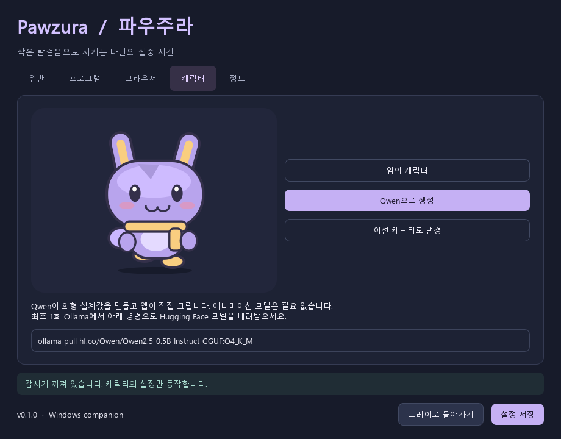

# Pawzura · 파우주라

작은 SD 캐릭터가 작업표시줄 위를 산책하고, 집중을 방해하는 창의 닫기 버튼을 깨무는 Windows 데스크톱 동반자입니다.

Windows 10 **1809 이상** / Windows 11 · x64 · Python **3.12–3.15** · MIT (앱 자체 코드)



## 사용하기

**빌드도 Python 설치도 필요 없는 방법:** 배포 ZIP 전체를 풀고 `Pawzura/Pawzura.exe`를 실행하세요. EXE 옆 `_internal` 폴더와 라이선스 파일을 함께 보관해야 합니다. 최초 실행은 설정 화면을 엽니다. 모델이나 Ollama는 임의 캐릭터와 감시 기능에 필요하지 않습니다.

**소스로 실행:** 일반 CPython 3.12 이상을 설치한 뒤 `run.bat`를 더블 클릭하세요. 처음에 프로젝트 전용 `.venv-standard` 환경과 Qt를 설치합니다. `uv`가 있으면 관리형 CPython 3.14를 사용하며, 없으면 `py -3.14`를 사용합니다. Python 버전을 직접 고르려면 다음 명령을 실행하세요.

```powershell
powershell -NoProfile -ExecutionPolicy Bypass -File .\setup.ps1 -Python C:\Python312\python.exe
.\.venv-standard\Scripts\python.exe -m pawzura --settings
```

Conda Python과 Qt DLL의 조합에서 로딩 오류가 재현되어 **일반 CPython을 권장**합니다. Python 3.16 이후 버전은 현재 고정한 Qt 의존성의 지원 대상이 아닙니다. 호환 버전 확장 시 Qt와 Windows 10 지원을 함께 확인하세요.

## 설정과 동작

- 트레이 아이콘 클릭: 설정. 우클릭: 감시 켜기/끄기, 캐릭터 숨기기/보이기, 완전 종료. 캐릭터를 더블 클릭해도 설정이 열립니다.
- **첫 실행은 감시 OFF, 미리보기 ON**입니다. 미리보기로 허용 목록을 확인한 뒤 실제 닫기를 켜세요. 실제 닫기는 일반 `WM_CLOSE` 요청입니다. 저장 확인창을 우회하거나 프로세스를 강제 종료하지 않습니다.
- Spotify, WhatsApp, VS Code, Docker, PowerShell, Ollama, 주요 브라우저, Codex, Claude, Antigravity 등을 기본 허용합니다. 첫 실행에 Windows Run 키와 Startup 폴더의 실행 파일도 탐색해 허용합니다. 시작프로그램 목록은 프로그램 탭에서 다시 탐색할 수 있습니다.
- 프로그램은 **실행 파일명**으로 허용합니다. 실행 파일 선택 또는 현재 열려 있는 프로그램에서 추가할 수 있습니다. Windows 시스템 폴더의 창과 Pawzura 자체는 항상 보호합니다.
- 열린 일반 창을 약 0.8초마다 검사합니다. 미허용 창을 4초 관찰한 뒤 점프 → 깨물기 → 균열 → 닫기 요청 → 복귀합니다. 균열은 1.8초에 걸쳐 사라집니다. 프로그램이 닫기를 거절하면 강제 종료하지 않습니다.
- 연결된 모니터의 작업 영역을 따라 걷습니다. 다음 모니터로 이동하고 마지막 모니터에서는 처음으로 돌아옵니다. 음수 좌표와 모니터별 DPI를 고려합니다. 모니터 탈착 시 주 모니터로 복귀합니다.
- 한국어/English, 로그인 시 실행, 캐릭터 생성·변경·이전 캐릭터 복원을 지원합니다. 언어를 저장한 뒤 설정을 다시 열면 전체 번역이 적용됩니다.

## Hugging Face sLLM으로 캐릭터 생성

[Ollama](https://ollama.com/)를 설치·실행하고 모델을 한 번 내려받으세요.

```powershell
ollama pull hf.co/Qwen/Qwen2.5-0.5B-Instruct-GGUF:Q4_K_M
```

캐릭터 탭에서 **Qwen으로 생성 → 설정 저장**을 누릅니다. 사용하는 모델은 Qwen 팀의 [Qwen2.5-0.5B-Instruct-GGUF](https://huggingface.co/Qwen/Qwen2.5-0.5B-Instruct-GGUF), Apache-2.0, Q4_K_M 약 491 MB입니다. 원래 텍스트 모델은 [Qwen2.5-0.5B-Instruct](https://huggingface.co/Qwen/Qwen2.5-0.5B-Instruct)입니다.

sLLM은 임의의 색상·귀·장식 설계 JSON을 생성하고, 앱은 자체 벡터 도형으로 SD 캐릭터를 그립니다. **텍스트에서 픽셀 이미지를 만드는 확산 모델 방식은 아닙니다.** 걷기, 눈 깜박임, 귀와 발의 움직임, 점프, 깨물기에는 모델 없이 수학적 애니메이션을 사용합니다. GPU나 PyTorch가 필요하지 않습니다. 모델 없이 쓰는 **임의 캐릭터** 버튼은 로컬 난수 생성입니다.

유명 캐릭터·상표·이름을 입력하는 프롬프트는 받지 않고, 제한된 자체 도형만 렌더링합니다. 이것이 제3자 권리를 침해하지 않는다는 법적 보장을 의미하지는 않습니다. 모델, 생성 데이터의 처리 및 한계는 [모델 문서](docs/MODELS.md)에 기록했습니다.

## 브라우저에서 허용 사이트만 유지하기

브라우저는 프로그램으로 허용하고, **탭**은 확장으로 별도 검사합니다. Chrome/Edge/Brave/Opera/Vivaldi 등 Chromium 계열과 Firefox/Zen용 확장 파일을 제공합니다. 브라우저별로 다음 절차를 수행하세요.

1. Chromium: 확장 관리 화면에서 개발자 모드를 켜고 `extensions/chromium` 폴더를 압축 해제된 확장으로 로드합니다. Firefox 임시 설치 및 정식 서명 절차는 [브라우저 문서](docs/BROWSERS.md)를 참고하세요.
2. Pawzura 설정 → 브라우저에서 해당 브라우저 선택 → **확장 연결 정보 복사**.
3. 확장 아이콘 → 옵션 화면에 붙여넣고 연결합니다.
4. 허용할 사이트를 한 줄에 하나씩 추가하고 **이 브라우저의 사이트 허용 목록 적용**을 켜서 저장합니다. 일반 탭에서 집중 지킴이도 켭니다.
5. 미리보기로 확인하고 미리보기를 해제하면 실제 탭 닫기가 적용됩니다.

초기 허용은 `about:blank`, 브라우저 내장 새 탭/기본 홈 화면 등 명시된 내부 URL뿐입니다. **사용자가 지정한 시작 사이트는 자동으로 신뢰하지 않습니다.** `https://example.com`은 그 사이트의 모든 경로를 허용합니다. 하위 도메인은 별도이며 `*.example.com`으로 명시해야 합니다. HTTP와 HTTPS, 다른 포트도 별도입니다. 설정/확장 관리 내부 페이지, 파일 URL은 기본 허용이 아닙니다. 확장은 감시를 켜기 전에 설치하세요.

이 기능은 **탐색 후 탭 닫기**입니다. 요청 자체를 차단하는 방화벽이 아니어서 콘텐츠가 잠시 로드될 수 있습니다. 앱 종료·확장 해제·연결 실패 시 탭 닫기는 중단됩니다. 브라우저 창 전체를 종료하지 않습니다(단, 마지막 탭을 닫으면 브라우저가 창을 닫을 수 있습니다).

## EXE 빌드

```powershell
powershell -NoProfile -ExecutionPolicy Bypass -File .\setup.ps1
powershell -NoProfile -ExecutionPolicy Bypass -File .\build.ps1
```

결과: `dist/Pawzura/Pawzura.exe`, `dist/Pawzura-0.1.0-windows-x64.zip`. 빌드는 Windows에서 PyInstaller를 사용합니다. DLL 교체가 가능한 `onedir` 배포입니다. 빌드별 Python/라이브러리 버전은 `BUILD-INFO.json`, 실행 바이너리 SHA-256은 `BINARY-MANIFEST.json`에 기록합니다. 빌드에 모델 가중치와 Ollama는 포함하지 않습니다.

원문 고지 파일은 저장소의 `licenses/`에 포함합니다. 의존성/Qt 버전을 바꾼 경우 `scripts/fetch_licenses.py`의 버전도 맞추고 다시 수집하세요. 네트워크 오류 시 빌드에 고지를 빼는 방식으로 우회하지 않습니다.

## 검증 및 제한

```powershell
.\.venv-standard\Scripts\python.exe -m unittest discover -s tests -v
.\.venv-standard\Scripts\python.exe -m pawzura --smoke-check --capture artifacts\settings.png
node --test tests/extension.test.cjs
```

지원 대상으로 설계한 환경과 실제 검증 범위는 [검증 기록](docs/VALIDATION.md)에서 구분합니다. 다중 모니터 실기기 조합, 커스텀 창 프레임, 관리자 권한 프로그램, 브라우저별 확장 스토어 배포는 별도 확인이 필요합니다.

사용자 지정 창 프레임에서는 X 위치를 Windows가 제공하지 않으면 우측 상단 추정 위치를 사용합니다. **사이트 탭의 X 버튼 좌표는 확장 API가 제공하지 않아**, 활성 브라우저는 창의 X 부근, 백그라운드 탭은 바탕화면 우측 상단에 깨물기를 표시합니다. 실제 닫기 대상은 확장이 다시 확인한 해당 탭입니다. 정확한 탭 X 위치를 알아내는 브라우저별 접근성 통합은 현재 구현 범위에 포함되지 않습니다.

설정: `%LOCALAPPDATA%\Pawzura\settings.json`. 자동 실행은 현재 사용자 Run 키의 `Pawzura` 항목만 사용하며 설정에서 해제할 수 있습니다. 시작 메뉴/Startup 아이콘 대신 **알림 영역(트레이) 아이콘**을 제공합니다. URL은 설정한 로컬 브리지(`127.0.0.1:47831`)에만 전송하고 기록하지 않습니다. 파일명 기반 허용 목록과 이 앱은 보안 경계나 변조 방지 자녀 보호 도구가 아닙니다.

## Contributors와 라이선스

| Contributor | 역할 |
| --- | --- |
| [hobby-programmer-5000](https://github.com/hobby-programmer-5000) | 원안, 제품 방향, 상세 요구사항, 저장소 소유·관리, 최종 사용성 판단 |
| ChatGPT (Codex, OpenAI) | 사용자 지시에 따른 설계·코드 작성, 캐릭터 도형과 애니메이션, 확장 연결, 테스트·빌드·기술 문서 작성 지원 |

자세한 역할과 GitHub 기여자 표시 정책은 [CONTRIBUTORS.md](CONTRIBUTORS.md)에 명시합니다. 앱 자체 코드는 [MIT](LICENSE)이며 Python, Qt/PySide, 빌드 도구와 선택 모델은 각자의 라이선스를 따릅니다. [THIRD-PARTY-NOTICES.md](THIRD-PARTY-NOTICES.md)와 배포에 동봉한 원문 고지를 함께 확인하세요.

Pawzura라는 이름은 초기 공개 웹 및 GitHub 저장소 이름 검색에서 동일 소프트웨어 이름을 찾지 못해 선택했습니다. 정식 상표 등록·전 세계 상표 조사를 완료했다는 뜻은 아닙니다.
