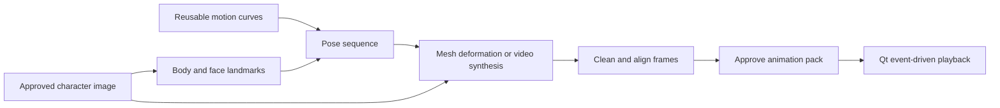

[English](../en/ANIMATION-RESEARCH.md) | [한국어](../ko/ANIMATION-RESEARCH.md) · [Documentation](../README.md)

# Single-image character animation survey

Follow-up: [actual local mesh/facial experiments and resource results](ANIMATION-EXPERIMENT.md).

Checked: **2026-11-03, Asia/Seoul**. This is a research/design note, not an implemented feature or a list of supported models. No models were installed or run for this survey; **8 GB device compatibility is untested**. Model/dependency licenses need a pinned, component-by-component check before integration. App MIT does not replace those terms.

The requested approach exists: retain one character image, drive a sequence of body/face poses, and produce new animation frames. A full manually authored 3D rig is not always needed. In Pawzura 0.3.0, four cutout regions rotate independently; there is no continuous body mesh or generated facial-expression sequence. That implementation is narrower than the systems below.

## Three distinct approaches

| Approach | What changes between frames | Main tradeoff |
| --- | --- | --- |
| 2D mesh / skeleton deformation | Original texture follows connected joints and mesh vertices | Keeps the drawing; cannot reconstruct unseen anatomy or invent detailed facial expressions automatically |
| Pose-conditioned image-to-video | A model synthesizes pixels using the reference identity and a pose sequence | Can depict new limb poses/clothing motion; needs temporal consistency, more memory and cleanup |
| Facial neural rendering | Eye/mouth/head parameters produce expression frames | Useful for blinking/smiling; usually does not animate walking legs |

Keypoints alone are coordinates, not an image renderer. They must drive a mesh or condition a synthesis model. Independently regenerating every pose is not equivalent to a temporally conditioned sequence: identity, outline and palette can drift. This distinction is central to the proposed design.

## Primary-source candidates

| Candidate | Verified capability and available material | Hardware evidence and Pawzura fit | License evidence |
| --- | --- | --- | --- |
| [Meta Animated Drawings](https://github.com/facebookresearch/AnimatedDrawings) · 2023 | Drawing segmentation/joints, skeletal motion and ARAP mesh deformation; annotation correction and rendering code | Best reference for connected 2D movement. Official testing lists macOS/Ubuntu; archived in 2025. Windows/Python integration needs work, not a drop-in dependency | Code and released detection/pose weights: MIT, according to the [official README](https://github.com/facebookresearch/AnimatedDrawings#trained-model-weights) |
| [One-to-All Animation](https://github.com/ssj9596/One-to-All-Animation) · CVPR 2026 | Single reference + pose sequence; released 1.3B/14B variants and inference code | Strong generative research candidate. Authors show a **16 GB T4** workflow; this is not 8 GB proof | Repo and [1.3B v2 model card](https://huggingface.co/MochunniaN1/One-to-All-1.3b_2): Apache-2.0. The [project page](https://ssj9596.github.io/one-to-all-animation-project/) also says academic research/demonstration intent; resolve scope before product integration |
| [Wan2.2-Animate-14B](https://humanaigc.github.io/wan-animate/) · 2025 | Reference image + performer video; body skeleton and facial signals control new frames; official code/weights released | Relevant whole-body-plus-expression reference, but **not an established 8 GB default** | [Model card](https://huggingface.co/Wan-AI/Wan2.2-Animate-14B): Apache-2.0. Preprocessing components have separate terms |
| [Talking Head Anime 3](https://github.com/pkhungurn/talking-head-anime-3-demo) · 2022 | Anime image + expression/head/body parameters; manual poser and public weights | Facial-expression candidate, not a leg-walking solution; input layout and Windows runtime need validation | Code MIT; weights **CC BY 4.0**, expressly separated in the official README |
| [Talking Head Anime 4](https://github.com/pkhungurn/talking-head-anime-4-demo) · WACV 2025 | Character-specific distillation yields a small controllable renderer | Interesting precompute-once design. Official README reports about **30 hours on RTX A6000** for one student; unsuitable as an easy setup default | Code MIT; **THA4 weights CC BY-NC 4.0**. Exclude from the unrestricted product path |
| [LivePortrait](https://github.com/KlingAIResearch/LivePortrait) · 2024 | Portrait expression/head motion from a driving source; code and weights available | Face-focused comparison, not full-body walking | [Official license](https://github.com/KlingAIResearch/LivePortrait/blob/main/LICENSE): MIT code; bundled InsightFace models are noncommercial research-only and must be replaced for commercial use |
| [MimicMotion](https://github.com/Tencent/MimicMotion) · ICML 2025 | Reference image plus motion guidance; temporal video generation | Useful research comparison; not selected for general product integration | Apache-2.0 code differs from the [published weight license](https://huggingface.co/tencent/MimicMotion/blob/b3ea1fc3b8b7c18feaaa77d95465fae5c16d452b/LICENSE), which forbids commercial/production use; SVD terms also apply |

For the geometric mechanism, inspect the authors' [ARAP implementation and explanation](https://github.com/facebookresearch/AnimatedDrawings/blob/main/animated_drawings/model/arap.py). It moves mesh vertices subject to control points while preserving local shape, instead of merely rotating four cutout patches. Adopting this architecture would be a proposed change, not a capability of the current release.

Wan's [preprocessing guide](https://github.com/Wan-Video/Wan2.2/blob/main/wan/modules/animate/preprocess/UserGuider.md) warns about body-proportion mismatches and lists detection/whole-body pose models plus optional SAM2 and FLUX.1-Kontext-dev. Do not inherit that entire pipeline under the Wan model's Apache label. Its basic retargeting path can avoid the optional image editor, but quality and all remaining component terms still need checking.

## What an 8 GB laptop does and does not establish

Model parameter count is not VRAM demand: the text encoder, VAE, reference/pose modules, frame count and resolution also matter. One-to-All's [official inference script](https://github.com/ssj9596/One-to-All-Animation/blob/main/video-generation/inference_1.3b.py) constructs those extra components and moves the pipeline to the GPU. Its unmodified example is not a low-memory integration recipe.

Wan's documented **24 GB** consumer inference example is for **TI2V-5B**, not Animate-14B. Do not transfer that number between models. [Official configurations](https://github.com/Wan-Video/Wan2.2#run-text-image-to-video-generation).

[LTX-Video's official README](https://github.com/Lightricks/LTX-Video#ltx-videoq8) links a community Q8 implementation reporting an RTX 4060 8 GB run. That is useful feasibility evidence for video generation, **not** proof of pose-controlled SD-character walking, transparent output, current LTX-2.5 compatibility or Pawzura performance. Version-specific weight licenses also differ. Keep it as a secondary experiment rather than a promised configuration.

## Proposed Pawzura architecture — engineering recommendation

**Generate and approve a reusable animation pack once; play it with Qt afterward.** The renderer can support multiple preparation backends without running a video model continuously.

This is a proposal inferred from the research, not a benchmark result. A first prototype should contain a few meaningful loops rather than hundreds of unrelated images:

| Clip | Suggested initial frame budget | Observable result |
| --- | --- | --- |
| Idle | 8–12 | Breathing, occasional blink, small head motion |
| Walk | 12–16 | Alternating arm/leg motion, foot contact and weight shift |
| Hover / greet | 8–12 | Look toward cursor, smile, wave |
| Click / hop | 8–12 | Anticipation, takeoff, landing and recovery |
| Bite | 6–10 | Mouth change with an explicit bite landmark per frame |

These counts are design targets, not model input constraints or promised results. Generate any longer model-required sequence first, then select/resample suitable frames. Pixel alignment, timing and the return from the last frame to the first matter more than raw frame count.

Proposed preparation steps: fit motions to SD body proportions; render temporally related frames; remove backgrounds consistently; align scale/foot anchors; inspect identity, hands, eyes and loop boundaries; review all generated frames for the existing content restrictions. Keep per-frame mouth anchors so a visible reaction does not change the guardian's independently validated close boundary. A failed/cancelled pack must retain the current character. These are future acceptance requirements, not completed implementation.

## Recommended experiment order

The later [directional walking requirement and novel-view experiment](DIRECTIONAL-ANIMATION.md) adds a necessary acceptance gate: front idle must transition into side-facing travel with appropriate depth/occlusion. Frontal mesh/facial success alone is insufficient.

1. **Geometric baseline:** use Animated Drawings' mesh/retargeting concepts to compare connected arms/legs against current cutouts. It is the most suitable reference for predictable full-body control with the original image, in my assessment; unseen surfaces and expressions still need another method.
2. **Facial baseline:** evaluate THA3 on correctly prepared original character crops, then composite or cache expression frames. Keep THA4 as research-only because of its weight terms and per-character training cost. Do not assume arbitrary SD faces will work.
3. **Generative branch:** benchmark One-to-All 1.3B on a disposable original image and a short owned motion sequence. Investigate component offload/quantization only after measuring the unmodified pipeline and resolving usage terms. Record OOM, RAM, VRAM, time and visual failures; do not advertise an 8 GB tier until it passes.
4. **Higher-resource comparison:** use Wan-Animate to assess the desired body/expression quality if an appropriately provisioned test environment becomes available. It is not the first local default for the current laptop constraint.

This survey establishes that the requested method is a real research direction. It does **not** establish a model that already provides reliable arbitrary SD characters, expressive faces, transparent seamless loops and Windows 8 GB execution together. The next deliverable should be a side-by-side walking/blinking/waving prototype, with measured resources, before changing the supported-model list or making a release.
