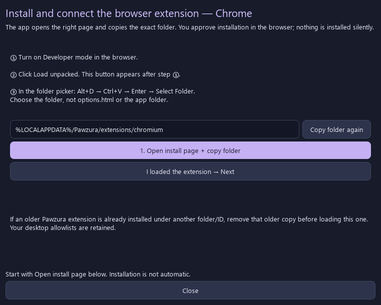
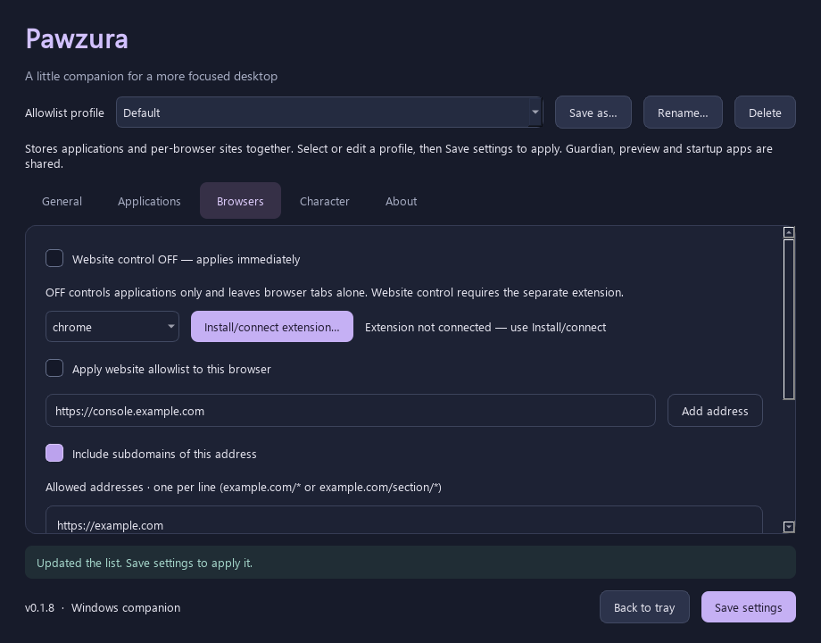

[English](../en/BROWSERS.md) | [한국어](../ko/BROWSERS.md) · [Documentation](../README.md)

# Browser setup — start in the app

**The extension is required only for website control.** If you want applications controlled while browsing freely, turn **Browsers → Website control OFF**. This switch applies immediately; application monitoring and site lists stay as configured. The tray has the same switch. It is shared across profiles. New installs default to OFF; upgrades preserve previously enabled site monitoring.

## Chrome / Edge: the shortest setup

1. In Pawzura 0.1.5+, open **Browsers**, choose **chrome** or **edge**, and click **Install/connect extension…**.
2. Click **Open install page + copy folder**. The app opens the browser's extension manager and puts the correct folder on the clipboard.
3. **On the extensions manager page just opened**, turn on the **Developer mode switch**: in Chrome, **`chrome://extensions` → upper right**; in Edge, **`edge://extensions` → left sidebar**. **Ctrl+Shift+I opens Developer Tools; it does not turn on this switch.** Close Developer Tools if you opened it.
4. On that same extensions page, click **Load unpacked**, which appears after enabling the switch. In the folder picker, press **Alt+D → Ctrl+V → Enter → Select Folder**. No manual folder search is needed.
5. Confirm that **Pawzura Focus Bridge** appears on the extensions page and is enabled. Then return to the helper → **I loaded the extension → Next → Open connection and request pairing**. Choose **Yes** in Pawzura's confirmation. The helper detects a recent authenticated connection and shows completion.

The browser and port are filled automatically. Do not open `options.html` from Explorer; that is only a file preview. Installation requires the browser's own controls and cannot be silently approved by this helper. It does not change enterprise policies or browser profiles. [Chrome's local-load steps](https://developer.chrome.com/docs/extensions/get-started/tutorial/hello-world#load-unpacked), [Edge's local-load steps](https://learn.microsoft.com/en-us/microsoft-edge/extensions/getting-started/extension-sideloading).

## If a button or page is missing



The actual folder is filled and copied on your PC when you click Open install page.

| What you see | Do this |
| --- | --- |
| No Load unpacked button / I pressed Ctrl+Shift+I | Close Developer Tools. Open `chrome://extensions` in Chrome and enable the upper-right Developer mode switch. In Edge, open `edge://extensions` and use the left sidebar switch. |
| Browser not found | In the helper, use Choose browser executable, select the chosen browser's EXE, then retry Open install page. |
| A folder picker with unrelated folders | Alt+D focuses its address bar. Ctrl+V pastes the path copied by the helper. Enter opens that folder; then Select Folder. |
| Cannot find manifest / failed to load | Select the folder prepared by the helper, not the entire Pawzura folder, a ZIP, or options.html. Extract the complete app ZIP first. |
| Connection page cannot open | Finish Load unpacked first. For an existing installation, use Reload on its Pawzura card after the helper updates files. |
| Developer mode is unavailable or managed | Local installation may be blocked by browser/organization policy. The helper cannot override it; apps-only mode remains available. |
| Connected but no tab closing | Turn on the global Website control switch, this browser's allowlist switch and the General guardian. Preview must be off for actual closing. |

## What gets installed

The helper copies six public extension files to `%LOCALAPPDATA%/Pawzura/extensions/chromium` (or `firefox`). This location stays stable when a new EXE is extracted elsewhere. Keep that installed folder. Updates copy the new public files to the same folder; reload the browser's extension card afterwards. The folder path is what the helper copies, not a connection credential.

Chromium uses a fixed public manifest key to keep a stable development ID. This public key is not a private signing key or a pairing credential. The connection link carries only browser, port, language and a request flag. The actual token is exchanged on loopback only after desktop approval. [Chrome extension IDs](https://developer.chrome.com/docs/extensions/reference/manifest/key).

<details>
<summary>Upgrading from 0.1.4 or an older unpacked copy</summary>

The new helper's fixed ID can differ from older path-derived IDs. Remove the older Pawzura card before loading the new helper folder to avoid duplicate extensions. Desktop allowlists remain in the same local settings file. This is a one-time change; later helper updates retain the folder and ID.

</details>

## Other browsers

Brave/Opera/Vivaldi use the Chromium folder and their extension-manager page where supported; Arc compatibility and nonstandard browser executable discovery need separate testing. If detection fails, the helper lets you select the EXE.

Firefox/Zen use the helper's temporary add-on instructions: **Load Temporary Add-on → manifest.json**. Restarting the browser removes this temporary installation. The connection button opens `about:addons`; open Pawzura's Options/Preferences (or its toolbar icon), select the browser and click **Connect automatically**, then approve in the app. Firefox assigns its own extension UUID, so the Chromium direct-options shortcut is not used. Permanent Firefox installation needs Mozilla signing; Zen requires separate validation. [Mozilla distribution requirements](https://extensionworkshop.com/documentation/publish/signing-and-distribution-overview/).

<details>
<summary>Advanced manual connection and old JSON examples</summary>

Automatic connection is recommended. For an older app or troubleshooting, enable **Manual connection — advanced** in the desktop Browsers tab to access Copy connection code and the port. In extension options, expand its own manual connection section, paste the code, and click Connect and test. The sample below is illustrative and cannot connect.

### Concrete example

| Field | Example | What you should enter |
| --- | --- | --- |
| Browser | Chrome | The browser where you installed this extension |
| Port | 47831 | The number shown in Pawzura → Browsers |
| Connection code | EXAMPLE_ONLY_REPLACE_WITH_YOUR_APP_CONNECTION_CODE | Your real code from Copy connection code |

The example code **cannot connect**. It is labelled as a sample and rejected by the Connect button. The **Fill example fields** button demonstrates where values belong without saving a connection.

### Already copied JSON from 0.1.0?

Expand **See an example / import old JSON**. Paste the complete copied text into the import box, then click **Use these details**. This fills the three fields; it does not connect until you click **Connect and test**.

```json
{
  "browser": "chrome",
  "port": 47831,
  "token": "EXAMPLE_ONLY_REPLACE_WITH_YOUR_APP_CONNECTION_CODE"
}
```

`browser` is the Browser field, `port` is Port, and `token` is Connection code. In 0.1.1 the app copies just the code, so paste it into the main Connection code field. No braces or quotation marks are needed there.


</details>

## Add allowed sites and enable monitoring

In 0.1.8+, use **Add address** for entries such as `https://console.example.com`. Leave **Include subdomains of this address** unchecked to allow that host only. Check it to add the entered host and `*.` beneath that same host together, then click **Save settings**. Adding an address does not turn monitoring on.



| Enter | Include subdomains | Result |
| --- | --- | --- |
| `https://console.example.com` | OFF | Allows console.example.com; not example.com or login.example.com |
| `example.com` | ON | Adds example.com and *.example.com, including console/login and deeper subdomains |
| `console.example.com` | ON | Adds console.example.com and *.console.example.com; not its parent or siblings |

Paths, query constraints, scheme and port stay the same on both generated entries. For example, `example.com/team/*?view=work` with the checkbox permits that section on the host/subdomains, not every section. IP addresses and localhost are added individually with the checkbox off. Existing lists are not broadened automatically. Manual `*.example.com` entries still allow subdomains only; pair them with `example.com` for both.

1. In desktop **Browsers**, select the connected browser. Enter sites, one per line, for example `https://example.com`.
2. Check **Apply website allowlist to this browser** and click **Save settings**, then turn on the global **Website control** switch.
3. In **General**, check **Enable focus guardian**, leave preview on, and save. Verify the behavior before turning preview off.

Built-in new-tab/home pages, blank pages and the narrow extension-installation pages are initially allowed. General browser settings and custom startup URLs are **not** automatically allowed. Add custom home URLs yourself. Install and connect the extension before enabling site monitoring.

| Rule | Allows | Does not allow |
| --- | --- | --- |
| `https://example.com` | Every path on that HTTPS origin | Subdomains, HTTP, non-default ports |
| `https://console.example.com` | Every HTTPS path on that specific subdomain | Parent, sibling or deeper subdomains |
| `example.com/*` | Every HTTPS path, query and fragment on that host, including `/` | Subdomains, HTTP, lookalike hosts |
| `example.com/section/*` | `/section` and its children | `/section-other` or other sections |
| `github.com/my-account` | HTTPS `/my-account` and its child paths | Other accounts or `/my-account-other` |
| `https://example.com/personal/home` | That path and its child paths | Other sections of the site |
| `example.com/ko?viewMode=svod` | HTTPS `/ko` and children with `viewMode=svod` | Missing/different `viewMode` values |
| `*.example.com` | HTTPS subdomains such as `help.example.com` | The root `example.com` |
| `http://localhost:3000` | That exact HTTP origin | A different port |

You can paste a domain, a URL path, or a URL with query parameters. Without a scheme, HTTPS is assumed; explicit `http://` and `https://` URLs both work and remain separate. **A bare `http://` or `https://` is incomplete and is not a rule that allows every site.**

A domain without a path allows the whole site. A path allows that section and children on slash boundaries: `/home` does not allow `/home-other`. Query values in the rule must match; extra keys such as tracking parameters are allowed, but extra values for a constrained key are rejected. `#fragment` parts are ignored and cannot restrict SPA hash routes. Internationalized names, Unicode paths and default ports are normalized. Dot segments, backslashes and encoded path separators are rejected for path-scoped rules.

`example.com` and `www.example.com` remain different hosts. If a site redirects to another host or a login site, add that address explicitly if you want to allow it. A rule such as `github.com/my-account` does not permit GitHub's login page. Hostnames still match exactly, so `example.com.evil.test` is not allowed.

Before 0.1.2, paths or queries caused the whole edited list to fail validation. Version 0.1.2 accepts them and identifies the line of any remaining error in the selected language. Saving shows the normalized addresses, including the assumed `https://`.

## Connection messages and troubleshooting

| Message | Next step |
| --- | --- |
| File preview | Install the extension, then open Extension options |
| Code rejected | Copy the current code from the app again |
| Cannot reach Pawzura | Start the desktop app and check the port |
| Connected, guardian off | Enable the browser setting and overall guardian in the app |
| Connected, preview | Keep preview for testing; turn it off to close tabs |

The badge shows ON for real monitoring, PRE for preview and OFF for a connection failure. A blank badge means monitoring is disabled. Disconnecting removes pairing; closing the desktop app stops tab closing.

## Technical behavior and limits

A final `/*` is accepted in 0.1.3 and normalized to the equivalent domain/path rule after saving. `/section/*` includes `/section` itself. Other path patterns such as `/section*` or `/*/item` are rejected. Query constraints after `/*` still apply. Use [profiles](PROFILES-AND-RECOVERY.md) for separate work/leisure lists.

The extension checks up to 200 open tabs per sweep. Each unlisted URL gets an animation ticket; the URL is checked again before closing the tab. A suspended Chromium worker can take about 30 seconds to resume through its alarm. Version 0.1.4 uses a separate synthetic **Tab preview ×** / **Blocked tab ×** marker near the taskbar for both active and background tabs. It does not infer a native window's X from a browser tab ID, use the foreground window's controls, or fall back to the screen's upper-right corner. This marker is not the real browser tab X. Its own extension options pages are excluded from monitoring. Before closing the last blocked tab in a window, the extension creates an about:blank replacement in that same window. If that fails, it leaves the tab open. Other tabs are not closed.

Preview mode never closes tabs. A still-blocked tab/URL is demonstrated once rather than repeating when its animation ticket expires. Navigation, closing/reopening the tab or applying settings can rearm the demonstration. Browser IDs, URLs and preview fingerprints stay in memory; they are not added to logs or settings. Real tab removal is performed only by the extension after an acknowledged decision, with guardian/browser checks enabled and preview off. The native guardian excludes known browser windows in both preview and live modes.

Navigation happens **before** tab closing; this is not a network firewall. Removing the extension or closing the app stops enforcement. Incognito tabs require separate browser permission. Permanent store distribution and real-browser E2E testing remain separate work; see [validation](VALIDATION.md).

The bridge binds only to `127.0.0.1`, checks its private code and Host, limits requests and does not log URLs. In-memory URL tickets expire after 20 seconds. Only extension origins receive CORS responses. URLs never go to the character model. The app is a focus aid, not a security boundary.

References: [Chrome tabs API](https://developer.chrome.com/docs/extensions/reference/api/tabs), [Firefox signing](https://extensionworkshop.com/documentation/publish/signing-and-distribution-overview/).

Automatic pairing requests accept only extension origins, expire after 60 seconds and disclose a credential only after explicit desktop approval. The one-time result is bound to the requesting origin and cannot be redeemed again. Ordinary website origins are rejected. Manual token-based pairing remains an advanced fallback.
