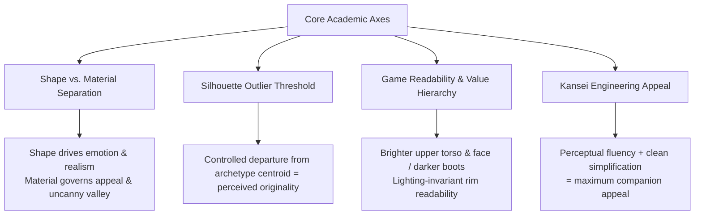
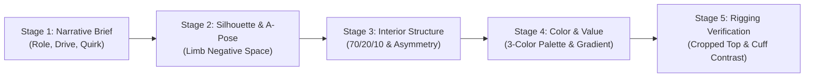

[English](../en/CHARACTER-DESIGN-METHODOLOGY.md) | [한국어](../ko/CHARACTER-DESIGN-METHODOLOGY.md) · [Documentation](../README.md) · [Original artwork](CREATIVE-ART.md) · [3D motion](3D-MOTION.md)

# Original Character Design Methodology and Guidelines

> **Synthesis of 75 Academic Studies and Industry Frameworks · Connected to Pawzura 2D/2.5D/3D Character Generation**

---

## 1. Overview: Form Follows Function

Master character designers across animation, games, and illustration, together with cognitive and computational researchers, define character design not as mere drawing, but as **visual problem-solving and narrative architecture**.

> **Core Principle: Instant Visual Readability ("Show, Don't Tell")**  
> Before a single line of dialogue appears, a viewer should intuitively grasp a character's personality, role, physical capability, and mood **within 0.1 seconds** from silhouette, geometric shape language, and color contrast alone.

---

## 2. Five Foundational Design Principles (Industry Master Frameworks)

Synthesizing the frameworks of veteran Disney animator **Tom Bancroft (*Creating Characters with Personality*)** and Warner Bros. / Nickelodeon lead character designer **Stephen Silver (*The Silver Way*)**:

### (1) Story & Circumstance First
* Before sketching, answer three questions:
  1. **Who are they?**: Role, species, age group, and vocation.
  2. **What do they want?**: Core motivation (knowledge, survival, peace, vindication).
  3. **What is their flaw or quirk?**: Flawless characters lack charm. Shyness, theatrical chuunibyou posturing, or workaholic fatigue create visual individuality.
* Every costume and prop detail (a rolled sleeve, an apron vest, a compass badge) must serve as visual evidence of that narrative context.

### (2) Line of Action & Gesture
* Strong designs originate from a clear **line of action** and readable posture rather than a stiff mannequin T-pose, while maintaining balanced front-view symmetry suitable for rigging when preparing 2D/3D companion assets.

### (3) Shape Language & Intentional Subversion
Human visual perception responds subconsciously to primary geometric shapes (Gestalt psychology and visual semiotics):

| Primary Shape | Psychological Association | Typical Archetypes | Design Application |
| :--- | :--- | :--- | :--- |
| **Circle / Oval** | Friendly, approachable, warm, harmless | Protagonists, companions, chibi mascots | Rounded cheeks, curved head volume, soft silhouette |
| **Square / Rectangle** | Sturdy, reliable, grounded, steadfast | Guardians, artisans, veterans | Broad shoulders, structured vest/apron, chunky boots |
| **Triangle** | Agile, sharp, ambitious, cunning, high-tech | Hunters, netrunners, strategists, anti-heroes | Upturned collars, angular visor goggles, tapered lapels |

> **Creating Originality through Shape Subversion**  
> Clichés arise when shapes are used one-dimensionally. Memorable characters combine contrasting shapes:
> - *Gentle Veteran*: Sturdy square apron silhouette + warm rounded eyes and tiny horn buds (Retired adventurer barista).
> - *Strategic Noble / Mastermind*: Approachable rounded chibi proportions + sharp triangular lapels, rose brooch, or chess-knight pin (Strategic villainess noble, Quiet mastermind scholar).

### (4) Silhouette Readability & Negative Space
* **Black-Fill Test**: When filled solid black, the character must remain identifiable from outer contour alone.
* **Negative Space**: Clear air gaps between the arms and torso and between both legs prevent polygon fusion (webbing) during 3D reconstruction (`three_d.py`) and 2D cutout rigging (`pose.py`).
* **Asymmetrical Focal Accents**: Subtle asymmetry—such as a single lapel brooch, a side herb pouch, or a hairpin—adds life without breaking rigging topology.

### (5) Visual Hierarchy (The 70-20-10 Rule)
* Allocate **70% to primary rest areas** (clean hair, sleeves, trousers), **20% to secondary garment structure** (cropped waistcoat, bolero jacket, boots), and **10% to a high-contrast focal emblem** (crescent brooch, glowing rune emblem, stained-glass sunleaf pin).

---

## 3. Ten Core Findings from 75 Academic Studies

### 1) Functional Separation of Shape and Material
* **Study**: *The Interaction of Shape and Material in Character Stylization*
* **Finding**: Perceptual experiments demonstrate that **geometry (shape)** governs emotional intensity, whereas **surface material (texture)** governs appeal and avoids the uncanny valley. Forcing flat 2D cel-shaded anime art into distorted single-view 3D geometry triggers uncanny artifacts—Directly motivating Pawzura's hybrid `classify_art_texture` architecture (`2.5d_parallax` / medial depth inflation for `flat_2d`, and volumetric mesh reconstruction for `shaded_3d`).

### 2) Quantitative Silhouette Analysis of 169 Animated Characters
* **Study**: *Quantitative Silhouette Analysis of Box-Office Animated Characters*
* **Finding**: Characters rated by audiences as "fresh and original" occupy the controlled boundary (outliers) of their role's morphological cluster rather than its generic center.

### 3) Silhouette Invariants Across Video Game Skins
* **Study**: *Form and Silhouette Consistency in Character Skin Variations across Video Games (LoL & Overwatch)*
* **Finding**: Instant character recognition at small desktop sizes depends on preserving head-to-body ratio and upper-body value contrast.

### 4) Developmental Psychology of Shape Language
* **Study**: *How Can a Character's Personality be Conveyed Visually, through Shape (Ekström, 2013)* & *Children's Perception of Shape Language*
* **Finding**: Across age groups, hybrid proportions pairing a rounded head with a structured torso achieve the highest trust and companion appeal.

### 5) Valve's *Team Fortress 2* Value Hierarchy
* **Study**: *Illustrative Rendering and Character Readability in Team Fortress 2 (Mitchell et al., 2007)*
* **Finding**: Inspired by J.C. Leyendecker, a vertical value gradient (darker boots and lower trousers, brighter sleeves/collar/face) draws the eye immediately to the character's expression even at small desktop companion dimensions.

---

## 4. Practical Pipeline for Pawzura 2D/3D Rigging Compatibility

1. **Separated Arms (A-Pose)**: Hold arms slightly apart from the torso with visible empty hands so torso and sleeves do not fuse into a single web.
2. **Cropped Upper Garments**: Use cropped waistcoats, bolero jackets, or short aprons instead of floor-length robes or ballgowns so hip, knee, and ankle joints remain clearly visible to ViTPose and 3D mesh segmentation.
3. **Clear Wrist and Ankle Boundaries**: Maintain distinct color/value transitions between sleeves and hands, and between trousers and boots, enabling accurate distal cuff escape.

---

## 5. Pawzura Prompt Engineering Checklist

| Check Item | Guideline | Example Prompt Keywords |
| :--- | :--- | :--- |
| **Solo Full-Body** | Request exactly one centered full-body figure on white | `Solo single chibi ..., upright full-body front view centered on plain white background` |
| **Limb Separation** | Ensure negative space between arms, torso, and legs | `Arms held apart with visible empty hands, separated legs, wide white margins` |
| **Rig-Friendly Attire** | Keep hip and knee joints unobstructed | `cropped velvet waistcoat`, `cropped tech jacket`, `tailored breeches`, `ankle boots` |
| **10% Focal Emblem** | Attach narrative props directly to chest/lapel/forehead | `glowing cyan rune emblem`, `gold rose brooch`, `chess knight lapel pin`, `sunleaf brooch` |

- Related guides: [Literary Genres, Worldbuilding, and Character Configurations](LITERARY-WORLDBUILDING-AND-CHARACTERS.md) · [Subcultural Literature and Light Novel Narratology](SUBCULTURAL-LITERATURE-AND-LIGHT-NOVELS.md) · [Comprehensive Research Bibliography](CHARACTER-AND-LITERATURE-BIBLIOGRAPHY.md)
