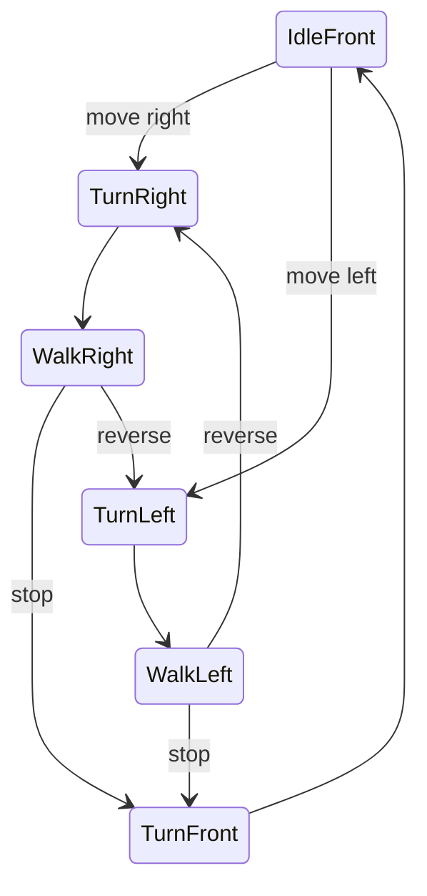

[English](../en/DIRECTIONAL-ANIMATION.md) | [한국어](../ko/DIRECTIONAL-ANIMATION.md) · [Animation experiments](ANIMATION-EXPERIMENT.md)

# Directional walking and depth

Source update: [experimental 8 GB pose-assisted 3D motion](3D-MOTION.md) now connects approved artwork to the actual app. The older release/experiment descriptions below retain their original scope.

Next preparation contract: [consistent frames and sequential drawing/reconstruction/rigging workers](STAGED-CHARACTER-PIPELINE.md).

Requirement added **2026-11-03, Asia/Seoul**: the companion should show its side while moving horizontally. A frontal view may be used when stopped. Turning between frontal, three-quarter and profile views must preserve a sense of volume. This is a design/experiment record, not an implemented feature of 0.3.0.

The earlier frontal [mesh/facial test](ANIMATION-EXPERIMENT.md) does not establish this requirement. Current Pawzura flips its drawing horizontally for facing; neither flipping nor changing a frontal texture's scale provides the unseen side of the head, torso or clothing.

## Observable behavior required

| State | Body orientation and motion |
| --- | --- |
| Idle / stop | Finish the supporting step, turn through three-quarter to front, then blink/breathe or react |
| Walk right | Right-facing profile or a near-profile three-quarter view, clearly oriented along travel; alternating steps and arm motion |
| Walk left | Corresponding left-facing view and walking cycle |
| Start / stop | Frontal ↔ three-quarter ↔ side transition, followed by or returning from the appropriate gait |
| Reverse direction | A brief pivot/turn before the opposite gait; do not immediately flip the frontal bitmap |
| Hover / greet | Stop, turn toward the viewer as appropriate, then perform the reaction |
| Bite / landing | Select the direction of the target, use that clip's mouth anchor, then return to the relevant idle/walk state |

Body facing and eye gaze are separate controls. Looking at the cursor must not force a walking body to stare forward throughout the gait. Crossing an extended-monitor boundary does not itself reverse travel direction.

### Walk, pause and expression flow

User refinement: a brief intentional pause should also bring the character to the front; facial expression and limb motion must continue naturally while it walks sideways. A slowed render frame is not an intentional pause and must not trigger a turn.

Use the flow **front idle → turn toward travel → side walk → plant feet/decelerate → turn to front → idle/reaction**. On resuming, turn back toward travel before accelerating. Preserve the supporting foot through stopping/turning rather than sliding both feet or snapping the facing direction. If another move arrives during a turn, continue from the current orientation instead of restarting from front.

The gait needs hip/knee/ankle articulation, alternating arm swing, restrained head/body weight shift and correct near/far limb occlusion. Blinking, a small smile and ear/accessory follow-through are secondary tracks, not a fixed expression repeated once per step. Side-view expressions act on the visible eye, brow and mouth; they must not paste a two-eye frontal face onto a profile. Facing a cursor or showing a large reaction can stop the gait first. These are animation requirements, not evidence that the current reconstructed asset has the required joints or facial controls.

## Assets and depth cues

Prepare consistent front, left/right three-quarter and left/right profile appearances. Check the head **and** torso, arm/leg overlap, ear/nose silhouette and clothing side panels. The far eye/arm should be hidden when appropriate; compressing the width of a two-eye face is not sufficient. Keep an asymmetric accessory on the correct side rather than assuming left/right sprites can always be mirrored.

Turn clips need actual intermediate views or a validated 3D representation. Alpha fades between unrelated front and side images can produce double faces. A single still also provides no evidence for the back, ear shape or hidden clothing; those areas must be inferred or authored and reviewed.

Keep scale, ground/foot anchors and perceived body volume consistent across views. Store a mouth contact point for every relevant clip/frame. Orientation playback must remain separate from the guardian's identity/state checks and must not issue or revive close callbacks. These are future integration criteria, not changes to current closing behavior.

## Bite as a separate action

Proposed sequence: **plant feet → face the target → crouch/anticipate → jump with tucked legs → open mouth → contact/close jaw → recoil → land with bent knees → recover to front idle or the prior travel direction**. The face may be profile or three-quarter depending on the target, rather than turning front during contact. A short eye squeeze and arm movement can sell the effort; cracks start at the contact point and fade independently. This is a proposed clip sequence, not an animation already produced by the test.

The current `pet.py` artwork path draws a small ellipse at a single mouth coordinate, and `bite()` plans its destination from that coordinate (mirrored for direction). That is insufficient for an articulated turning head. A future asset needs a real jaw/face control or reviewed view-specific open/closed mouth frames with correct lip/teeth occlusion. TripoSR's static scene supplies neither a movable jaw nor a mouth interior; additional mesh preparation/rigging or authored corrective frames are necessary. Frontal THA3 results do not establish profile mouth control.

Each contact frame must carry a validated mouth anchor and its view/scale transform. Align the transformed mouth anchor with the target at contact, rather than centering the sprite there. During approach, interpolated anchors must not cause a position jump as the jaw opens. Contact is a one-shot animation event: an authorized app close still requires the existing final window/process checks; a browser action still uses its separate marker and the exact still-matching tab, never a guessed native browser X. Preview can show the same performance without producing a close request.

Cancellation, changed targets, display changes or character replacement must invalidate the pending contact event. Missing/invalid anchors must not fall back to guessing a screen corner. After an interruption, recover on the current monitor work area without replaying an old close callback. These are integration acceptance requirements; this documentation does not change current app behavior.

## Candidate implementation paths

| Path | What it would provide | What remains |
| --- | --- | --- |
| View-specific 2D animation packs | Generate/review each view, rig or synthesize its gait, then bake turning/walking frames for lightweight Qt playback | Consistent multi-view artwork, side-view limb occlusion and profile-compatible expressions need validation |
| Reconstructed 3D character | A shared volume can produce genuine intermediate camera views; rig/skinning could later drive whole-body motion | Reconstruction quality, hidden surfaces, actual skeleton/weights, gait, facial controls and baking are separate stages |

The preferred runtime remains cached playback. A 3D preparation path does not require permanently running a 3D model in the desktop app. Neither path is accepted solely because a static turntable or frontal blink succeeds.

## Current experiment boundary

The existing THA3 `standard_half` was tested with normalized `head_y` values −1, −0.5, 0, 0.5 and 1, both alone and with `body_y`. These are model control values, **not camera degrees**. All ten frames were finite. Visual inspection still showed two-eye frontal/three-quarter character views, not a full-body profile; this source/model combination does not satisfy directional walking.

An isolated [TripoSR](https://github.com/VAST-AI-Research/TripoSR) test reconstructed a 3D scene from the same original QA illustration and rendered **24 actual camera views** at 15° intervals. Inspection showed a profile silhouette, hidden far eye/arm and newly inferred side/back surfaces. The output also simplified facial details and reinterpreted the drawing as a 3D toy. It is not an exact recovery of the original or unseen surfaces. Mixing the original 2D frontal idle with these reconstructed profiles would introduce a style discontinuity.

| Measured stage / resource | Result |
| --- | --- |
| Environment | Windows; Python 3.12.14; Torch 2.7.1+cu118; RTX 2070 Max-Q 8 GiB; float32 |
| Load / scene encoding | 12.453 s / 1.203 s |
| Render 24 views, 256 × 256 | 177.328 s; total including load/encoding 192.047 s |
| Peak Torch allocated / reserved VRAM | 2,224.85 / 2,604 MiB |
| Actual inference-process peak working set | 3,956.86 MiB |

The local English/Korean report includes front-to-profile turns in both directions, five-view comparisons and 144-pixel previews. These are **static poses with changing camera views**, not walking, rigging or profile expressions. Native output has a white background; transparent character playback was not tested. This single character/configuration does not establish a 2/4/6 GB support tier. Cached preview timing is independent of inference speed.

Provenance: upstream source `107cefdc244c39106fa830359024f6a2f1c78871`; [official MIT model](https://huggingface.co/stabilityai/TripoSR) revision `5b521936b01fbe1890f6f9baed0254ab6351c04a`. Only two unused optional imports (`torchmcubes`, `rembg`) were deferred in the isolated clone. Learned model and volume renderer were unchanged; mesh extraction and background removal were not exercised. DINO architecture configuration was pinned at `facebook/dino-vitb16` revision `f205d5d8e640a89a2b8ef0369670dfc37cc07fc2`; no separate DINO weights were downloaded. Raw outputs, hashes, commands and resource records remain in ignored local experiment evidence. No model was added to Pawzura's supported list or distribution.

Zero123++ is relevant to multi-view research, but its [official README](https://github.com/SUDO-AI-3D/zero123plus#license) separates Apache-2.0 code from CC BY-NC 4.0 weights. It is not selected for the unrestricted product-model path. Models and their complete dependency terms need independent checks even when the main app is MIT.

## Follow-up: manually rigged motion demo

The user-requested follow-up reuses that cached scene, without downloading another model or package. A custom marching-tetrahedra extractor sampled a 96³ density grid at threshold 25: **18,682 vertices, 37,336 triangles and 168,016 dense surface samples**. Color was projected from the earlier 24 camera renders; near-white background contamination on hair/boots received a localized color cleanup. Extraction took 22.531 s, with 1,648.16 MiB peak allocated Torch VRAM and 3,776.63 MiB inference-process peak working set on the same test machine. This is a custom extraction path, not the previously untested upstream mesh exporter.

The demonstration manually fits **12 bones and skin weights** to this one character. Own leg IK and linear-blend skinning drive the limbs; localized procedural corrections drive blink, smile and jaw opening, with an authored curved mouth/teeth/tongue surface. These controls are not outputs of a learned animation/facial model and are not an automatic rigging solution for new characters. Depth-tested surface splats preserve view-dependent near/far occlusion. All preparation stays outside the app.

The 12-second, 288-frame sequence shows both side walks, a front-facing pause, a greeting, anticipation/jump/jaw opening, synthetic contact/crack, recoil and landing. The local English/Korean player supports play/pause, restart, seeking and jumping to the walk/bite sections; GIFs and face-detail views are available. Compact playback shows a roughly 144-pixel-tall character. GIF timing alternates 40/50 ms to match 12 seconds at an average 24 FPS; this is cached playback, not live inference. The GIF restarts the scripted presentation rather than demonstrating a seamless ambient loop.

Regression checks cover opposing arm motion, knee articulation and bone lengths, constant-speed supporting-ankle contact, facing states, localized blink/smile/jaw controls, mouth-anchor alignment and one-shot synthetic contact. The first rig stretched short legs at long stance positions; lowering the walking pelvis corrected the reach problem. A rounded stride constant also left small ankle drift and was replaced by a stride derived from speed, period and render scale. A frontal eye-point compression check passed while the profile still appeared open; visual inspection led to a curved-surface eyelid color correction, checked using the visible dark aperture as well as rendered open/closed comparisons. Cancelled, invalid-anchor or changed-target synthetic actions cannot later produce contact. There is no native/window/browser close API in this demo.

Remaining limitations: visible surface/texture seams and approximate clothing/skin weights; procedural mouth shape and facial quality; stopping/turning foot contact; generic-character fitting; gaze, actual monitor transitions, product cancellation/recovery and integration remain unvalidated. Existing app behavior and 0.3.0 assets are unchanged. A successful scripted demonstration does not satisfy all integration criteria below.

## Actual app check after the demo

On 2026-11-03 the source app's real artwork dialog, local image/review models, Use/Save flow and `Companion`/`Pet` were exercised with disposable settings. Guardian monitoring was stopped and native close calls were blocked. This was not a test of a new frozen release or Windows 11.

Two SDXL generations reached taskbar playback: 34 walking samples remained on the primary monitor's current available-work-area floor, with 125 logical pixels of travel, one synthetic bite contact and zero contacts after cancellation. Visual inspection invalidated the first result as a multi-figure sheet; a second result still contained unwanted detached props. Composition guidance and an alpha-component/vision response check were added, and the original collage is now rejected. The vision-only single-character flag missed that example, so neither check is presented as a reliable semantic counter.

An SD 1.5 courier example applied and traveled 67 logical pixels, but automatic limb estimation returned no rig. Its articulated-motion acceptance **failed**; whole-image fallback movement is not a successful limb-animation result. A further SDXL courier probe was stopped after slow progress under high GPU-memory occupancy; resource contention was suspected, not established as its cause. Its partial output is not a successful generation check.

**The actual app still does not reproduce the 3D demo.** Automatic view/rig preparation, side-facing facial motion and an animated jaw are not connected to image generation. New drawing examples help users request suitable input, but cannot supply that missing pipeline. Only the current monitor floor was exercised; enumerating other monitor work areas does not establish cross-monitor or mixed-DPI playback. Raw QA images, errors and run receipts stay ignored and local; no personal profiles or images were used.

## Acceptance before app integration

1. Show a single identity at front, both three-quarter and both profile views without an obvious second face or contradictory accessories.
2. Play left/right side-walking loops with foot contact and near/far limb ordering. A camera orbit of a stationary character fails this check.
3. Demonstrate turn-start-walk-stop-turn-back at the actual 144-pixel companion size, including direction reversal and monitor changes.
4. Validate gaze, blink and smile for the visible facial parts in each supported view. Frontal expression success does not establish profile support.
5. Verify loop/transition continuity, bounded per-frame anchors, memory/setup cost and cancellation while retaining the old character. Keep guardian/preview/browser protections unchanged.
6. Show a short pause returning to front and a restart into each side gait, with visible side-view blink/expression and planted-foot stopping. Do not count whole-image bobbing as limb animation.
7. Show bite anticipation, an opening/closing profile jaw, mouth-aligned contact, recoil and landing. Check cancel-before-contact, duplicate contact suppression, invalid anchors and target changes with synthetic targets; no live guardian test on the user's desktop.

Until these checks pass, describe the current artifacts as appearance/motion experiments; do not label them completed directional walking.
