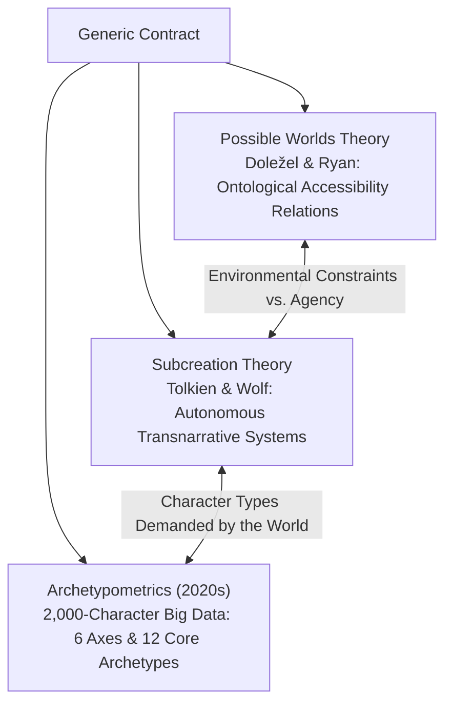
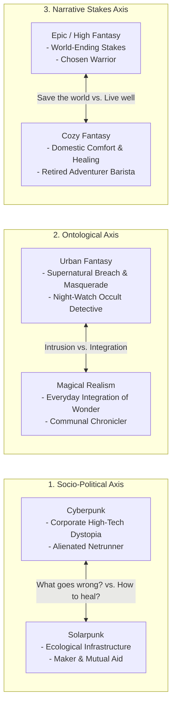

[English](../en/LITERARY-WORLDBUILDING-AND-CHARACTERS.md) | [한국어](../ko/LITERARY-WORLDBUILDING-AND-CHARACTERS.md) · [Documentation](../README.md) · [Original artwork](CREATIVE-ART.md) · [3D motion](3D-MOTION.md)

# Literary Genres, Worldbuilding, and Character Configurations

> **Comprehensive Synthesis of Classic Literature (Project Gutenberg) and Contemporary Speculative Fiction Scholarship (92 Academic Studies & Comparative Narratology)**

---

## 1. Introduction: Three Theoretical Pillars of Worldbuilding and Character

Comparative literature and modern narratology treat worldbuilding and character configuration not as isolated craft elements, but as **two sides of the same generic contract**.

1. **Possible Worlds Theory (Lubomír Doležel, Marie-Laure Ryan)**:
   - Literary fiction is classified by its *accessibility relations* to the actual world—physical laws, biological compatibility, and social causality (*Heterocosmica*, 1998).
2. **Subcreation and Secondary Worlds (J.R.R. Tolkien, Mark J.P. Wolf)**:
   - A secondary world is not a disposable backdrop for a single plot, but an autonomous **transnarrative, transmedial** ecosystem (*Building Imaginary Worlds*, 2012).
3. **Empirical Archetypometrics (2020s)**:
   - Computational analysis of 2,000 characters across 341 stories and 464 semantic dimensions demonstrates that literary characters converge into **12 foundational archetypes** organized across Big Five personality traits, order/chaos, and power/vulnerability axes.

---

## 2. Three Evolutionary Axes of Contemporary Speculative Fiction

Over the past four decades, contemporary speculative literature has evolved along three primary axes:

---

## 3. Worldbuilding Laws and Character Configurations by Genre

### [Genre 1] Cyberpunk & Post-Cyberpunk
* **Representative Works**: William Gibson (*Neuromancer*), Neal Stephenson (*Snow Crash*), Philip K. Dick (*Do Androids Dream of Electric Sheep?*)
* **Worldbuilding Laws (*High-Tech, Low-Life*)**: Corporate feudalism, cyberspace as mythological frontier, and ubiquitous cybernetic augmentation.
* **Character Configuration**:
  - **Console Cowboy / Netrunner Hacker**: A nimble outsider navigating data matrices with visor optics and circuit-lined gear → **Built-in Pawzura Preset: `Cyberpunk netrunner hacker (Cyberpunk)`**.

### [Genre 2] Magical Realism
* **Representative Works**: Gabriel García Márquez (*One Hundred Years of Solitude*), Jorge Luis Borges (*Ficciones*), Salman Rushdie, Haruki Murakami
* **Worldbuilding Laws (*Integration, Not Intrusion*)**: Complete resolution of antinomy (Amaryll Chanady, 1985), where supernatural phenomena are narrated as ordinary everyday facts alongside cyclical generational memory.

### [Genre 3] Contemporary Urban Fantasy
* **Representative Works**: Neil Gaiman (*Neverwhere*, *American Gods*), Jim Butcher (*The Dresden Files*), Sergei Lukyanenko (*Night Watch*), China Miéville (*The City & The City*)
* **Worldbuilding Laws (*The Supernatural Breach & The Hidden City*)**: A dual-layered metropolis where arcane societies coexist behind a hidden veil beneath modern transit and night streets (Stefan Ekman, *Urban Fantasy and Modernity*, 2024).
* **Character Configuration**:
  - **Night-Watch Occult Detective**: A mediator between mundane law and hidden compacts carrying a silver compass emblem and tailored detective jacket → **Built-in Pawzura Preset: `Night-watch occult detective (Urban Fantasy)`**.

### [Genre 4] Solarpunk (Ecological Utopian Imaginary)
* **Representative Works**: Becky Chambers (*A Psalm for the Wild-Built*), Kim Stanley Robinson (*The Ministry for the Future*), Ursula K. Le Guin (*Always Coming Home*)
* **Worldbuilding Laws (*Infrastructural Symbiosis*)**: Post-crisis ecological restoration combining decentralized solar microgrids, Art Nouveau stained-glass aesthetics, and mutual aid (William J. Gillam, 2023).
* **Character Configuration**:
  - **Maker / Solarpunk Eco-Tinker**: A cheerful craftsperson who repairs community infrastructure wearing a moss-green work vest and stained-glass sunleaf brooch → **Built-in Pawzura Preset: `Solarpunk eco-tinker (Solarpunk)`**.

### [Genre 5] Cozy Fantasy & Slice-of-Life
* **Representative Works**: Travis Baldree (*Legends & Lattes*), T.J. Klune (*The House in the Cerulean Sea*), Sarah Beth Durst (*The Spellshop*)
* **Worldbuilding Laws (*Low Stakes, High Comfort*)**: Deliberate de-escalation of apocalyptic stakes in favor of a warm domestic micro-world (a neighborhood coffee shop, bakery, or spellshop) and found family.
* **Character Configuration**:
  - **Retired Adventurer Barista**: A former warrior with tiny horn buds who hangs up weapons to brew warm drinks in a cinnamon-brown apron with a coffee cup pin → **Built-in Pawzura Preset: `Retired adventurer barista (Cozy Fantasy)`**.

### [Genre 6] Space Opera & Planetary Ecology
* **Representative Works**: Frank Herbert (*Dune*), Ursula K. Le Guin (*The Left Hand of Darkness*), Isaac Asimov (*Foundation*)
* **Character Configuration**: Star navigators, planetary ecologists, and astronomers → **Built-in Pawzura Preset: `Chibi astronomer`**.

### [Genre 7] Classic Literary Canon (Project Gutenberg & Classic Fantasy)

| Classic Genre | Canonical Works | Worldbuilding Traits | Character Archetypes & Pawzura Presets |
| :--- | :--- | :--- | :--- |
| **Galactic & Lyric Fantasy** | Kenji Miyazawa (*Night on the Galactic Railroad*), Saint-Exupéry (*The Little Prince*) | Starlight railway stations and philosophical secondary worlds across constellations | **Galactic train conductor (Classic Fantasy)** (`conductor_prompt`) |
| **Gothic & Proto-SF** | *Frankenstein*, *Jekyll and Hyde*, *Dracula* | Stormy castles, laboratories, reason vs. obsession | Promethean creator ↔ alienated creation |
| **Detective & Deduction** | *Sherlock Holmes*, *Auguste Dupin*, *The Moonstone* | Foggy metropolis, rational order pierced by mystery | Eccentric detective ↔ empathetic chronicler |
| **Portal & Nature Adventure** | *Alice in Wonderland*, *The Wizard of Oz*, *Treasure Island* | Threshold crossings into wondrous ecosystems | **Woodland courier**, **Clockwork gardener**, **Forest otter explorer** |

---

## 4. Evolution Matrix: Classics vs. Cyberpunk vs. Solarpunk/Cozy

| Dimension | 18th–19th c. Classics | Late 20th c. Cyberpunk | 21st c. Solarpunk & Cozy Fantasy |
| :--- | :--- | :--- | :--- |
| **Central Conflict** | Human vs. nature / inner darkness | Individual vs. megacorporate system | Burnout & alienation vs. ecological/communal healing |
| **Narrative Stakes** | Survival, truth, honor, exploration | Micro-survival in a neon dystopia | **Emotional restoration, everyday peace, hospitality** |
| **World Character** | Uncharted frontier, celestial railway | Rain-slicked megacity, data matrix | **Solar-botanical symbiosis, warm tavern/café** |
| **Hero Archetype** | Explorer, detective, conductor | Lone-wolf netrunner, street mercenary | **Maker, tinker, retired adventurer barista** |

---

## 5. Built-In Literary Genre Presets in Pawzura (`Create original artwork…`)

| Literary Genre | Pawzura Preset Label | Visual Shape Language & 10% Focal Emblem | 3D Rigging Optimization |
| :--- | :--- | :--- | :--- |
| **Cyberpunk** | `Cyberpunk netrunner hacker (Cyberpunk)` | Neon-pink bob + forehead cyan visor goggles + circuit-trim tech jacket | Cropped matte-black jacket and high-top boots keep hip/knee/ankle joints clear |
| **Solarpunk** | `Solarpunk eco-tinker (Solarpunk)` | Warm-bronze wavy hair + stained-glass sunleaf brooch | Rolled sleeves and cropped moss-green vest separate wrists and waist |
| **Cozy Fantasy** | `Retired adventurer barista (Cozy Fantasy)` | Silver-braided hair + tiny horn buds + coffee-cup pin apron | Cropped waist apron over slate trousers avoids long-skirt leg fusion |
| **Urban Fantasy** | `Night-watch occult detective (Urban Fantasy)` | Tousled ash-blond hair + amber eyes + silver compass badge | Cropped detective bolero jacket replaces ankle-hiding trenchcoats |
| **Classic Fantasy** | `Galactic train conductor (Classic Fantasy)` | Indigo hair + starry golden eyes + brass ticket-punch emblem | Fitted cobalt jacket with high-contrast cream trousers and russet boots |

- Related guides: [Original Character Design Methodology](CHARACTER-DESIGN-METHODOLOGY.md) · [Subcultural Literature and Light Novel Narratology](SUBCULTURAL-LITERATURE-AND-LIGHT-NOVELS.md) · [Comprehensive Research Bibliography](CHARACTER-AND-LITERATURE-BIBLIOGRAPHY.md)
