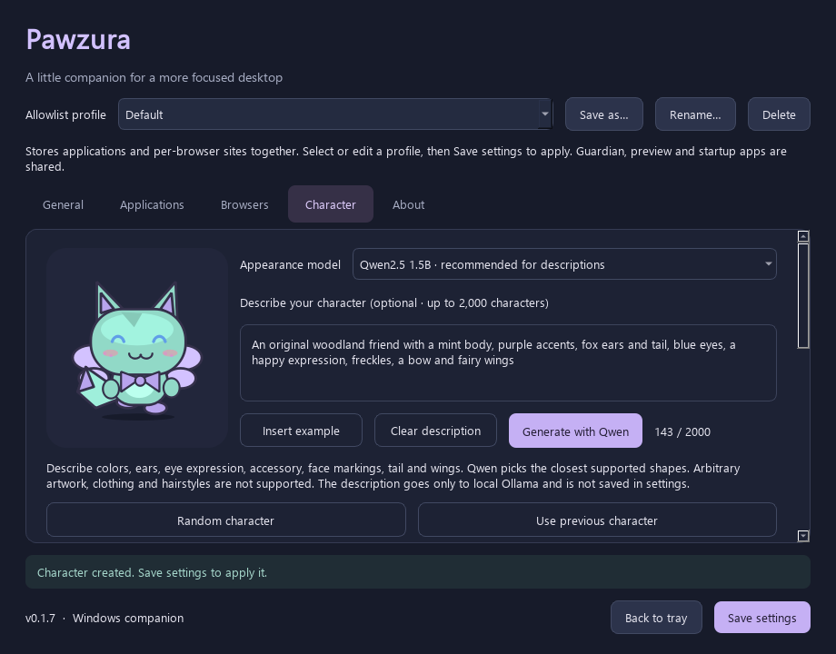

[English](../en/MODELS.md) | [한국어](../ko/MODELS.md) · [Documentation](../README.md)

# Models and character generation

For actual generated illustrations with original silhouettes, clothing and hairstyles, use **Character → Create original artwork…**. This separate optional GPU path has its own setup, content checks and model license acknowledgement: [Creative artwork](CREATIVE-ART.md). The remaining sections describe the vector trait designer.

**Ollama must be running and the selected model downloaded. Keep enough free system RAM/VRAM for weights plus inference overhead.** Random/manual characters work without it. For **Advanced → 2/4/6/8 GB VRAM guides**, larger Qwen3 options and licenses, see [advanced models and memory](ADVANCED-MODELS.md). These improve the available description-interpreting choices; the vector artwork capabilities remain the same.

| Role | Model/component | License | How it is used |
| --- | --- | --- | --- |
| Original text sLLM | Qwen/Qwen2.5-0.5B-Instruct | Apache-2.0 | Model lineage; Transformers is not installed by the app |
| Actual inference weights | Qwen/Qwen2.5-0.5B-Instruct-GGUF, Q4_K_M | Apache-2.0 | Downloaded from the official Qwen Hugging Face repository through Ollama |
| Detailed description option | Qwen/Qwen2.5-1.5B-Instruct-GGUF, Q4_K_M | Apache-2.0 | Optional larger local designer; selected in Character, never bundled or automatically downloaded |
| Inference server | Separately installed Ollama | MIT for its main project; bundled components retain individual terms | Local 127.0.0.1:11434/api/generate |
| Vector motion models | None | Not applicable | Original vector drawing and procedural motion |
| Optional artwork / review / cutout | SD 1.5, SDXL, Qwen3-VL, Falconsai ViT, U2NetP | Individual terms | [Separate catalog and flow](CREATIVE-ART.md) |
| Optional artwork joint suggestions | usyd-community/vitpose-base-simple (~350 MB), pinned revision in catalog | Apache-2.0 | Local CPU helper during setup/generation; [editable hand/foot motion](ARTWORK-MOTION.md). Walking itself uses no model |

## Use the optional designer

Install and start [Ollama](https://ollama.com/), then download once:

```powershell
ollama pull hf.co/Qwen/Qwen2.5-1.5B-Instruct-GGUF:Q4_K_M
```

1. Open **Character**, select **Qwen2.5 1.5B** for descriptions (about 1.12 GB of weights), and click **Copy command** beside the selector. Paste into PowerShell, press Enter and wait for `success`. The smaller **0.5B** option uses about 491 MB of weights, but often misses detailed English/Korean requests. **Model setup guide** lists exact commands and steps for every VRAM tier. Existing saved 0.5B designs retain their model identity.
2. Enter a description, or use **Insert example**. Up to 2,000 characters are accepted; leaving it blank requests a random design.
3. Optionally choose colors or traits under **Choose appearance options**. Explicit choices take priority over the prompt and model output. **Auto** / blank colors leave those fields to Qwen.
4. Click **Generate with Qwen**, inspect the preview, then **Save settings**. An error leaves the current design unchanged.

Example: “An original woodland friend with a mint body, purple accents, fox ears and tail, blue eyes, a happy expression, freckles, a bow and fairy wings.” Names of known characters are unnecessary; describe their generic traits instead.

## Custom options without a model



This example uses manual choices for exact colors and traits; it is not a promise that the model follows every word.

Choose traits and click **Apply options (no model needed)** to update the current preview, then **Save settings**. Unselected fields keep the current appearance in this mode. Hex color fields accept `#RRGGBB`; the color picker fills them for you. **Use previous character** restores earlier designs, and **Reset default appearance** restores the baseline.

| Option | Supported values |
| --- | --- |
| Body, accent, eye color | Any `#RRGGBB` color |
| Ears | Rabbit, cat, bear, fox, none |
| Accessory | Scarf, star, leaf, bow, bell, none |
| Eye expression | Round, sleepy, happy |
| Face markings | None, freckles, stripes, spots |
| Tail | Puff, cat, fox, none |
| Wings | None, fairy, bat |

The sLLM maps descriptions to these original SD vector shapes. In the vector designer, arbitrary illustrations, clothing, hairstyles, body proportions and reference-image generation are not supported. Use the separate artwork flow for image generation; reference-image input remains unsupported. Model choices can miss requested details, especially with 0.5B; use explicit options for exact traits/colors. Wings and tails move with the existing procedural animation; walking, blinking, jumps, bites and cracks require no motion model or PyTorch.

## Processing

1. Read the session-only description and validated manual choices. A random seed varies unspecified traits. Instructions request an original design and generic traits rather than named characters, franchises or logos.
2. Ask the selected Qwen model on local Ollama for nine schema-constrained visual fields. No remote/custom endpoint or arbitrary model name is accepted.
3. Validate the fields. Invalid individual fields use deterministic fallback values; broken JSON or missing keys leaves the current character unchanged and reports an error.
4. Render original QPainter geometry; never evaluate model code, HTML or SVG.
5. Apply explicit manual choices last. Store only the seed, selected appearance and model identifier locally; keep up to 20 previous designs. The description stays in the current settings window only, is not included in saved settings/history, and is not logged or sent to an external service. Clear it with **Clear description**. Ollama is a separately installed service with its own behavior.

Downloads are explicit, not automatic. No weights or Ollama executable are bundled. Inference can run offline after download. Generation runs in a worker thread; normal exit waits until generation finishes.

## Rights and reproducibility

The [character policy and provenance](CHARACTER-RIGHTS.md) record the default design, source hashes and objection to exclusive appropriation. Existing MIT permissions remain unchanged; the policy cannot block third-party applications automatically.

The default character is original vector-drawing code produced with AI assistance; it is not a licensed third-party mascot. No formal trademark/image clearance has been completed. Independent drawing does not by itself guarantee that no existing protected design or similar trademark conflicts with it. Copyright and trademark rights are distinct, and exclusive copyright in AI-assisted output depends on the applicable rules and human creative contribution. Keep design provenance and obtain suitable rights checks before branding or commercialization. [Official Korean AI copyright guidance](https://www.kipo.go.kr/ko/kpoBultnDetail.do?aprchId=BUT0000029&menuCd=SCD0200618&ntatcSeq=21075&sysCd=SCD02), [trademark scope](https://www.kipo.go.kr/ko/kpoContentView.do?menuCd=SCD0200242).

Apache-2.0 covers the model's terms and does not guarantee originality or non-infringement of generated output. The designer requests original generic traits and renders only built-in geometry; this is not an automatic originality check. External reference images are not supported. Free-text descriptions are supported from 0.1.7.

Tags can change upstream. The tested digest is recorded in [model provenance](../../artifacts/model-provenance.json), and [the sample appearance](../../artifacts/qwen-character.json) came from actual local inference. Retain the model's original license in [licenses](../../licenses/upstream/Qwen-LICENSE.txt); do not relicense its weights as the app's MIT code. Any future motion model must have its identity, license, download size and usage documented before adding it.

The 1.5B test digest and download size are recorded in [its provenance](../../artifacts/model-provenance-1.5B.json); its unmodified license is [here](../../licenses/upstream/Qwen-1.5B-LICENSE.txt). Actual sample tests followed most requested traits but missed eye color and tail type; exact prompt compliance is not guaranteed even with 1.5B. Manual choices are enforced after inference.

Sources: [0.5B GGUF card](https://huggingface.co/Qwen/Qwen2.5-0.5B-Instruct-GGUF), [1.5B GGUF card](https://huggingface.co/Qwen/Qwen2.5-1.5B-Instruct-GGUF), [Hugging Face Ollama guide](https://huggingface.co/docs/hub/en/ollama), [Ollama structured outputs](https://docs.ollama.com/capabilities/structured-outputs).
