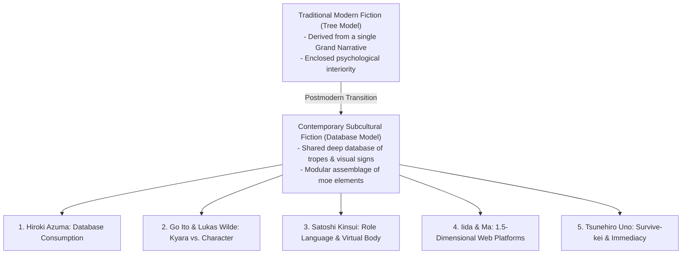
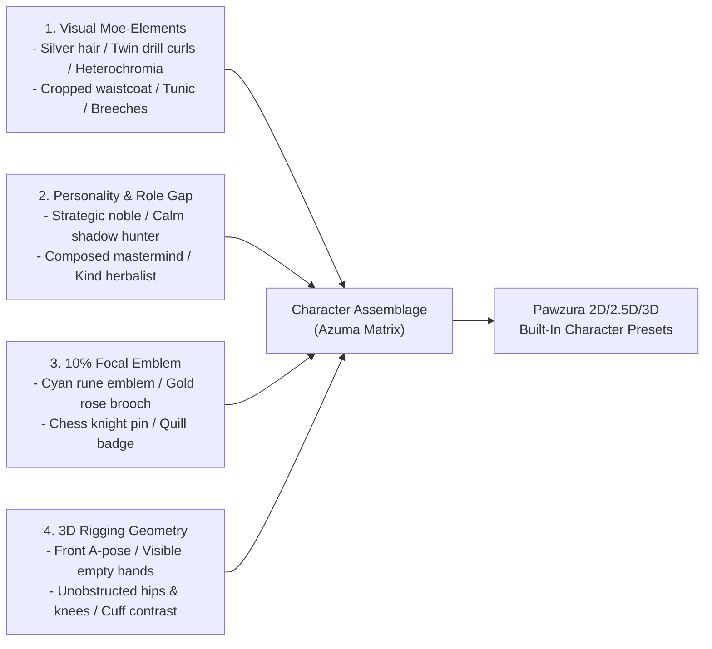

[English](../en/SUBCULTURAL-LITERATURE-AND-LIGHT-NOVELS.md) | [한국어](../ko/SUBCULTURAL-LITERATURE-AND-LIGHT-NOVELS.md) · [Documentation](../README.md) · [Original artwork](CREATIVE-ART.md) · [3D motion](3D-MOTION.md)

# Subcultural Literature, Light Novels, and Web Fiction Character Narratology

> **Database Consumption Theory, Kyara Semiotics, Role Language (Yakuwarigo), Platform Media Ecology, and Isekai/LitRPG Scholarship · Connected to Pawzura 3D Character Presets**

---

## 1. Introduction: Narrative Paradigm Shift in Subcultural Fiction

Light novels (LN), web novels (WN), and subcultural genre fiction operate at the intersection of **media ecology, visual semiotics, and ludology (game studies)** rather than traditional realist linearity.

---

## 2. Five Core Theoretical Frameworks

### (1) Hiroki Azuma (東浩紀): Database Consumption (*Otaku: Japan's Database Animals*, 2001/2009)
* **Grand Narrative Dissolution & Deep Database**: Readers consume the underlying **shared database of visual and narrative elements** prior to any individual plot.
* **Modular Character Assemblage**: Characters are engineered as recombinant sign matrices—for example, `silver hair + ruby eyes + glowing cyan rune emblem + cropped hunter vest`.

### (2) Go Ito (伊藤剛) & Lukas Wilde: *Kyara* vs. *Character* (*Tezuka is Dead*, 2005)
* **Separation of Diegetic Character and Proto-Visual *Kyara***:
  - **Character (*Kyarakutā*)**: A figure bound to a specific story plot.
  - ***Kyara***: A decontextualized, autonomous visual-symbolic entity capable of living independently as a desktop companion, illustration, or figure.
* **Relevance to Pawzura**: A desktop companion walking across the taskbar is a quintessential **living *Kyara***—requiring immediate silhouette recognition and iconic visual markers.

### (3) Satoshi Kinsui (金水敏) & Tianyun Yang (2026): Role Language (*Yakuwarigo*)
* **Linguistic Virtual Body**: Distinct speech registers and archetypal descriptors immediately evoke a complete visual body (villainess noble, quiet mastermind, herbalist supporter, shadow hunter) in the reader's mind.

### (4) Ichishi Iida & Sheng-mei Ma (2024): 1.5-Dimensionality of Web Fiction Platforms
* Contemporary web-novel ecosystems (*Shōsetsuka ni Narō*, KakaoPage, Munpia) evolve genres through reader feedback loops, turning shared conventions (status windows, isekai workshops, villainess survival, party banishment) into versatile creative building blocks.

### (5) Tsunehiro Uno (宇野常寛) & Fabrizio Cervelli (2025): *Survive-kei* and Immediacy
* Protagonists navigate systemic rules through optimization, craftsmanship, and immediate agency.

---

## 3. Five Subcultural Subgenres and Their Pawzura 3D Character Presets

### [Subgenre A] Isekai Workshop & Artisan Reincarnation
* **Canonical Examples**: *Ascendance of a Bookworm*, *Mushoku Tensei*, *That Time I Got Reincarnated as a Slime*
* **Worldbuilding Law**: Modern craftsmanship (printing, bookbinding, apothecary work) transforms a fantasy society from the ground up.
* **Built-In Pawzura Preset → `Isekai bookshop artisan (Reincarnation)` (`artisan_prompt`)**:
  - Short deep-blue hair with gold hairpin, cheerful face, rolled cream sleeves, cropped amber leather apron vest with quill badge, navy trousers, warm brown boots.

### [Subgenre B] Hunter Gates & Status-Window LitRPG
* **Canonical Examples**: *Solo Leveling*, *Omniscient Reader's Viewpoint*, *Dungeon Crawler Carl*
* **Worldbuilding Law**: Game mechanics—levels, skills, and holographic status windows—function as objective physical reality.
* **Built-In Pawzura Preset → `Status-window shadow hunter (LitRPG)` (`hunter_prompt`)**:
  - Short silver hair, ruby eyes, calm expression, fitted charcoal sleeves, cropped midnight-blue hunter vest with glowing cyan rune emblem, dark slate pants, black tactical boots.

### [Subgenre C] Villainess Otome Isekai & Romance Fantasy (RoPan)
* **Canonical Examples**: *Villains Are Destined to Die*, *My Next Life as a Villainess*, *The Reason Why Raeliana Ended Up at the Duke's Mansion*
* **Worldbuilding Law**: High-stakes aristocratic intrigue where a reincarnated protagonist uses strategy and financial independence to overturn a doomed script.
* **Built-In Pawzura Preset → `Strategic villainess noble (Otome Isekai)` (`villainess_prompt`)**:
  - Short lavender twin drill curls, confident smile, cream ruffled sleeves, cropped crimson velvet waistcoat with gold rose brooch, tailored dark plum breeches (replacing floor-length ballgowns so hip, knee, and ankle joints rig cleanly in 3D), ivory ankle boots.

### [Subgenre D] Misunderstanding & Quiet Mastermind Fantasy
* **Canonical Examples**: *Overlord*, *The Eminence in Shadow*
* **Worldbuilding Law**: Dramatic irony and information asymmetry turn a composed scholar's subtle gestures into perceived masterstrokes.
* **Built-In Pawzura Preset → `Quiet mastermind scholar (Misunderstanding)` (`mastermind_prompt`)**:
  - Short jet-black tousled hair, gold and violet heterochromia eyes, composed smile, fitted silver-trimmed black tunic, antique chess knight lapel pin, charcoal pants, crimson boots.

### [Subgenre E] Banished Support & Slow-Life Apothecary
* **Canonical Examples**: *Banished from the Hero's Party, I Decided to Live a Quiet Life in the Countryside*
* **Worldbuilding Law**: Leaving a toxic high-pressure party reveals that logistics, alchemy, and herbal support were the true backbone of survival.
* **Built-In Pawzura Preset → `Banished herbalist supporter (Slow-life)` (`supporter_prompt`)**:
  - Short sage-green hair, gentle smile, cream linen sleeves, cropped chestnut utility vest with herb pouch belt, olive cargo pants, russet leather boots.

---

## 4. Recombinant Character Matrix for 2D/2.5D/3D Rigging

---

## 5. Summary Table of Subcultural & Light Novel Presets in Pawzura

| Subgenre | Pawzura Selector Label | Modular Sign Combination (Azuma Matrix) | Prompt Key (`pawzura/art_ui.py`) |
| :--- | :--- | :--- | :--- |
| **LitRPG / Hunter** | `Status-window shadow hunter (LitRPG)` | Silver hair + ruby eyes + glowing cyan rune emblem + midnight-blue hunter vest | `hunter_prompt` |
| **Otome Isekai / RoPan** | `Strategic villainess noble (Otome Isekai)` | Lavender twin drill curls + gold rose brooch + crimson velvet waistcoat + dark plum breeches | `villainess_prompt` |
| **Isekai Artisan** | `Isekai bookshop artisan (Reincarnation)` | Deep-blue hair + gold hairpin + quill badge + amber leather apron vest | `artisan_prompt` |
| **Banished Slow-Life** | `Banished herbalist supporter (Slow-life)` | Sage-green hair + herb pouch belt + chestnut utility vest | `supporter_prompt` |
| **Misunderstanding** | `Quiet mastermind scholar (Misunderstanding)` | Jet-black hair + gold/violet heterochromia + chess knight lapel pin + silver-trimmed black tunic | `mastermind_prompt` |

- Related guides: [Original Character Design Methodology](CHARACTER-DESIGN-METHODOLOGY.md) · [Literary Genres, Worldbuilding, and Character Configurations](LITERARY-WORLDBUILDING-AND-CHARACTERS.md) · [Comprehensive Research Bibliography](CHARACTER-AND-LITERATURE-BIBLIOGRAPHY.md)
