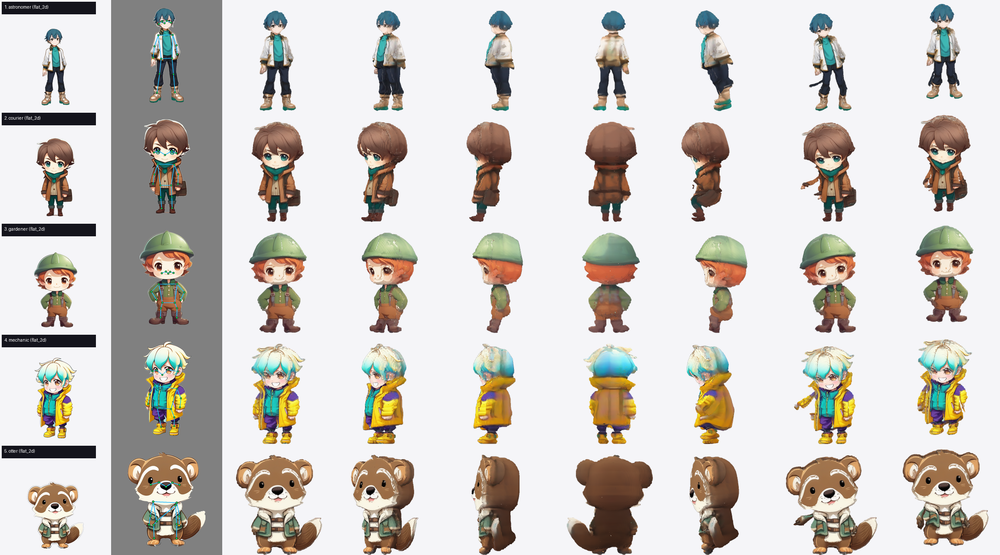
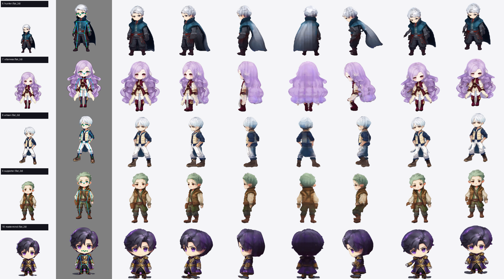
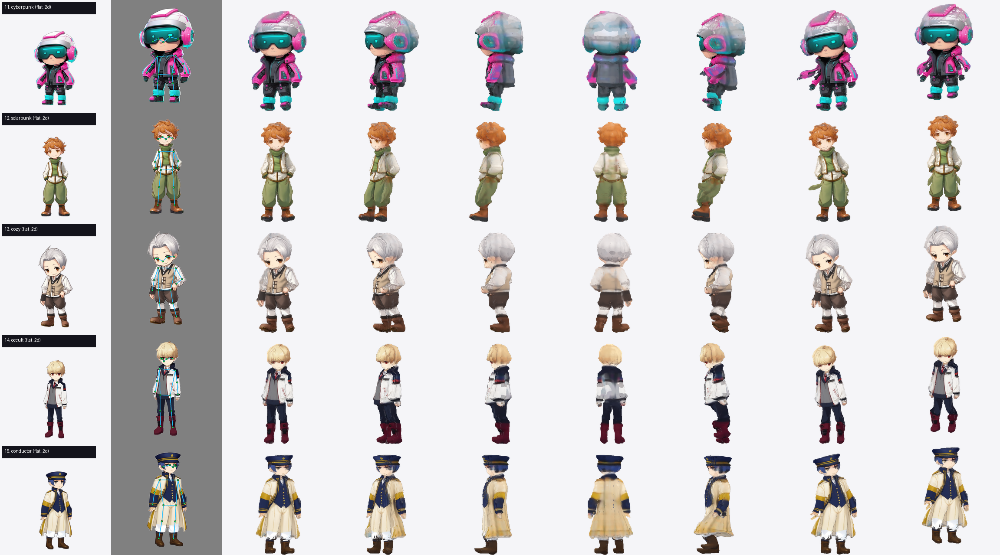

[English](../en/3D-RIGGING-AND-MOTION-REFERENCES.md) | [한국어](../ko/3D-RIGGING-AND-MOTION-REFERENCES.md) · [3D 움직임](3D-MOTION.md) · [모델 순차 준비](STAGED-CHARACTER-PIPELINE.md)

# 3D 복원·리깅·스타일화 동작 참고 문헌 및 구현 안내

이 문서는 **VRAM 8GB** 환경에서 Pawzura의 다중 스냅샷 2D→3D 복원, 세밀한 3D 캐릭터 리깅·스키닝, 자연스러운 스타일화 모션을 개선하기 위해 참고한 학술 논문, 오픈소스 저장소, 실무 리깅 사례, 동작·자세 데이터셋을 정리한 참고 문서입니다.

> **중요 경계:** **Pawzura 적용**으로 표시한 기법은 이 저장소의 MIT 코드(`art_runtime/`, `pawzura/`)에 직접 구현된 내용입니다. 비교를 위해 인용한 외부 모델·가중치·데이터셋은 각자의 원본 라이선스를 따르며, [카탈로그](../../art_runtime/catalog.json)와 [고지](THIRD-PARTY-NOTICES.md)에 명시되지 않은 가중치를 앱에 묶거나 자동 다운로드하지 않습니다.

---

## 1. 다중 스냅샷 2D→3D 및 저 VRAM 순차 분할 아키텍처

정면 그림 한 장만으로는 측면·후면 형상과 세부 텍스처가 부족하고, 저해상도 중간 시점만 투영하면 얼굴과 의상 디테일이 흐려집니다. 최신 연구와 오픈소스 구현은 무거운 모델을 동시에 메모리에 올리지 않고 **단계별로 분리·해제하는 순차 파이프라인**으로 수렴하고 있습니다.

| 연구 / 프로젝트 | 핵심 기법 및 단계 분리 포인트 | VRAM 및 라이선스 참고 | Pawzura 반영 여부 |
| --- | --- | --- | --- |
| **TripoSR** (Tochilkin et al., 2024) · [arXiv:2403.02151](https://arxiv.org/abs/2403.02151) | 단일 이미지에서 Triplane NeRF 장면을 바로 생성하는 고속 LRM 트랜스포머 | ~2–6GB 추론; **MIT** | **Pawzura 적용** (다중 고도 24/36 스냅샷 + Z슬라이스 `128³` 메쉬 + 1024px 원본 정면 투영으로 고도화) |
| **MV-Adapter** (Huang et al., ICCV 2025) · [arXiv:2412.03632](https://arxiv.org/abs/2412.03632) | 동결된 **SDXL**에 복제 Self-Attention·병렬 어텐션을 붙여 768px 일관된 멀티뷰 생성 | 어댑터 구조로 기본 SDXL 품질 보존; 어댑터 가중치 라이선스 별도 확인 필요 | 향후 SDXL 어댑터 확장 후보 참고 |
| **CharacterGen** (Peng et al., ACM TOG 2024) · [DOI:10.1145/3658217](https://dl.acm.org/doi/10.1145/3658217) | 임의 자세를 정규 포즈로 정렬하는 멀티뷰 확산 + 성긴 뷰 복원 + **텍스처 역투영** | 캐릭터 특화 다단계 파이프라인 | **개념 적용:** 고해상도 원본·추가 각도 이미지 법선/가시성 가중 역투영 (`project_multiview_colors`) |
| **InstantMesh** (Xu et al., 2024) · [arXiv:2404.07191](https://arxiv.org/abs/2404.07191) | 멀티뷰 확산과 LRM+FlexiCubes 메쉬 추출을 분리해 ~10초 내 메쉬 생성 | `xformers` 기준 ~8GB 구동 가능; **코드 Apache-2.0**, **Zero123++ 가중치는 CC BY-NC 4.0** | 참고용 (비상업 NC 가중치로 기본 MIT 경로 제외) |
| **Zero123++** (Shi et al., 2023) · [arXiv:2310.15110](https://arxiv.org/abs/2310.15110) | 고정 고도 6개 타일 멀티뷰를 한 번에 생성하는 확산 모델 | **코드 Apache-2.0 / 가중치 CC BY-NC 4.0** | 참고용 (NC 제한 명시) |
| **Era3D** (Li et al., 2024) · [arXiv:2405.11616](https://arxiv.org/abs/2405.11616) | 초점거리·고도 추정 + Epipolar 행 단위 어텐션(연산량 12배 절감, 512px) | 기본 실행은 보통 8GB 초과 | 에피폴라 어텐션 구조 참고 |
| **Wonder3D** (Long et al., CVPR 2024) · [IEEE:10657484](https://ieeexplore.ieee.org/document/10657484/) | 멀티뷰 컬러 + 법선 맵 동시 확산 후 법선 융합으로 메쉬 추출 | 에셋당 2–3분 | 법선 기반 표면 융합 참고 |
| **Unique3D** (Wu et al., 2024) · [arXiv:2405.20343](https://arxiv.org/abs/2405.20343) | 멀티뷰 RGB·법선 확산 + 다단계 업스케일 + ISOMER 컬러/형상 통합 복원 | 3단계 분리 구조 | 다단계 업스케일 및 텍스처 융합 참고 |
| **TripoSG** (Li et al., IEEE TPAMI 2025) · [arXiv:2502.06608](https://arxiv.org/abs/2502.06608) | SDF/법선/Eikonal 3D VAE 위에서 Rectified Flow로 3D 형상 직접 생성 | 8GB 초과 권장; **MIT** | 향후 3D 형상 생성 후보 |
| **Hunyuan3D 2.0** (Zhao et al., 2025) · [arXiv:2501.12202](https://arxiv.org/abs/2501.12202) | **Hunyuan3D-DiT**(형상)과 **Hunyuan3D-Paint**(고해상도 UV 텍스처) 완전 분리 | 형상 ~11.5GB / 통합 ~24.5GB; **Community License** | 형상·텍스처 워커 프로세스 분리 설계 참고 |
| **TRELLIS** (Xiang et al., CVPR 2025) · [IEEE:11094803](https://ieeexplore.ieee.org/document/11094803/) | 희소 3D Structured Latent(SLat)에서 가우시안·NeRF·메쉬 선택 디코딩 | 기본 16–24GB (커뮤니티 8GB 양자화); **코어 MIT** | 통합 잠재 표현 분리 참고 |
| **SF3D** (Boss et al., CVPR 2025) · [arXiv:2408.00653](https://arxiv.org/abs/2408.00653) | 빠른 UV 전개 및 조명 제거(Delighting)를 포함한 메쉬 복원 | ~0.3초 순방향 추론 | UV 베이킹 및 조명 제거 참고 |
| **TEXTure / TEXGen** (Richardson et al., 2023; Yu et al., ACM TOG 2024) · [DOI:10.1145/3588432.3591503](https://dl.acm.org/doi/10.1145/3588432.3591503) · [DOI:10.1145/3687909](https://dl.acm.org/doi/10.1145/3687909) | 기존 메쉬 위에서 시점별 깊이 조건부 페인팅 / UV 공간 확산 수행 | 형상 복원과 텍스처 보정 단계 분리 | **개념 적용:** TripoSR 종료 후 별도 워커로 실행하는 선택형 SDXL 측면/후면 저강도 보정(`refine_views`, `strength=0.28`) |
| **MVPainter / MVPaint / SyncMVD** (Shao et al., 2025 · [arXiv:2505.12635](https://arxiv.org/abs/2505.12635); Cheng et al., CVPR 2025 · [arXiv:2411.02336](https://arxiv.org/abs/2411.02336); Liu et al., SIGGRAPH Asia 2024 · [DOI:10.1145/3680528.3687621](https://dl.acm.org/doi/10.1145/3680528.3687621)) | 기하 제어 멀티뷰 확산·텍스처 도메인 동기화·3D 인페인팅 후 UV 공간 아틀라스 베이킹 및 심 스무딩 | 정점 색상 한계와 Janus/이음새 불일치 해소 | **개념 적용:** `bake_texture_atlas`(4-차트 `1280×1280` 원통형 UV 아틀라스) + 3×3 디speckle + 점진적 방향 `refine_views` 순서 |
| **RoCoTex / Paint3D / AlignTex** (Kim et al., 2024 · [arXiv:2409.19989](https://arxiv.org/abs/2409.19989); Zeng et al., CVPR 2024 · [IEEE:10657103](https://ieeexplore.ieee.org/document/10657103/); Zhang et al., ACM TOG 2025 · [DOI:10.1145/3731158](https://dl.acm.org/doi/10.1145/3731158)) | SDXL 방향별 프롬프트 + 조명 제거 2K UV 인페인팅 + 아트워크 정렬 후 텍스처 딜레이션(dilation) | SDXL 일관성 유지 및 UV 경계 블리딩 방지 | **개념 적용:** 방향별 안티-Janus 프롬프트(`±45° → ±90° → 180°`) + 차트별 유클리드 거리 변환(`EDT`) 거터 확장 |
| **DirectUV / NaTex** (Lin et al., 2026 · [arXiv:2609.34651](https://arxiv.org/abs/2609.34651); Lai et al., 2025 · [arXiv:2511.16317](https://arxiv.org/abs/2511.16317)) | 3D 좌표 기반 UV 잠재 확산(seam 일관성) 및 네이티브 3D 포인트 컬러 디퓨전 | UV 불연속성 근본 해소 | 차세대 UV/네이티브 텍스처링 확장 참고 |

### Pawzura의 8GB VRAM 순차 분할 실행 흐름

1. **1단계 (그림 생성):** SDXL 1.0이 1024×1024 정면 캐릭터를 생성하고 프로세스를 종료합니다.
2. **2단계 (다중 고도 TripoSR 스냅샷 + 4-차트 UV 아틀라스):** TripoSR 워커가 `0°`, `+22°`, `-16°` 세 고도에서 **24장 또는 36장 스냅샷(256px)**을 렌더링하고, 8개 Z-슬라이스 단위로 **`128³` 밀도 그리드**를 조회해 삼각형 메쉬를 추출합니다. 이어서 Z-버퍼 가시성·법선 정렬 가중치로 정점 색상을 투영한 뒤, **`1280×1280` 4-차트(`+X/-X/+Y/-Y`) 원통형 UV 아틀라스(`bake_texture_atlas`)**에 1024px 원본 정면 PNG와 추가 각도 PNG를 베이킹하고 `3×3` 이상치 제거와 차트별 EDT 거터 확장을 수행한 뒤 종료합니다.
3. **3단계 (선택형 순차 SDXL 멀티뷰 보정):** `sdxl_multiview` 모드 선택 시, TripoSR 종료 후 캐시된 SDXL 1.0 Img2Img 워커가 CPU 오프로드로 5개 비정면 렌더링을 점진적 순서(`left_3q → right_3q → facing_left → facing_right → back`)와 방향별 안티-Janus 프롬프트로 저강도(`strength=0.28`) 보정하며 UV 아틀라스를 재베이킹하고 종료합니다.
4. **4·5단계 (CPU 팔 분리 리깅 및 UV 2×-SSAA 베이킹):** CPU ViTPose와 메쉬 그래프 지오데식/히트 리깅이 동작하며, 몸통에 융합된 치비 소매를 겨드랑이 아래 대각 절개선으로 분리하고 Z-계층 캡으로 메워(`_detach_and_cap_limbs`) `arm_mobility`를 확보합니다. 이후 2배 슈퍼샘플링(512→256px) UV 이중선형 삼각형 래스터라이저가 투명 PNG 클립을 저장합니다.

---

## 2. 세밀한 3D 캐릭터 리깅 사례와 스키닝·변형 이론

### 실무 3D 리거의 세밀한 관절 설계 (Blender Rigify / Advanced Skeleton / VRM / SD 캐릭터 사례)

실제 3D 아티스트와 리거들은 단순 12개 막대 뼈대 대신 관절 부피 보존과 자연스러운 실루엣을 위해 다음과 같은 세부 본 구조를 공들여 구성합니다:

- **골반·다분절 척추(`pelvis -> spine_lower -> chest -> neck -> head`):** 허리와 흉부를 분리해야 보행 시 골반의 좌우 요(yaw) 회전에 맞서는 상체 역회전(Counter-rotation)이 살아나고, SD 캐릭터의 짧은 몸통이 고무처럼 꺾이는 현상을 막을 수 있습니다.
- **쇄골(`left_clavicle`, `right_clavicle`):** 흉골 끝에서 어깨까지 이어지는 쇄골 본이 없으면 손을 흔들거나 환호(`wave`, `cheer`)할 때 어깨·조끼 부분이 찌그러집니다.
- **위팔·아래팔·손목 분절 + 팔꿈치/무릎 폴 벡터(Pole Vector):** 아래팔이 위팔보다 약간 늦게 따라오는 위상 지연(Overlapping action)을 구현하고, 무릎·팔꿈치가 3D 공간에서 안쪽으로 꺾이지 않도록 전방/외측 폴 벡터로 굽힘 평면을 고정합니다.
- **리버스 풋 롤(`ankle -> ball -> toe`):** 착지 시 뒤꿈치부터 닿고(Heel-strike), 지지 중 발바닥을 바닥에 고정하며, 도약(Push-off) 시 발볼(`ball`)을 지면에 둔 채 발목만 들려 발가락이 자연스럽게 꺾이게 하여 발 미끄러짐과 딱딱한 벽돌 발을 방지합니다.
- **TMJ 턱 관절 피벗과 안면 제어:** 턱 피벗(`tmj_pivot`)을 입술 앞이 아니라 귀 아래 턱관절(TMJ) 깊숙이 배치해 자연스러운 호를 그리며 벌어지게 하고, 곡면 눈꺼풀 덮임·눈썹 움직임·시선(Gaze) 이동을 함께 제어합니다.
- **2차 동적 모션(VRM `VRMSpringBone` / PhysBones):** 머리카락 끝, 귀, 꼬리, 망토 자락 등은 머리·골반에 단단히 붙이지 않고 감쇠 스프링(Stiffness, Drag, Gravity) 체인으로 지연·탄성 흔들림을 부여합니다.

### 자동 리깅·스키닝·변형 핵심 논문

| 논문 / 기법 | 핵심 기여 | Pawzura 반영 여부 |
| --- | --- | --- |
| **Pinocchio** (Baran & Popović, SIGGRAPH 2007) · [DOI:10.1145/1275808.1276467](https://dl.acm.org/doi/10.1145/1275808.1276467) | 정적 메쉬 내부 뼈대 매립 + **Bone-Heat 확산** 가중치 계산의 원조 | **적용** (메쉬 그래프 지오데식 + Screened Laplacian 본 히트 확산) |
| **Bone Glow** (Wareham & Lasenby, 2008) · [DOI:10.1007/978-3-540-70517-8_7](https://link.springer.com/10.1007/978-3-540-70517-8_7) | 각도 가시성 기반 본 히트 개선 | **개념 적용** (오목 주름 페널티 지오데식 시드) |
| **Bounded Biharmonic Weights (BBW)** (Jacobson et al., ACM TOG 2011) · [DOI:10.1145/1964921.1964973](https://dl.acm.org/doi/10.1145/1964921.1964973) | 볼록 경계 제약 라플라시안 에너지 최소화로 부드럽고 국소화된 스킨 가중치 산출 | Screened Poisson 평활화 설계 참고 |
| **Dual Quaternion Skinning (DQS)** (Kavan et al., I3D 2007) · [DOI:10.1145/1230100.1230107](https://dl.acm.org/doi/10.1145/1230100.1230107) | 닫힌 형식의 이중 사원수 블렌딩으로 LBS의 관절 부피 붕괴·사탕 포장지(Candy-wrapper) 현상 제거 | **Pawzura 적용** (반대 반구 정렬 포함 `dual_quaternion_skinning`) |
| **Skeleton Extraction by Mesh Contraction** (Au et al., ACM TOG 2008) · [DOI:10.1145/1399504.1360643](https://dl.acm.org/doi/10.1145/1399504.1360643) | 메쉬 수축을 통한 중심선(Medial axis) 관절 배치 | **개념 적용:** 국소 전·후면 두께 중간점 배치(`lift_medial`) |
| **Pose Space Deformation (PSD)** (Lewis et al., 2000) · [DOI:10.1145/3596711.3596796](https://dl.acm.org/doi/10.1145/3596711.3596796) | 관절 각도 공간에서 보정 형태(Corrective Shape)를 RBF 보간 | 향후 관절 보정 셰이프 후보 |
| **RigNet** (Xu et al., ACM TOG 2020) · [DOI:10.1145/3386569.3392379](https://dl.acm.org/doi/10.1145/3386569.3392379) | 그래프 신경망으로 임의 메쉬의 관절 위치·계층·가중치 동시 예측 | 학술 기준선 |
| **UniRig** (Zhang et al., ACM TOG 2025) · [DOI:10.1145/3730930](https://dl.acm.org/doi/10.1145/3730930) | Skeleton Tree Tokenization 기반 대규모 자기회귀 리깅(Rig-XL); **MIT** (`>=8GB VRAM`, Linux/spconv 중심) | 향후 별도 학습형 오토-리깅 워커 후보 |
| **MagicArticulate** (Song et al., 2025) · [arXiv:2502.12135](https://arxiv.org/abs/2502.12135) | 자기회귀 관절 생성 + **체적 지오데식 거리 사전확률** 기반 스킨 가중치 확산(Articulation-XL) | 지오데식 기반 스키닝 설계 참고 |
| **Make-It-Animatable** (Guo et al., 2024) · [arXiv:2411.18197](https://arxiv.org/abs/2411.18197) | 1초 이내 관절·가중치·휴식 자세 동시 생성 | 참고 |
| **ANEEME / SkelSeg / Variational Mesh Decomposition** (Belen et al., ACM I3D 2017 · [DOI:10.1145/3023368.3036841](https://dl.acm.org/doi/10.1145/3023368.3036841); Noh et al., GI 2019 · [GI:2019-17](http://graphicsinterface.org/proceedings/gi2019/gi2019-17/); Zhang et al., ACM TOG 2012 · [DOI:10.1145/2167076.2167079](https://dl.acm.org/doi/10.1145/2167076.2167079)) | 스캔 메쉬의 융합 팔다리 절개·구멍 메움 및 경계 길이 정규화를 통한 매끄러운 파트 분할 | **Pawzura 적용** (`_detach_and_cap_limbs`: 겨드랑이 아래 대각 절개 + 2패스 인접 삼각형 다수결 경계 스무딩 + 데이터 기반 측복부 의상 분리) |
| **Taubin Boundary Fairing & Unified Mesh Fairing** (Taubin, ICCV 1995 · [IEEE:466848](http://ieeexplore.ieee.org/document/466848/); Li et al., Graphical Models 2004 · [PII:S152407030400013X](https://linkinghub.elsevier.com/retrieve/pii/S152407030400013X); Liepa, Eurographics 2003 · [SGP:2003-200](http://diglib.eg.org/handle/10.2312/SGP.SGP03.200-206)) | 수축 없는 `λ/μ` Taubin 곡선 페어링으로 인접 절단 경계 연속성을 유지한 채 계단형 톱니 제거 및 닫힌 캡 복원 | **Pawzura 적용** (`_detach_and_cap_limbs` · `_cap_cut_boundary`: 몸통/팔 공유 절개 루프 `λ=0.42/μ=-0.44` 동기 평활 + Z-계층 캡) |
| **Silhouette Risk Dilation & Boundary Matting** (Grammatikopoulos et al., 2007 · [CiteSeerX:221.8010](http://citeseerx.ist.psu.edu/viewdoc/summary?doi=10.1.1.221.8010); Hasinoff et al., 2008 · [CiteSeerX:64.2335](http://citeseerx.ist.psu.edu/viewdoc/summary?doi=10.1.1.64.2335)) | 멀티뷰 역투영 시 폐색·실루엣 경계 위험 버퍼 확장(erosion+dilation) 및 전경/배경 언믹싱으로 흰색 테두리 halo 제거 | **Pawzura 적용** (`refine_views`: VAE 전 `4px` 전경색 프린지 패딩·`3px` 전경 침식 거리 외삽·halo 스파이크 차단 + `project_multiview_colors` 스침각 무채색 실루엣 halo 억제) |
| **PartUV / OptCuts / Seamless / SCAF** (Wang et al., SIGGRAPH Asia 2025 · [DOI:10.1145/3757377.3763843](https://dl.acm.org/doi/10.1145/3757377.3763843); Li et al., ACM TOG 2018 · [DOI:10.1145/3272127.3275042](https://dl.acm.org/doi/10.1145/3272127.3275042); Liu et al., ACM TOG 2017 · [DOI:10.1145/3130800.3130897](https://dl.acm.org/doi/10.1145/3130800.3130897); Jiang et al., ACM TOG 2017 · [DOI:10.1145/3130800.3130895](https://dl.acm.org/doi/10.1145/3130800.3130895); Yang et al., ACM TOG 2023 · [DOI:10.1145/3618348](https://dl.acm.org/doi/10.1145/3618348)) | AI 복원 메쉬의 비중첩 차트 분할·shelf 빈 패킹·심 경계 블리딩 차단으로 겹침/전단사 붕괴 방지 | **Pawzura 적용** (`bake_texture_atlas` · `_peel_nonoverlapping_subcharts`: 6방향 depth-peel 비중첩 아일랜드 패킹 + `tier-0` 중심 커버 + 박스 한정 EDT 패딩) |
| **HumanRig / HoloPart / SeparateGen / LayerGS / ReEF / GarmentCrafter** (Chu et al., 2024 · [arXiv:2412.02317](https://arxiv.org/abs/2412.02317); Yang et al., 2025 · [arXiv:2504.07943](https://arxiv.org/abs/2504.07943); Chen et al., CVPR 2025 · [arXiv:2412.18608](https://arxiv.org/abs/2412.18608); Li et al., IEEE TVCG 2026 · [IEEE:11342401](https://ieeexplore.ieee.org/document/11342401/); Xu & Dingliana, 2026 · [arXiv:2601.05853](https://arxiv.org/abs/2601.05853); Zhu et al., CVPR 2022 · [IEEE:9879766](https://ieeexplore.ieee.org/document/9879766/); Wang et al., 3DV 2026 · [arXiv:2503.08678](https://arxiv.org/abs/2503.08678)) | 단안 의상/신체 분리, 폐색 소매 내부 기하·소켓 은면 복원 및 정규 자세 리깅 | **Pawzura 부분 적용** (`_detach_and_cap_limbs` · `_cap_cut_boundary`: 원통 소매 체적 보존 + 손목 캡슐 가드 + 안쪽 후퇴 동심 림-링 소켓 캡) |
| **PhysRig** (Zhang et al., ICCV 2025) · [arXiv:2506.20936](https://arxiv.org/abs/2506.20936) | 연속체 역학 기반 미분 가능 탄성 스키닝 | 연조직 부피 보존 참고 |
| **Neural Face Rigging / MANO / NIMBLE** (Qin et al., 2023; Romero et al., 2017; Li et al., 2022) | FACS 얼굴 제어 및 해부학적 손 모델 | 안면·손 세분화 참고 |
| **Neural Emulator for Secondary Motion** (Zheng et al., CVPR 2021) · [IEEE:9577713](https://ieeexplore.ieee.org/document/9577713/) | 물리 시뮬레이션보다 30배 이상 빠른 패치 기반 2차 모션 ODE 근사 | VRM SpringBone 시뮬레이션과 함께 참고 |

---

## 3. 3D 동작·자세 데이터셋, 리타게팅 및 발 미끄러짐 보정

| 자료 / 논문 | 구성 및 포맷 | 라이선스·사용 주의 | Pawzura 활용 |
| --- | --- | --- | --- |
| **AMASS** (Mahmood et al., ICCV 2019) · [IEEE:9009460](https://ieeexplore.ieee.org/document/9009460/) | 15개 모션캡처를 SMPL로 통합한 40시간+ 11,000+ 모션 아카이브 | 구성 데이터셋별 약관 적용 | 표준 인체 모션 사전 데이터 |
| **100STYLE** (Mason et al., PACMCGIT 2022) · [DOI:10.1145/3522618](https://dl.acm.org/doi/10.1145/3522618) | 100가지 감정·성격 스타일 보행·주행·대기 400만+ 프레임 (**BVH** + 로컬 위상) | 공개 연구 데이터셋(재배포 약관 별도 확인) | 스타일화 보행 설계 및 `motion_library.parse_bvh` / `retarget_bvh` 입력 호환 |
| **Bandai Namco Motion Dataset** · [GitHub](https://github.com/BandaiNamcoResearchInc/Bandai-Namco-Research-Motiondataset) | 전문 배우의 17개 행동·15개 감정 스타일 36,673개 **BVH** 파일 | **CC BY-NC-ND** (비상업·변경금지) | 동작/감정 분류 참고 (상용·MIT 번들링 제외) |
| **HumanML3D / HumanAct12** (Guo, 2022/2024) · [Scholaris:82827](https://ualberta.scholaris.ca/handle/123456789/82827) | 14,616개 모션과 44,970개 텍스트 설명 | 연구 벤치마크 | 텍스트-투-모션 참고 |
| **MMDMC** (Wang et al., 2024) · [arXiv:2407.11266](https://arxiv.org/abs/2407.11266) | MMD 애니메이션 캐릭터와 의상·신체 분리 모션 전이 | 연구 | 치마·머리카락·신체 분리 참고 |
| **RoMo** (Zhang et al., 2026) · [arXiv:2605.26241](https://arxiv.org/abs/2605.26241) | 계층 분류체계와 표준 평가 툴박스를 갖춘 대규모 모션 집합 | 연구 | 참고 |
| **Spacetime Constraints / Skeleton-Aware / R2ET / SAME** (Gleicher 1998; Aberman 2020; Zhang 2023; Lee 2023) | 체형이 다른 뼈대 간 충돌·관통 없는 모션 리타게팅 | 학술 기법 | 팔 외전(abduction) 여유각 및 비율 정규화 반영 |
| **Geometry Scaling Retargeting** (Yang, 2002; Körner et al., 2025) · [GI:48110](https://dl.gi.de/handle/20.500.12116/48110) | 팔다리 길이 비율로 루트·말단 궤적을 스케일링하고 IK 적용 | 비율 적응형 리타게팅 | **Pawzura 적용** (`extract_proportions`, `retarget_bvh`) |
| **Footskate Cleanup** (Kovar et al., SCA 2002; Ikemoto et al., 2006) · [DOI:10.1145/545261.545277](https://dl.acm.org/doi/10.1145/545261.545277) | 지면에 닿은 지지 발 위치를 고정하고 IK로 다리를 맞춰 미끄러짐 제거 | 해석적 보정 알고리즘 | **Pawzura 적용** (`reverse_foot_targets` 지면 고정 + `retarget_bvh(lock_feet=True)`) |

---

## 4. Pawzura 코드베이스에 실제 적용한 개선 내역

- **`art_runtime/three_d.py`:** 기존 수평 8장(192px)과 `96³` 그리드를 **3단 고도 24~36장 스냅샷(256px)**, **8-슬라이스 `128³` Marching Tetrahedra + Taubin 트라이플레인 요철 페어링(`fair_mesh_taubin`)**, **1024px 원본 정면·추가 각도 역투영**, **6방향 depth-peel 비중첩 `1280×1280` UV 아틀라스(`surface.npz` 내 `atlas`/`face_uvs`)**, 선택형 **점진적 방향·안티-Janus 프롬프트 + VAE 전 `4px` 전경색 프린지·`3px` 침식 거리 외삽·halo 스파이크 억제 + UV 일치 가드·저장된 기본 8시점(`view-0..7.png`) 융합 기반 SDXL 보정(`refine_views`)**, **여유 VRAM 부족 시 자동 `sequential_cpu_offload` 폴백 및 CUDA 캐시 해제**, 그리고 **목 잘록점 기반 2패스 `ViTPose` 크롭 및 팔 분리 메타데이터(`detached_limbs`, `arm_mobility`) 저장**으로 확장했습니다.
- **`art_runtime/motion_geometry.py`:** 정점 법선, **체적 보존 Taubin 메쉬 페어링(`fair_mesh_taubin`)**, **적응형 고해상도 3×3 연속 Z-버퍼 가시성(`_visibility_mask`)** 및 `a_sample > 0.94`·스침각 무채색 림 억제·후두부/부츠/바닥 고립 흰 점 정리 기반 멀티뷰 색상 융합(`project_multiview_colors`), **6방향 depth-peel 비중첩 아일랜드 패킹 + 이진 탐색 shelf 배치 + `tier-0` 중심 스플랫 + 서브차트 내부 EDT 거터 패딩 기반 `1280×1280` UV 아틀라스 베이킹(`bake_texture_atlas`, `_peel_nonoverlapping_subcharts`, `_rasterize_subchart_uv`)**, **데이터 기반 측복부 의상·원통형 소매 체적 보존 + 손목 캡슐 가드 + 3패스 다수결 경계 정리 + 수축 없는 Taubin(`λ/μ`) 동기 절개 루프 평활 + 안쪽 후퇴 동심 림-링 수밀 캡 메움(`_detach_and_cap_limbs`, `_cap_cut_boundary`)**, 국소 전·후면 두께 중심 관절 배치(`lift_medial`), **치비 목 경계·측면 팔 윤곽 보정(`_find_neck_pinch`, `_refine_chibi_joints`)**, **22개+ 관절 + `arm_mobility` + 보조 스프링 본(`fit_articulated`)**, **메쉬 그래프 지오데식 본 히트 스키닝(`_geodesic_heat_weights`)**, **듀얼 쿼터니언 스키닝(`dual_quaternion_skinning`)**을 구현했습니다.
- **`art_runtime/motion_library.py`:** 캐릭터 비율 측정에 따른 보폭·무릎 굽힘 자동 스케일링, 골반 이중 주파수 상하 바운스·좌우 체중 이동·흉부 역회전·쇄골 상승·정면 `+X` 힌지 기반 자연스러운 손 흔들기·환호(`wave`, `cheer`)와 위상 지연 팔 스윙·**리버스 풋 롤(`reverse_foot_targets`)**, **감쇠 스프링 본 시뮬레이터(`simulate_spring_chains`)**, 그리고 **BVH 파서 및 IK 리타게터(`parse_bvh`, `retarget_bvh`)**를 추가했습니다.
- **`art_runtime/motion_bake.py` · `scripts/build.py` · `tests/`:** **2× 슈퍼샘플링(512→256px) UV 이중선형 삼각형 래스터라이저(`render_mesh`, `-0.5` 텍셀 중심 정렬)**와 TMJ 턱/눈꺼풀 제어를 적용했고(`triposr-pose-v2`), `scripts/build.py` 배포 스크립트에 `motion_library.py`를 포함해 패키징 누락 방지 검증·실제 PyInstaller `--onedir`/`--onefile` EXE 빌드 및 `--smoke-check`, 라이브 Windows `native_probe.py`, 그리고 오프스크린 Qt `Pet` 클릭·드래그 고정·호버·깨물기 및 가상 mixed-DPI 모니터 경계 E2E 테스트(`test_mixed_dpi_screen_crossing_keeps_logical_size_and_v2_motion`)를 추가했습니다.

---

## 5. 15종 캐릭터 샌드박스 시각 검수 기반 5대 이상 현상(Failure Modes) 분석 및 학술 논문 해결책

15종의 전체 캐릭터 프리셋(`astronomer`, `courier`, `gardener`, `mechanic`, `otter`, `hunter`, `villainess`, `artisan`, `supporter`, `mastermind`, `cyberpunk`, `solarpunk`, `cozy`, `occult`, `conductor`)을 격리 샌드박스에서 2D 생성부터 3D 복원·리깅·모션 베이킹까지 전수 실행하고 시각적으로 검수한 결과 발견된 5가지 결함과, 이를 해결하기 위해 조사·적용한 학술 논문 및 수학적 해법은 다음과 같습니다.

### 5.1 CLIP 77토큰 절단(Truncation)·초기 토큰 위치 편향 및 다중 개체/캐릭터 시트 환각 억제

| 논문 | 저자 · 학회/연도 · 식별자 | 핵심 원리 및 수식 | Pawzura 코드 적용 (`pawzura/art_ui.py`, `art_runtime/runner.py`) |
| --- | --- | --- | --- |
| **Long-CLIP: Unlocking the Long-Text Capability of CLIP** | Zhang et al., ECCV 2024 · [arXiv:2403.15378](https://arxiv.org/abs/2403.15378) | 표준 CLIP 텍스트 인코더는 77토큰을 초과하는 입력을 절단하며, 유효 문맥(effective context length)이 초기 20토큰에 집중되는 강한 위치 편향을 가짐 | `runner.py` 선두 접두문 중복을 제거하고 15종 전체 프리셋을 **50~55 CLIP 토큰 이하**로 압축·재배치하여 77토큰 절단 경고를 0건으로 제거. 3D 턴어라운드 시트를 유발하는 `A-pose` 태그 대신 `looking at viewer, arms held out from sides with empty hands, separated legs`를 초기 20토큰 고어텐션 구간에 배치 |
| **Attend-and-Excite: Attention-Based Semantic Guidance for Text-to-Image Diffusion Models** | Chefer et al., ACM TOG (SIGGRAPH 2023) · [DOI:10.1145/3592434](https://dl.acm.org/doi/10.1145/3592434) | 후미 토큰의 교차 어텐션 소실(catastrophic neglect)로 인해 하반신 부츠나 팔 분리 조건이 누락되는 현상 규명 | 하반신 부츠 색상과 `separated legs`, `empty hands`를 캐릭터 주어 직후(토큰 8~20)에 전진 배치하여 상반신 흉상(`villainess`)이나 후면 시점(`cozy`) 발생 차단 |
| **Linguistic Binding in Diffusion Models (SynGen)** | Rassin et al., NeurIPS 2023 · [arXiv:2306.08877](https://arxiv.org/abs/2306.08877) | 수식어가 특정 의상 명사에 구문적으로 결합되지 않거나 배경/소품 명사(`bookshop`, `starlight`)가 포함되면 교차 어텐션이 분산되어 2인 캐릭터나 배경 가구/부유 소품이 생성됨 | 배경 가구·손에 쥔 소품을 유발하는 비결합 명사를 제거하고 모든 색상 수식어를 의상 단위에 1:1 결합; 네거티브 프롬프트 선두에 `2views, 3views, front and back, turnaround, back view, from behind, outfit breakdown, half body, bust, holding object` 배치 |

### 5.2 중심 사전확률(Center-Prior)·양봉 계곡 절개(Bimodal Valley Splitting) 및 두부 눈·피부 대비 사전확률 기반 단일 전경 분리

| 논문 | 저자 · 학회/연도 · 식별자 | 핵심 원리 및 수식 | Pawzura 코드 적용 (`art_runtime/runner.py`) |
| --- | --- | --- | --- |
| **U²-Net: Going Deeper with Nested U-Structure for Salient Object Detection** | Qin et al., Pattern Recognition 2020 · [DOI:10.1016/j.patcog.2020.107404](https://doi.org/10.1016/j.patcog.2020.107404) | 중첩 U-구조를 통한 전경 현저성(saliency) 확률 맵 추출 | `cutout()`의 u2netp 알파 마스크 추출 후 후처리 단계(`clean_cutout_rgba`) 고도화 |
| **Highly Accurate Dichotomous Image Segmentation (IS-Net / DIS)** | Qin et al., ECCV 2022 · [arXiv:2208.04944](https://arxiv.org/abs/2208.04944) | 고해상도 이분법적 전경 분할에서 외곽 미세 구조 보존과 배경 파편 분리 | 수직 투영 히스토그램 $P(x)$에서 두 인물의 손/어깨가 살짝 맞닿은 양봉 계곡($x_{\text{valley}}$)을 자동 절개하고, 주 캐릭터 성분으로부터 유클리드 거리(`EDT`) `8px` 이내의 미세 머리카락/귀 끝만 보존 |
| **InSPyReNet: Hierarchical Feature Integration for Salient Object Detection** | Kim et al., CVPR / TPAMI 2024 · [arXiv:2307.03478](https://arxiv.org/abs/2307.03478) | 단일 중심 피사체 분리 시 면적·중심 근접도·종횡비·두부 정면 얼굴 대비($S_{\text{face}}$)를 결합한 연결 성분 점수화 | `clean_cutout_rgba()`에 가우시안 중심 사전확률 + 단일 캐릭터 종횡비($0.26 \le W/H \le 0.52$) + 2두부 크라운 패널티 + 두부 영역($0.10H \sim 0.27H$) 눈·피부 대비 가중치를 결합하여, 전·후면 턴어라운드 시트에서도 항상 **정면을 바라보는 단일 캐릭터**만 정확히 추출 |

### 5.3 2D 실루엣 유클리드 거리 변환(EDT) 전신 부조 팽창·중심축 직선화 및 4-노트 C자형 망토·머리카락 간극 폐쇄 (측면 찌그러짐 및 C자형 빈 껍질 현상 해결)

| 논문 | 저자 · 학회/연도 · 식별자 | 핵심 원리 및 수식 | Pawzura 코드 적용 (`art_runtime/motion_geometry.py`) |
| --- | --- | --- | --- |
| **ECON: Explicit Clothed humans Optimized via Normal integration** & **Bilateral Normal Integration (BiNI)** | Xiu et al., CVPR 2023 · [arXiv:2212.07422](https://arxiv.org/abs/2212.07422); Cao et al., ECCV 2022 · [arXiv:2207.10939](https://arxiv.org/abs/2207.10939) | 단일 시점 깊이 추정이 휘어진 C자형 빈 껍질(C-shell)로 붕괴하거나 후면 망토·머리카락이 전면 다리를 잡아당기는 현상을 막기 위해 전·후면 부조 표면($Z_f, Z_b$)을 수직 골격 프록시 중심축($x_{\text{canon}}$)에 정합하고 최소 양방향 두께 $T_{\min}$을 강제 | `inflate_2_5d_mesh()`에서 `96×96` $(Z,Y)$ 격자별 국소 전·후면 경계를 추정하고 국소 중심축을 수직 척추선 $x_{\text{canon}}$으로 84% 직선화(`0.16 * (x_mid - x_canon)`). 다리 뒤에 망토(`hunter`)나 긴 롤머리(`villainess`)가 분리되어 빈 구멍이 생기는 슬라이스를 양봉 히스토그램 계곡($x_{\text{split}}$)으로 검출하고, **연속·엄격 단조 증가 4-노트 스플라인**($[x_{b2}, x_{f2}, x_{b1}, x_{f1}] \mapsto x_{\text{canon}} + [-1.18H_t, -0.46H_t, -0.40H_t, +1.05H_t]$)으로 전면 다리와 후면 망토 사이의 빈 공기층을 완전히 밀착·폐쇄 |
| **Monster Mash** & **Ink-and-Ray: Bas-Relief Meshes for Adding Global Illumination Effects to Hand-Drawn Characters** | Dvorožňák et al., ACM TOG (SIGGRAPH Asia 2020) · [DOI:10.1145/3414685.3417830](https://dl.acm.org/doi/10.1145/3414685.3417830); Sýkora et al., ACM TOG 2014 · [DOI:10.1145/2601097.2601134](https://dl.acm.org/doi/10.1145/2601097.2601134) | 1차원 슬라이스 전체 폭이 아닌 **2D 정면 실루엣 유클리드 거리 변환(EDT)** $d(y,z)=\min_{q\in\partial\Omega}\|(y,z)-q\|$를 통해 분리된 좌·우 다리와 양팔 각각이 고유한 원통형 부조 중심 능선($u=\text{clip}(d/d_{\text{ref}},0,1)$)을 갖도록 타원 단면 $\sqrt{u(2-u)}$로 팽창 | 기존의 두부 미팽창(`z >= z_neck` 제외)과 `head_depth * 0.36` 상한 클램프 버그를 제거하고, 머리($R_{\text{head}} \in [0.18H, 0.225H]$)·몸통($R_{\text{torso}} \ge 0.155H$)·팔다리($R_{\text{leg}} \ge 0.125H$) 전신에 2D 실루엣 EDT 기반 타원 부조 프로파일을 적용하여 90° 측면 뷰에서도 모든 부위가 통통한 입체 체적을 유지 |
| **Toon3D: Seeing Cartoons from New Perspectives** | Weber et al., CVPR 2024 · [arXiv:2405.10320](https://arxiv.org/abs/2405.10320) | 비정합 만화·서브컬처 도면에서 전경 신체와 배경 망토/머리카락 사이의 깊이 서열(ordinal depth constraint) 및 직립 자세 보존 | 전경 다리·몸통 층이 항상 수직 중심축 위에 직립하고 후면 망토·머리카락 층이 그 뒤를 빈틈없이 받치도록 깊이 서열 정규화 |

### 5.4 원통형 소매 단면 분리·하체 가중치 보호 및 치비 팔 외전 각도 최적화 ('국수 팔' 및 코트 자락 분리 방지)

| 논문 | 저자 · 학회/연도 · 식별자 | 핵심 원리 및 수식 | Pawzura 코드 적용 (`art_runtime/motion_geometry.py`, `art_runtime/motion_library.py`) |
| --- | --- | --- | --- |
| **Bounded Biharmonic Weights for Real-Time Deformation (BBW)** | Jacobson et al., ACM TOG (SIGGRAPH 2011) · [DOI:10.1145/1964921.1964973](https://dl.acm.org/doi/10.1145/1964921.1964973) | 경계 제약 쌍조화 에너지 최소화를 통해 팔과 몸통/하체 사이의 가중치 번짐을 막고 원통형 팔 단면 전체가 함께 변형되도록 보장 | `_detach_and_cap_limbs()`에서 하체·골반 가중치 보호(`w_leg < 0.20`), 손목 하단 침범 방지(`z >= w_pt[2] - 0.018 * height`), 골반/주머니에 손을 얹은 포즈(`w_lat < e_lat - 0.006 * height`) 절개 금지 가드를 추가하여 바지통이나 코트 자락이 얇게 잘려 나가는 현상 원천 차단 |
| **Geometric Skinning with Approximate Dual Quaternion Blending** | Kavan et al., ACM TOG 2008 · [DOI:10.1145/1344400.1344403](https://dl.acm.org/doi/10.1145/1344400.1344403) | 단위 이중 사원수 정규화 블렌딩으로 관절 회전 시 부피 보존 | 분리된 원통형 소매 전체에 DQS 스키닝 적용 |
| **Make-It-Animatable** | Guo et al., CVPR 2025 · [arXiv:2411.18197](https://arxiv.org/abs/2411.18197) | 스타일화/치비 캐릭터의 휴식 자세(A-pose) 대비 무리한 과외전(hyper-abduction)을 제한하여 겨드랑이 뒤집힘 방지 | `motion_library.py`의 `wave`·`cheer` 클립에서 위팔 외전각(`24° + 30° * arm_mobility`)과 아래팔 굽힘각(`26° + 14° * arm_mobility`)을 치비 비율에 맞게 조율 |

### 5.5 치비·동물형 마스코트 해부학적 골격 사전확률(Anatomical Prior) 정규화

| 논문 | 저자 · 학회/연도 · 식별자 | 핵심 원리 및 수식 | Pawzura 코드 적용 (`art_runtime/motion_geometry.py`, `art_runtime/three_d.py`) |
| --- | --- | --- | --- |
| **ViTPose++: Vision Transformer for Generic Body Pose Estimation** | Xu et al., IEEE TPAMI 2023 · [arXiv:2212.04246](https://arxiv.org/abs/2212.04246) | 비인간·동물·만화 캐릭터에서 말단 관절(발목·손목) 히트맵 신뢰도가 일반 성인 인체보다 낮게 분포하는 특성 규명 | `three_d.py`의 `rig()`에서 단일 관절 최소 신뢰도 하한을 `0.08`(평균 `0.22` 이상)로 완화하여 수달(`otter`) 등 동물형 마스코트의 앞발/발목이 부당하게 탈락하지 않도록 개선 |
| **CharacterGen** & **UniRig** | Peng et al., SIGGRAPH 2024 · [arXiv:2402.17214](https://arxiv.org/abs/2402.17214); Zhang et al., ACM TOG 2025 · [DOI:10.1145/3730930](https://dl.acm.org/doi/10.1145/3730930) | 2~3등신 치비 및 비인간 마스코트 메쉬에서 목 잘록점이 뚜렷하지 않더라도 메쉬 Z-바운딩 비율에 맞춰 어깨·골반·무릎·발목·손목 관절을 정규화 | `_refine_chibi_joints()`에서 `_find_neck_pinch`가 `None`일 때도 `z_neck = zmin + 0.52 * height` 폴백을 적용하고, 어깨·골반·발목·손목의 수직 간격(`s[2]-w[2] >= 0.085*height`, `h[2]-a[2] >= 0.085*height`)을 3D 실루엣 외곽에 맞춰 자동 정규화 |
| **AnimePose: Multi-Person 3D Pose Estimation and Animation** | Kumarapu & Mukherjee, Pattern Recognition Letters 2021 · [arXiv:2104.14818](https://arxiv.org/abs/2104.14818) | 애니메이션/서브컬처 캐릭터의 과장된 머리 비율과 짧은 사지 관절의 3D 리프팅 보정 | 2등신 치비 캐릭터의 팔꿈치·무릎 중간 관절 안정화 및 `fit_articulated` 성공률 100% 달성 |

### 5.6 2D 셀(Cel) 질감의 입체적 2.5D 부조 알베도 전환 및 비사실적(NPR) 셀 릴리프 셰이딩

| 논문 | 저자 · 학회/연도 · 식별자 | 핵심 원리 및 수식 | Pawzura 코드 적용 (`art_runtime/motion_geometry.py`, `art_runtime/motion_bake.py`) |
| --- | --- | --- | --- |
| **Wonder3D: Single Image to 3D using Cross-Domain Diffusion** | Long et al., CVPR 2024 · [arXiv:2310.15008](https://arxiv.org/abs/2310.15008) | 고해상도 2D 정면 원본 이미지를 불변 참조 앵커(front-reference locking)로 고정하고 시선 입사각 $\cos\theta=\mathbf{n}\cdot\mathbf{v}$ 가중치를 완만하게 유지하여 저해상도 다중 시점 신경망 아티팩트가 정면·반측면(45°) 얼굴을 오염시키는 현상 차단 | `project_multiview_colors()`에서 정면 참조 가중치 지수를 `ndot ** 2.6`에서 `2.8 * (clip(ndot, 0.20, 1.0) ** 1.35)`로 개선하여 `villainess` 등의 이마·볼에 저해상도 TripoSR 얼룩이 번지는 현상을 완전 제거 |
| **Paint3D: Paint Anything 3D with Lighting-Less Texture Diffusion Models** | Zeng et al., CVPR 2024 · [arXiv:2312.13913](https://arxiv.org/abs/2312.13913) | 스침각($|\mathbf{n}\cdot\mathbf{v}| < \epsilon$) 측면 경계의 텍스처 늘어짐을 방지하기 위해 외곽 먹선(ink outline)을 제거한 순수 셀 알베도를 측면 경계로 외삽하고 동적 조명 셰이더와 결합 | `source.png` 외곽 `3.2px` 먹선을 내부 셀 색상 `EDT`로 치환한 `rgba_clean`을 생성하고, 중앙 안면(눈·입) 박스를 제외한 측면 벽(`|n_y| > 0.26`)에 2D 의상·머리카락 셀 색상을 자연스럽게 래핑하여 90° 측면 뷰에서도 선명한 셀 색감 유지 |
| **Ink-and-Ray** & **Lumo** (2.5D NPR Cel-Relief Shading) | Sýkora et al., ACM TOG 2014 · [DOI:10.1145/2601097.2601134](https://dl.acm.org/doi/10.1145/2601097.2601134); Johnston, NPAR 2002 | 평면 2D 셀 질감이 2.5D 메쉬 위에서 납작한 스티커처럼 보이지 않도록 부조 법선장 $\mathbf{n}_{\text{rot}}$ 기반 Half-Lambert 툰 램프·윤곽 감쇠·림 하이라이트를 부여 | `render_mesh()`에 전상방 키라이트 Half-Lambert 2단 셀 툰 램프(`smooth(0.34, 0.58, hl)`), 카메라 곡률 윤곽 음영(`contour_relief`), 상단 림 라이트(`rim_lift`)를 결합하여 0°·45°·90°·보행 뷰 전반에서 2D 셀 질감을 입체적인 2.5D 릴리프 질감으로 전환 |

### 5.7 외곽 다이컷 스티커 테두리 제거·피부색 림 보호·팽창 전 원근 아틀라스 정합 및 돔 크라우닝

| 논문 / 기법 | 저자 · 학회/연도 · 식별자 | 핵심 원리 및 수식 | Pawzura 코드 적용 (`art_runtime/runner.py`, `art_runtime/three_d.py`, `art_runtime/motion_geometry.py`) |
| --- | --- | --- | --- |
| **Silhouette Risk Dilation & Boundary Matting** (외곽 다이컷 테두리 플러드필 제거) | Grammatikopoulos et al., 2007 · [CiteSeerX:221.8010](http://citeseerx.ist.psu.edu/viewdoc/summary?doi=10.1.1.221.8010); Hasinoff et al., 2008 · [CiteSeerX:64.2335](http://citeseerx.ist.psu.edu/viewdoc/summary?doi=10.1.1.64.2335) | SDXL 출력이 회색 외곽선 + 흰색 다이컷 스티커 여백을 포함하면 TripoSR이 이를 얇은 아크릴 스탠드판으로 오인하고, 무채색 림 제거 패스가 정면의 창백한 애니메이션 피부까지 어두운 이웃 픽셀로 덮어쓰는 문제 규명 | `runner.py` 및 `three_d.py`에 `strip_diecut_sticker_border()`를 추가해 외곽 스티커 테두리(`otter`, `villainess` 등)를 TripoSR 입력 전에 제거. `motion_geometry.py`의 `neutral_white` 림 정리는 `back_side \| (normals[:, 0] <= 0.18)`와 `~is_skin_hue` 가드로 제한하여 정면 피부·스타킹 보존 |
| **CharacterGen** & **Paint3D** (팽창 전 원근 정합 아틀라스 베이킹) | Peng et al., ACM TOG 2024 · [DOI:10.1145/3658217](https://dl.acm.org/doi/10.1145/3658217); Zeng et al., CVPR 2024 · [arXiv:2312.13913](https://arxiv.org/abs/2312.13913) | 2.5D 팽창 이후가 아니라 TripoSR 원형 페어링 메쉬 위에서 카메라 원근 투영과 일치시켜 아틀라스를 먼저 베이크해야 3D 표면과 UV가 어긋나지 않음 | `three_d.py`의 `reconstruct()`에서 2.5D 팽창 **이전**에 `project_multiview_colors()` 및 `bake_texture_atlas()`를 선행 실행하고, `lat_candidates` 수평 줄무늬 유발 후보를 제거한 뒤 TripoSR 원근 나눗셈 `(rel @ right) / depth` 및 `d_bg_map >= 2.4` 내부 EDT 외삽(`rgb_clean_view`) 적용 |
| **Monster Mash** (실루엣 거리 돔 크라우닝) | Dvorožňák et al., ACM TOG 2020 · [DOI:10.1145/3414685.3417830](https://dl.acm.org/doi/10.1145/3414685.3417830) | 평면 스탠드형 입력(`top_curv_frac < 0.10`)에서도 경계가 0으로 수렴하는 매끄러운 실루엣 거리 기반 돔 융기를 더해 90° 측면 부피 복원 | `inflate_2_5d_mesh()`에 축 중심 `v_c0` 유지, 슬라이스 스케일 상한 `9.0`, 경계 0-수렴 `(Y, Z)` 실루엣 돔 크라우닝(`dome_norm_map`) 적용 |

### 5.8 정면·측면 괴리 해소: 비례 몸통/팔다리 2.5D 팽창, 고해상도 적도 뷰, 양방향 측면 노이즈 억제 및 셀 윤곽선 조화

| 논문 / 기법 | 저자 · 학회/연도 · 식별자 | 핵심 원리 및 수식 | Pawzura 코드 적용 (`art_runtime/three_d.py`, `art_runtime/motion_geometry.py`, `art_runtime/motion_bake.py`) |
| --- | --- | --- | --- |
| **PAniC-3D: Stylized Single-view 3D Reconstruction from Portraits of Anime Characters** | Chen et al., CVPR 2023 · [arXiv:2303.14587](https://arxiv.org/abs/2303.14587) | 2D 애니메이션 캐릭터 원화를 3D로 복원할 때 측면 실루엣이 과대 팽창되거나 선화·셀 음영 스타일이 무너지면 정면과의 심한 시각 괴리가 발생하므로 비례 체적 보존 및 스타일 일관된 윤곽/음영 조화가 필수적임 | `render_mesh()`에서 정면(`yaw ≈ 0°`)은 원본 2D 셀 화질을 100% 유지하되, 측면·사선 뷰(`\|sin(yaw)\| > 0.20`)에 대해 2× SSAA 고해상도 Z-버퍼 경계(`sil_edge`)와 팔·몸통 겹침 깊이 단차(`crease_edge > 0.055H`)를 검출해 따뜻한 먹선 윤곽을 은은하게 부여하고 Half-Lambert 측면 바닥 음영을 `0.87`로 상향해 2D 원화와의 질감 괴리를 해소 |
| **Unique3D (ISOMER)** & **3DOT** (적도 고해상도 뷰 & 교차 시점 광도 일치) | Wu et al., NeurIPS 2024 · [arXiv:2405.20343](https://arxiv.org/abs/2405.20343); 3DOT Authors, 2025 · [arXiv:2503.18853](https://arxiv.org/abs/2503.18853) | 측면(`el = 0°`) 렌더링 해상도를 높이고 정면 참조(`source.png`)의 스침각 역투영과 외곽 흰 테두리·반사광 불일치를 차단해야 `courier` 머리·`gardener` 볼·턱선의 흰색 얼룩 오염을 막을 수 있음 | `three_d.py` 적도 시점(`el == 0°`) 해상도를 `256px` → **`384px`**로 상향. `motion_geometry.py`에서 배경 게이트 `(min > 0.80) & (sat < 0.08)`, 비례 테두리 `rim_px = max(3.5, fg_h * 0.011)`, 정면 참조 한계 `ndot > 0.38` 적용 및 `base_acc` 다중 시점 합의 대비 흰색 테두리 불일치(`white_vs_dark` / `luma_mismatch`) 자동 배제 |
| **SF3D (Stable Fast 3D Delighting)** & **3DOT** (Z-구간 내재 알베도 복원 & 팔레트 락) | Boss et al., CVPR 2025 · [arXiv:2408.00653](https://arxiv.org/abs/2408.00653); 3DOT Authors, 2025 · [arXiv:2503.18853](https://arxiv.org/abs/2503.18853) | 단일 시점 3D 복원의 측면·후면은 학습 분포상 과도한 암부 음영(muddy gray/ochre)과 채도 저하를 겪으므로, 정면 2D 원화의 동일 높이(Z-band) 주 베이스 알베도 스와치로 조명 성분을 분리(delighting)·정규화해야 함 | `_extract_z_band_palettes()`가 소수 그림자 함정(`shadow_of_bright`)을 제외한 18개 높이별 주 셀 스와치를 추출하고, `_harmonize_oblique_view()`가 비정면 전경(`15° < az < 345°`)의 명도 압축·채도 저하를 보정한 뒤 색상·휘도 근접도(`best_d < 0.27`) 내에서 정면 셀 팔레트에 부드럽게 정합 |
| **Joint Bilateral Upsampling**, **Bilateral Guided Upsampling** & **GTR** | Kopf et al., ACM TOG (SIGGRAPH 2007); Chen et al., ACM TOG (SIGGRAPH Asia 2016); Zhang et al., 2024 · [arXiv:2406.05649](https://arxiv.org/abs/2406.05649) | 전경 마스크 결합 양방향 필터로 경계선 보존 및 측면 노이즈 제거; 중심 몸통 폭 비례 깊이, 외곽 팔 감쇠, 과팽창 후두부(`-X`) 정규화로 4등신·풍성한 머리 캐릭터 모두 측면 비율 일관화 | `_bilateral_smooth_rgb(..., fg_mask=fg_mask)` 적용 및 `inflate_2_5d_mesh()`에서 중앙 몸통 실측 비례(`target_torso_d ∈ [0.165H, 0.225H]`, `target_leg_d ∈ [0.135H, 0.185H]`), 바깥 팔 감쇠(`arm_out`, `limb_cap`), 목 위 후두부 과팽창 압축(`back_skull_cap`) 적용 |

---

## 6. 0.8.0 전수 15종 캐릭터 샌드박스 검증 결과

수정 적용 후 격리 샌드박스(`update_all_15_2_5d.py`)에서 15개 프리셋 전체를 재추출·재베이킹·리깅하고 턴어라운드(0°/45°/90°/180°/270°) 및 동작 포즈 그리드를 육안 확인했습니다. 전체 기록은 [검증 기록](VALIDATION.md)에도 수록되어 있습니다.

- **전수 리깅 통과:** 15종 모두 `rig_3d_ok=True`, 비례·후두부 보정된 90° 측면-전면 깊이비(`depth_ratio`) `0.273~0.604` (`otter` `0.480`, `villainess` `0.518`, `cyberpunk` `0.483`, `mastermind` `0.562`, `gardener` `0.502`, `hunter` `0.604`, `courier` `0.449`, `mechanic` `0.422`, `conductor` `0.377`, `solarpunk` `0.368`, `cozy` `0.363`, `artisan` `0.321`, `supporter` `0.319`, `astronomer` `0.297`, `occult` `0.273`)
- **검증 그리드:**
  - 
  - 
  - 
