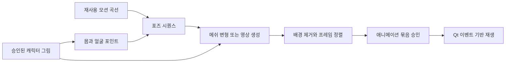

[English](../en/ANIMATION-RESEARCH.md) | [한국어](../ko/ANIMATION-RESEARCH.md) · [문서 목록](../README.ko.md)

# 단일 이미지 캐릭터 애니메이션 조사

후속 기록: [실제 로컬 메쉬·표정 실험과 자원 측정](ANIMATION-EXPERIMENT.md).

확인일: **2026-11-03, Asia/Seoul**. 구현된 기능이나 지원 모델 목록이 아닌 연구·설계 기록입니다. 이번 조사에서 모델을 설치·실행하지 않았으며 **8 GB 실기기 호환성은 미검증**입니다. 도입 전 정확한 리비전별 코드·가중치·의존성 조건을 확인해야 합니다. 앱 MIT가 다른 구성요소의 조건을 대체하지 않습니다.

요청한 방식은 실제로 있습니다. 캐릭터 이미지 한 장을 유지하면서 몸·얼굴 자세 시퀀스를 주고 새로운 애니메이션 프레임을 만듭니다. 사람이 완전한 3D 리그를 제작할 필요가 없는 방법도 있습니다. 현재 Pawzura 0.3.0은 네 그림 조각을 각각 회전할 뿐 연속적인 신체 메쉬나 표정 프레임 생성 기능은 없습니다. 아래 연구보다 좁은 구현입니다.

## 세 가지 방식의 차이

| 방식 | 프레임마다 바뀌는 것 | 주요 장단점 |
| --- | --- | --- |
| 2D 메쉬·뼈대 변형 | 연결된 관절·정점을 따라 원본 그림을 변형 | 외형 보존에 유리하나 가려진 신체나 세밀한 표정을 자동으로 만들지는 못함 |
| 포즈 조건 이미지→영상 | 원본 정체성과 자세 시퀀스를 조건으로 새 픽셀 생성 | 새로운 자세·옷 움직임을 표현할 수 있으나 프레임 일관성·메모리·후처리 필요 |
| 얼굴 신경 렌더링 | 눈·입·고개 파라미터로 표정 프레임 생성 | 깜빡임·미소에 유용하나 보통 다리 걷기는 해결하지 않음 |

관절 포인트 자체는 좌표이며 그림을 그리는 기능이 아닙니다. 메쉬 변형이나 생성 모델과 연결해야 합니다. 자세마다 이미지를 독립적으로 재생성하면 외형·윤곽·색이 달라질 수 있으므로, 시간적으로 연결된 시퀀스를 생성하는 방식과 구분해야 합니다.

## 원저자 자료로 확인한 후보

| 후보 | 확인한 기능·공개 자료 | 하드웨어 근거·Pawzura 적합성 | 라이선스 근거 |
| --- | --- | --- | --- |
| [Meta Animated Drawings](https://github.com/facebookresearch/AnimatedDrawings) · 2023 | 그림 분리·관절 추정, 뼈대 모션과 ARAP 메쉬 변형, 주석 수정·렌더 코드 | 연결된 2D 움직임의 좋은 참고 대상. 공식 시험 환경은 macOS/Ubuntu이며 2025년 보관 처리. Windows·Python 이식 검증 필요 | [공식 README](https://github.com/facebookresearch/AnimatedDrawings#trained-model-weights)에 따르면 코드·공개 검출/관절 가중치 MIT |
| [One-to-All Animation](https://github.com/ssj9596/One-to-All-Animation) · CVPR 2026 | 원본 한 장 + 포즈 시퀀스, 1.3B/14B 가중치·추론 코드 공개 | 생성형 우선 연구 후보. 저자 예시는 **16 GB T4**이며 8 GB 성공 근거는 아님 | 저장소·[1.3B v2 모델 카드](https://huggingface.co/MochunniaN1/One-to-All-1.3b_2)는 Apache-2.0. [프로젝트 페이지](https://ssj9596.github.io/one-to-all-animation-project/)의 학술 연구·시연 목적 표현도 있어 제품 도입 전 범위 확인 필요 |
| [Wan2.2-Animate-14B](https://humanaigc.github.io/wan-animate/) · 2025 | 원본 + 연기 영상, 뼈대·얼굴 신호로 새 프레임 생성, 공식 코드·가중치 공개 | 전신과 표정의 참고 대상. **8 GB 기본 설정으로 검증된 후보는 아님** | [모델 카드](https://huggingface.co/Wan-AI/Wan2.2-Animate-14B) Apache-2.0. 전처리 구성요소는 별도 조건 |
| [Talking Head Anime 3](https://github.com/pkhungurn/talking-head-anime-3-demo) · 2022 | 애니 이미지 + 얼굴/고개/몸통 파라미터, 직접 자세 편집·가중치 공개 | 표정 후보이며 다리 걷기 해결책은 아님. 입력 구도·Windows 환경 검증 필요 | 공식 README에서 코드 MIT와 가중치 **CC BY 4.0**을 구분 |
| [Talking Head Anime 4](https://github.com/pkhungurn/talking-head-anime-4-demo) · WACV 2025 | 캐릭터별 증류로 작은 제어 모델 제작 | 사전 처리 개념은 유용하나 공식 README의 학생 모델 학습 예시는 **RTX A6000 약 30시간**. 간편 설치 기본값에 부적합 | 코드 MIT, **THA4 가중치 CC BY-NC 4.0**. 자유로운 제품 이용 경로에서는 제외 |
| [LivePortrait](https://github.com/KlingAIResearch/LivePortrait) · 2024 | 구동 소스에서 얼굴·고개 움직임 전달, 코드·가중치 공개 | 얼굴 중심 비교 대상이며 전신 걷기용은 아님 | [공식 라이선스](https://github.com/KlingAIResearch/LivePortrait/blob/main/LICENSE): MIT 코드와 달리 포함된 InsightFace 모델은 비상업 연구 전용. 상업 이용 시 교체 필요 |
| [MimicMotion](https://github.com/Tencent/MimicMotion) · ICML 2025 | 원본 + 움직임 신호, 시간적으로 이어지는 영상 생성 | 연구 비교용. 일반 제품 도입 후보로 선정하지 않음 | Apache-2.0 코드와 [가중치 라이선스](https://huggingface.co/tencent/MimicMotion/blob/b3ea1fc3b8b7c18feaaa77d95465fae5c16d452b/LICENSE)는 다름. 가중치는 상업·제품 용도를 금지하고 SVD 조건도 적용 |

기하 방식은 저자의 [ARAP 구현·설명](https://github.com/facebookresearch/AnimatedDrawings/blob/main/animated_drawings/model/arap.py)을 참고할 수 있습니다. 조각 네 개만 돌리는 대신 제어점을 움직이며 국소 형태를 보존하도록 메쉬 정점을 계산합니다. 이런 구조 도입은 앞으로의 제안이며 현재 릴리스 기능이 아닙니다.

Wan의 [전처리 안내](https://github.com/Wan-Video/Wan2.2/blob/main/wan/modules/animate/preprocess/UserGuider.md)는 신체 비율 불일치를 경고하며 검출·전신 포즈 모델과 선택형 SAM2·FLUX.1-Kontext-dev를 나열합니다. 전체 파이프라인을 Wan 본체의 Apache 조건으로 묶으면 안 됩니다. 기본 리타게팅은 선택형 이미지 편집 모델을 피할 수 있으나 품질·남은 구성요소 조건은 각각 확인해야 합니다.

## 8 GB 노트북에서 아직 확인되지 않은 것

파라미터 수가 VRAM 요구량은 아닙니다. 텍스트 인코더·VAE·원본/포즈 모듈·프레임 수·해상도도 영향을 줍니다. One-to-All의 [공식 추론 코드](https://github.com/ssj9596/One-to-All-Animation/blob/main/video-generation/inference_1.3b.py)는 이런 구성요소를 만들고 파이프라인을 GPU로 옮깁니다. 수정하지 않은 예시를 저메모리 통합 방법으로 보면 안 됩니다.

Wan 공식 안내의 소비자 GPU **24 GB** 예시는 **TI2V-5B**용이며 Animate-14B용이 아닙니다. 다른 모델에 그대로 적용하면 안 됩니다. [공식 설정](https://github.com/Wan-Video/Wan2.2#run-text-image-to-video-generation).

[LTX-Video 공식 README](https://github.com/Lightricks/LTX-Video#ltx-videoq8)는 RTX 4060 8 GB 실행을 보고한 커뮤니티 Q8 구현을 연결합니다. 영상 생성의 가능성을 보여주는 자료이나 포즈 제어 SD 걷기·투명 출력·최신 LTX-2.5 호환·Pawzura 성능을 입증하지는 않습니다. 버전별 가중치 조건도 다릅니다. 약속할 지원 설정보다 보조 실험으로 남깁니다.

## 제안하는 Pawzura 구조 — 구현 판단

**애니메이션 묶음을 한 번 생성·검토하고 평소에는 Qt로 재생하는 방식**을 권합니다. 준비 엔진을 여러 종류로 지원하되 영상 모델을 계속 실행하지 않는 구조입니다.

연구에서 도출한 설계 제안이며 벤치마크 결과가 아닙니다. 무관한 이미지 수백 장보다 의미 있는 짧은 동작부터 시작합니다.

| 동작 | 초기 목표 프레임 수 | 눈으로 확인할 결과 |
| --- | --- | --- |
| 대기 | 8–12 | 호흡·가끔 깜빡임·작은 고개 움직임 |
| 걷기 | 12–16 | 팔·다리 교차, 발 접지와 무게중심 이동 |
| 커서 인사 | 8–12 | 커서를 바라보고 미소·손 인사 |
| 클릭 점프 | 8–12 | 준비 자세·도약·착지·회복 |
| 깨물기 | 6–10 | 입 변화, 프레임마다 명시한 깨물기 좌표 |

이 수치는 설계 목표이며 모델 입력 제약이나 결과 보장이 아닙니다. 모델이 더 긴 시퀀스를 요구하면 생성 후 알맞은 프레임을 선택·재표본화합니다. 프레임 수보다 위치 정렬·타이밍·마지막에서 첫 프레임으로 이어지는 연결이 중요합니다.

준비 단계 제안: SD 신체 비율에 모션 맞추기 → 시간적으로 연결된 프레임 생성 → 일관된 배경 제거 → 크기·발 위치 정렬 → 외형·손·눈·반복 경계 확인 → 생성 프레임 전체에 기존 콘텐츠 제한 검사. 프레임별 입 좌표를 보관하되 화면 반응이 별도로 검증하는 감시 기능의 종료 경계를 바꾸지 않게 합니다. 생성 실패·취소 시 기존 캐릭터를 유지합니다. 앞으로 필요한 수용 기준이며 완료한 구현은 아닙니다.

## 권장 실험 순서

이후 추가된 [방향성 걷기 요구·시점 생성 시험](DIRECTIONAL-ANIMATION.md)은 필수 수용 기준을 보강합니다. 정면 대기에서 입체감·가림을 유지하며 측면 이동으로 전환해야 하고, 정면 메쉬·표정 성공만으로는 부족합니다.

1. **기하 기준선:** Animated Drawings의 메쉬·모션 전달 개념으로 현재 조각 방식과 연결된 팔·다리를 비교합니다. 원본을 유지하면서 예측 가능한 전신 동작을 만드는 참고 대상으로 가장 적합하다는 판단입니다. 가려진 면·표정에는 다른 방법이 필요합니다.
2. **표정 기준선:** 조건에 맞춘 독창적 캐릭터 얼굴에 THA3를 시험하고 표정 프레임을 합성·저장합니다. THA4는 가중치 조건·학습 비용 때문에 연구 참고로 남깁니다. 모든 SD 얼굴에서 작동한다고 가정하지 않습니다.
3. **생성형 경로:** One-to-All 1.3B를 일회용 독창적 이미지와 직접 만든 짧은 모션으로 측정합니다. 기본 파이프라인 측정·이용 조건 확인 후 구성요소 오프로딩·양자화를 검토합니다. 메모리 부족·RAM·VRAM·시간·시각 오류를 기록하고 통과 전에는 8 GB 지원으로 안내하지 않습니다.
4. **고사양 비교:** 적절한 시험 환경이 확보되면 Wan-Animate로 목표 전신·표정 품질을 비교합니다. 현재 노트북 제약의 첫 기본 모델로 선정하지 않습니다.

요청한 방식이 실재하는 연구 방향인 것은 확인했습니다. 그러나 임의의 SD 외형·풍부한 표정·투명한 반복 동작·Windows 8 GB 실행을 모두 안정적으로 제공하는 모델을 검증한 것은 아닙니다. 지원 목록이나 릴리스를 바꾸기 전에 실제 자원 사용량을 기록한 걷기·깜빡임·인사 비교 시제품을 만드는 것이 다음 결과물입니다.
