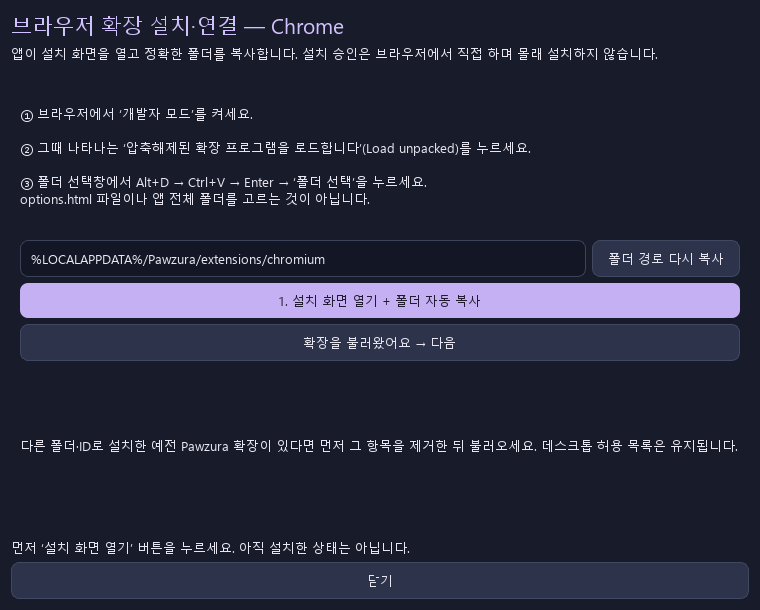
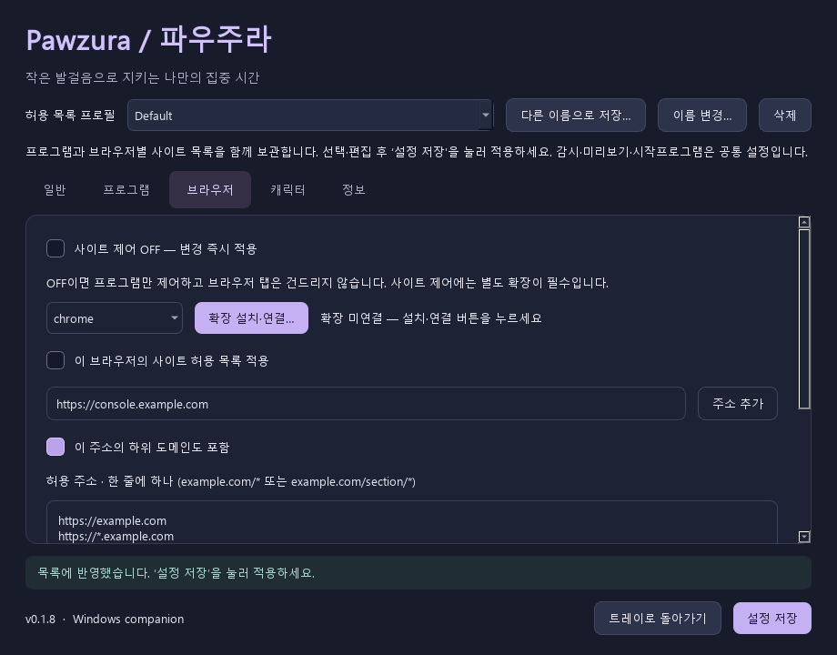

[English](../en/BROWSERS.md) | [한국어](../ko/BROWSERS.md) · [문서 목록](../README.ko.md)

# 브라우저 설정 — 앱에서 시작하세요

**사이트 제어를 사용할 때만 확장이 필요합니다.** 프로그램만 제어하고 브라우저를 자유롭게 쓰려면 **브라우저 → 사이트 제어 OFF**로 두세요. 즉시 적용하며 프로그램 감시·사이트 목록은 유지합니다. 트레이에도 같은 스위치가 있으며 프로필 전체에 공통입니다. 새 설치는 OFF, 업그레이드는 기존에 켜 둔 사이트 제어 선택을 유지합니다.

## Chrome / Edge: 가장 짧은 설치 순서

1. Pawzura 0.1.5 이상의 **브라우저**에서 **chrome** 또는 **edge** 선택 → **확장 설치·연결…**을 누릅니다.
2. **설치 화면 열기 + 폴더 자동 복사**를 누릅니다. 앱이 브라우저의 확장 관리 화면을 열고 정확한 폴더 경로를 복사합니다.
3. **방금 열린 확장 프로그램 관리 화면**의 **개발자 모드 스위치**를 켭니다. Chrome은 **`chrome://extensions` 화면 오른쪽 위**, Edge는 **`edge://extensions` 화면 왼쪽 사이드바**에 있습니다. **Ctrl+Shift+I는 개발자 도구를 여는 단축키이며, 이 스위치를 켜는 기능이 아닙니다.** 개발자 도구를 열었다면 닫으세요.
4. 같은 확장 관리 화면에서 새로 나타나는 **압축해제된 확장 프로그램을 로드합니다(Load unpacked)**를 누릅니다. 폴더 선택창에서 **Alt+D → Ctrl+V → Enter → 폴더 선택**을 누릅니다. 폴더를 직접 찾을 필요가 없습니다.
5. 확장 관리 화면에 **Pawzura Focus Bridge**가 나타나고 켜져 있는지 확인합니다. 도우미로 돌아와 **확장을 불러왔어요 → 다음 → 연결 화면 열고 연결 요청**을 누릅니다. Pawzura 확인창에서 **예**를 누르면 도우미가 최근 인증 연결을 확인하고 완료를 표시합니다.

브라우저·포트는 자동 입력합니다. 탐색기에서 `options.html`을 열면 연결 기능이 없는 파일 미리보기입니다. 브라우저 설치 승인은 직접 해야 하며 도우미가 몰래 승인하지 않습니다. 관리 정책이나 브라우저 프로필을 수정하지 않습니다. [Chrome 공식 설치 단계](https://developer.chrome.com/docs/extensions/get-started/tutorial/hello-world#load-unpacked), [Edge 공식 설치 단계](https://learn.microsoft.com/en-us/microsoft-edge/extensions/getting-started/extension-sideloading).

## 버튼이나 페이지가 안 보일 때



실제 경로는 설치 화면 열기를 누를 때 사용자 PC에서 자동으로 채우고 복사합니다.

| 보이는 상황 | 해결 방법 |
| --- | --- |
| 확장 불러오기 버튼이 없음 / Ctrl+Shift+I를 누름 | 개발자 도구를 닫으세요. Chrome은 `chrome://extensions` 화면 오른쪽 위의 개발자 모드 스위치를 켭니다. Edge는 `edge://extensions` 화면 왼쪽 사이드바의 스위치를 켭니다. |
| 브라우저를 찾지 못함 | 도우미의 브라우저 실행 파일 선택에서 해당 브라우저 EXE를 고른 뒤 설치 화면 열기를 다시 누르세요. |
| 폴더 선택창에 엉뚱한 폴더가 보임 | Alt+D로 주소줄 선택 → Ctrl+V로 복사된 경로 붙여넣기 → Enter로 해당 폴더 열기 → 폴더 선택 순서입니다. |
| manifest가 없거나 로드 실패 | 앱 전체 폴더·ZIP·options.html이 아니라 도우미가 준비한 폴더를 고르세요. 먼저 앱 ZIP 전체를 압축 해제하세요. |
| 연결 페이지를 열 수 없음 | 확장 불러오기를 먼저 마치세요. 기존 설치라면 도우미가 파일을 갱신한 뒤 Pawzura 카드의 새로고침을 누르세요. |
| 개발자 모드가 없거나 관리됨 | 브라우저·조직 정책이 로컬 설치를 막을 수 있습니다. 도우미가 우회하지는 않으며 프로그램만 제어하는 모드는 계속 쓸 수 있습니다. |
| 연결됐지만 탭을 닫지 않음 | 전체 사이트 제어, 선택한 브라우저의 목록 적용과 일반 탭의 감시를 켜세요. 실제 닫기는 미리보기가 꺼져 있어야 합니다. |

## 설치되는 내용

도우미는 공개 확장 파일 6개만 `%LOCALAPPDATA%/Pawzura/extensions/chromium` 또는 `firefox`로 복사합니다. 새 EXE를 다른 위치에 풀어도 이 경로는 유지됩니다. 설치된 폴더를 지우지 마세요. 업데이트도 같은 폴더로 복사하며 이후 브라우저의 확장 카드를 새로고침하세요. 복사하는 것은 폴더 경로이며 연결 비밀 코드가 아닙니다.

Chromium은 개발용 ID를 고정하기 위해 공개 manifest key를 사용합니다. 비공개 서명키나 연결 비밀 코드가 아닙니다. 연결 링크에는 브라우저·포트·언어·요청 표시만 넣고 실제 토큰은 데스크톱 승인 뒤 로컬 통신으로 주고받습니다. [Chrome 확장 ID 안내](https://developer.chrome.com/docs/extensions/reference/manifest/key).

<details>
<summary>0.1.4 이하 또는 예전 폴더 설치에서 업그레이드</summary>

새 고정 ID가 예전의 경로 기반 ID와 다를 수 있습니다. 중복 실행을 피하려면 예전 Pawzura 카드를 제거한 뒤 새 도우미 폴더를 불러오세요. 데스크톱 허용 목록은 같은 로컬 설정 파일에 유지합니다. 이번 한 번 바뀌며 이후 도우미 업데이트는 경로·ID를 유지합니다.

</details>

## 다른 브라우저

Brave·Opera·Vivaldi는 지원하는 경우 Chromium 폴더와 각자의 확장 관리 화면을 사용합니다. Arc 호환성과 비표준 실행 파일 검색은 별도 검증이 필요하며 자동 검색이 실패하면 EXE를 직접 고를 수 있습니다.

Firefox·Zen은 도우미에서 **임시 부가 기능 로드 → manifest.json**을 선택합니다. 브라우저 재시작 시 해제되는 임시 설치입니다. 연결 버튼은 `about:addons`를 열며 Pawzura의 설정/옵션이나 확장 아이콘에서 브라우저 선택 → **자동 연결** → 앱에서 **예** 순서로 연결합니다. 설치마다 UUID를 배정하므로 Chromium용 옵션 바로가기를 사용하지 않습니다. 영구 Firefox 설치에는 Mozilla 서명이 필요하고 Zen은 별도 검증이 필요합니다. [Mozilla 배포 조건](https://extensionworkshop.com/documentation/publish/signing-and-distribution-overview/).

<details>
<summary>고급 수동 연결과 이전 JSON 예시</summary>

기본적으로 자동 연결을 사용하세요. 이전 앱을 쓰거나 문제를 진단할 때는 데스크톱 브라우저 탭에서 **수동 연결 — 고급 설정**을 켜 연결 코드 복사와 포트를 확인할 수 있습니다. 확장에서도 수동 연결을 펼쳐 코드를 붙여넣고 연결하고 확인을 누르세요. 아래 예시는 실제 연결에 쓸 수 없습니다.

### 입력 예시

| 항목 | 예시 | 실제로 넣을 값 |
| --- | --- | --- |
| 브라우저 | Chrome | 이 확장을 설치한 브라우저 |
| 포트 | 47831 | Pawzura → 브라우저에 표시된 숫자 |
| 연결 코드 | EXAMPLE_ONLY_REPLACE_WITH_YOUR_APP_CONNECTION_CODE | 연결 코드 복사로 얻은 실제 코드 |

예시 코드는 **실제 연결에 쓸 수 없습니다**. 예시임을 표시하고 연결할 때 거절합니다. **예시를 입력 칸에 넣기** 버튼은 각 값이 어디에 들어가는지만 보여 주며 연결 정보를 저장하지 않습니다.

### 0.1.0에서 JSON을 복사했다면

**예시 보기 / 이전 JSON 가져오기**를 펼치세요. 복사한 텍스트 전체를 가져오기 칸에 붙여넣고 **입력 칸에 적용**을 누르면 위 세 항목을 자동으로 채웁니다. 마지막으로 **연결하고 확인**을 눌러야 연결됩니다.

```json
{
  "browser": "chrome",
  "port": 47831,
  "token": "EXAMPLE_ONLY_REPLACE_WITH_YOUR_APP_CONNECTION_CODE"
}
```

`browser`는 브라우저, `port`는 포트, `token`은 연결 코드입니다. 0.1.1 앱은 코드만 복사하므로 위쪽 연결 코드 칸에 그대로 붙여넣으세요. 중괄호나 따옴표는 넣지 않습니다.


</details>

## 허용 사이트를 추가하고 감시 켜기

### 브라우저 내부 설정 페이지

별도의 **브라우저 내부 설정 페이지** 칸은 선택한 브라우저에 맞춰 바뀝니다. **이 브라우저의 설정 페이지 허용**은 이전 설정을 불러올 때를 포함해 기본으로 켜져 있습니다. 주소는 자동 표시하며 직접 편집하지 않습니다. 일반 웹사이트는 아래 사이트 목록에 입력하세요. 체크 상태를 바꾼 뒤 **설정 저장**을 누르면 적용하며 브라우저·허용 목록 프로필마다 선택을 보관합니다.

| 브라우저 | 인식하는 설정 주소 |
| --- | --- |
| Chrome | `chrome://settings` |
| Edge | `edge://settings`, `chrome://settings` |
| Firefox / Zen | `about:preferences` |
| Brave | `brave://settings`, `chrome://settings` |
| Opera | `opera://settings`, `chrome://settings` |
| Vivaldi | `vivaldi://settings`, `chrome://settings` |
| Arc | `chrome://settings` (Chromium 호환 주소) |

`chrome://settings/privacy`, `about:preferences#privacy` 같은 하위 설정과 설정 검색 쿼리도 포함합니다. `chrome://history`·`chrome://flags`·`about:config` 같은 다른 내부 페이지, 비슷하게 꾸민 주소, 미허용 웹사이트까지 허용하지는 않습니다. 일부 Chromium 브라우저는 `chrome://settings` 별칭을 사용하며 Arc·Zen 연동의 별도 검증 제한은 위 설명을 따릅니다. [Chromium 설정 참고](https://chromium.googlesource.com/chromium/src.git/+/f1bb6e7acafff4116f8f6100f9612c93930c2ecc/docs/chrome_settings.md) · [Firefox 설정 참고](https://support.mozilla.org/en-US/kb/firefox-options-preferences-and-settings).

사이트 제어를 끄면 계속 자유롭게 탐색할 수 있습니다. 기존 확장 연결을 그대로 사용하므로 이 옵션을 위해 확장을 업데이트할 필요는 없습니다. 브리지가 설정 변경을 확인하면 대기 중인 탭 닫기 승인을 취소하지만 이미 전송 중인 응답을 소급해 회수하지는 않습니다.

### 일반 웹사이트

0.1.8부터 **주소 추가** 입력란에 `https://console.example.com` 같은 주소를 넣을 수 있습니다. **이 주소의 하위 도메인도 포함**을 끄면 해당 호스트만, 켜면 입력한 호스트와 그 아래 `*.` 규칙을 함께 추가합니다. 마지막에 **설정 저장**을 누르세요. 주소 추가만으로 감시를 켜지는 않습니다.



| 입력 | 하위 도메인 포함 | 결과 |
| --- | --- | --- |
| `https://console.example.com` | OFF | console.example.com만 허용, example.com·login.example.com 제외 |
| `example.com` | ON | example.com과 *.example.com 추가, console·login 및 더 깊은 하위 도메인 포함 |
| `console.example.com` | ON | console.example.com과 *.console.example.com 추가, 부모·형제 호스트 제외 |

생성한 두 규칙의 경로·쿼리·프로토콜·포트 조건은 동일하게 유지합니다. 예를 들어 `example.com/team/*?view=work`는 호스트·하위 도메인의 해당 구역만 허용합니다. IP 주소·localhost는 체크를 끄고 개별 추가하세요. 기존 목록은 자동 확장하지 않습니다. 직접 입력한 `*.example.com`은 계속 하위 도메인만 허용하므로 루트도 원하면 `example.com`과 함께 등록하세요.

1. 데스크톱 앱의 **브라우저**에서 연결한 브라우저를 선택하세요. `https://example.com`처럼 허용할 주소를 한 줄에 하나씩 입력하세요.
2. **이 브라우저의 사이트 허용 목록 적용 → 설정 저장**을 누른 뒤 전체 **사이트 제어** 스위치를 켜세요.
3. **일반**에서 **집중 지킴이 켜기**를 선택하고 미리보기는 켜 둔 채 저장하세요. 동작을 확인한 다음 미리보기를 해제하세요.

내장 새 탭·홈 화면·빈 페이지와 확장 설치에 필요한 제한된 내부 페이지는 설정 페이지 체크와 관계없이 계속 허용합니다. 브라우저 설정 주소는 위의 별도 옵션을 사용하고, 사용자 지정 시작 웹사이트는 직접 추가하세요. 사이트 감시를 켜기 전에 확장을 설치·연결하세요.

| 규칙 | 허용 | 허용하지 않음 |
| --- | --- | --- |
| `https://example.com` | 같은 HTTPS 사이트의 모든 경로 | 하위 도메인, HTTP, 다른 포트 |
| `https://console.example.com` | 해당 하위 도메인의 모든 HTTPS 경로 | 부모·형제·더 깊은 하위 도메인 |
| `example.com/*` | `/`를 포함한 같은 HTTPS 호스트의 모든 경로·쿼리·fragment | 하위 도메인, HTTP, 위장 호스트 |
| `example.com/section/*` | `/section`과 하위 경로 | `/section-other`와 다른 구역 |
| `github.com/my-account` | HTTPS의 `/my-account`와 하위 경로 | 다른 계정이나 `/my-account-other` |
| `https://example.com/personal/home` | 해당 경로와 하위 경로 | 사이트의 다른 구역 |
| `example.com/ko?viewMode=svod` | `viewMode=svod`인 HTTPS `/ko`와 하위 경로 | 해당 값이 없거나 다른 경우 |
| `*.example.com` | `help.example.com` 같은 HTTPS 하위 도메인 | 루트 `example.com` |
| `http://localhost:3000` | 해당 HTTP 주소와 포트 | 다른 포트 |

도메인뿐 아니라 경로와 쿼리가 포함된 주소도 그대로 붙여넣을 수 있습니다. 프로토콜을 생략하면 HTTPS로 처리합니다. `http://`와 `https://`로 시작하는 완전한 주소 모두 지원하며 서로 구분합니다. **호스트 없이 `http://` 또는 `https://`만 넣는 것은 불완전한 주소이며 모든 사이트 허용 규칙이 아닙니다.**

경로 없는 도메인은 사이트 전체를 허용합니다. 경로를 넣으면 해당 구역과 하위 경로만 허용하며 `/home` 규칙으로 `/home-other`를 허용하지 않습니다. 쿼리를 넣으면 그 키의 값이 같아야 합니다. 추적용 매개변수 같은 다른 키가 추가돼도 되지만, 조건에 지정한 키의 값이 추가되면 거절합니다. `#fragment`는 무시하므로 SPA의 해시 경로를 구분하는 용도로 쓸 수 없습니다. 국제화 도메인·한글 경로·기본 포트는 정규화합니다. 경로를 제한할 때는 .·.. 구역, 역슬래시, 인코딩된 경로 구분자를 허용하지 않습니다.

`example.com`과 `www.example.com`은 다른 호스트입니다. 다른 호스트나 로그인 사이트로 리디렉션되면 허용하려는 주소를 별도로 추가하세요. `github.com/my-account`만 허용하면 GitHub 로그인 페이지까지 허용하지 않습니다. 호스트는 정확히 비교하므로 `example.com.evil.test` 같은 위장 주소를 허용하지 않습니다.

0.1.2 이전에는 경로나 쿼리가 한 줄이라도 있으면 편집한 목록 전체의 검증이 실패했습니다. 0.1.2부터는 해당 주소를 허용하고, 다른 오류가 있으면 선택한 언어로 줄 번호를 표시합니다. 저장하면 생략된 `https://` 등을 반영한 주소가 보입니다.

## 연결 메시지와 해결 방법

| 표시 | 할 일 |
| --- | --- |
| 파일 미리보기 | 확장을 설치하고 확장 프로그램 옵션 열기 |
| 코드 거절 | 앱에서 현재 연결 코드를 다시 복사 |
| 앱에 연결할 수 없음 | 데스크톱 앱 실행 및 포트 확인 |
| 연결됨·감시 꺼짐 | 앱에서 브라우저 감시와 전체 집중 지킴이 켜기 |
| 연결됨·미리보기 | 시험 중에는 유지. 실제 닫기를 원하면 미리보기 해제 |

확장 배지는 ON=실제 감시, PRE=미리보기, OFF=연결 실패입니다. 빈 배지는 감시 비활성 상태입니다. 연결 해제는 연결 정보를 제거하고, 데스크톱 앱을 종료하면 탭 닫기가 중지됩니다.

## 기술 동작과 제한

0.1.3은 끝의 `/*`를 받아들이며 저장 시 같은 의미의 도메인·경로 규칙으로 정리합니다. `/section/*`는 `/section` 자체도 포함합니다. `/section*`·`/*/item` 같은 다른 경로 패턴은 거절합니다. `/*` 뒤에 지정한 쿼리 조건은 유지합니다. 업무·여가별 목록은 [프로필](PROFILES-AND-RECOVERY.md)로 나누세요.

한 번에 열린 탭 최대 200개를 검사합니다. 미허용 URL의 애니메이션 티켓을 만들고 닫기 직전에 URL을 다시 확인합니다. Chromium 작업자가 중단되면 알람으로 복구하는 데 약 30초 걸릴 수 있습니다. 0.1.4부터 활성·백그라운드 탭 모두 작업표시줄 근처의 별도 **탭 미리보기 ×** / **차단 탭 ×** 표식에서 애니메이션을 보여줍니다. 브라우저 탭 ID로 일반 창 X를 추정하거나, 현재 창의 버튼이나 화면 오른쪽 위를 대신 사용하지 않습니다. 이 표식은 브라우저의 실제 탭 X가 아닙니다. 확장 자신의 옵션 탭은 검사에서 제외합니다. 마지막 미허용 탭을 닫기 전에는 같은 창에 about:blank 탭을 먼저 만들고, 만들기에 실패하면 기존 탭을 닫지 않습니다. 다른 탭은 닫지 않습니다.

미리보기는 탭을 닫지 않습니다. 같은 차단 탭·주소는 한 번 시연하며 애니메이션 티켓 만료 때 반복하지 않습니다. 주소 이동, 탭을 닫고 다시 열기 또는 설정 적용 시 다시 시연할 수 있습니다. 브라우저 ID·주소·미리보기 식별값은 메모리에만 두며 로그·설정에 추가하지 않습니다. 실제 탭 제거는 감시·브라우저 검사가 켜져 있고 미리보기가 꺼진 상태에서 애니메이션 확인 후 확장만 수행합니다. 일반 창 감시는 미리보기·실제 동작 모두 알려진 브라우저 창을 제외합니다.

탐색 **후** 탭을 닫으므로 네트워크 방화벽이 아닙니다. 확장 제거·앱 종료로 감시를 중지할 수 있습니다. 시크릿 탭은 별도 권한이 필요합니다. 스토어 영구 배포와 실제 브라우저 전체 동작 검증은 [검증 문서](VALIDATION.md)에 구분했습니다.

브리지는 `127.0.0.1`에만 열고 비공개 코드·Host·요청 크기를 검사하며 URL을 기록하지 않습니다. 메모리의 URL 티켓은 20초 뒤 만료됩니다. 확장 origin에만 CORS 응답을 주고, 주소를 캐릭터 모델에 보내지 않습니다. 보안 경계가 아닌 집중 보조 앱입니다.

참고: [Chrome 탭 API](https://developer.chrome.com/docs/extensions/reference/api/tabs), [Firefox 서명](https://extensionworkshop.com/documentation/publish/signing-and-distribution-overview/).

자동 연결 요청은 확장 origin만 허용하고 60초 뒤 만료됩니다. 앱에서 명시적으로 승인한 뒤에만 인증 정보를 전달하며 요청한 origin에 묶인 결과를 한 번만 받을 수 있습니다. 일반 웹사이트 origin은 거절합니다. 수동 코드 연결은 고급 대체 경로로 남겨 둡니다.
