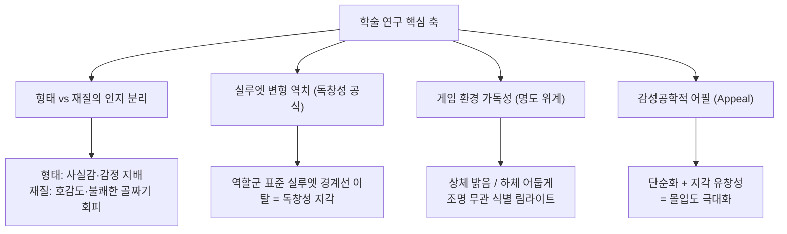
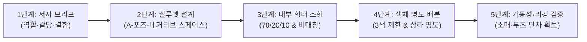

[English](../en/CHARACTER-DESIGN-METHODOLOGY.md) | [한국어](../ko/CHARACTER-DESIGN-METHODOLOGY.md) · [문서](../README.ko.md) · [창작 그림](CREATIVE-ART.md) · [3D 움직임](3D-MOTION.md)

# 독창적 캐릭터 제작 방법론 및 디자인 지침 보고서

> **웹 문헌 및 Liner Scholar 학술 연구 75편 종합 분석 · Pawzura 2D/2.5D/3D 캐릭터 생성 연계**

---

## 1. 개요: 캐릭터 디자인의 본질 (Form Follows Function)

애니메이션, 게임, 일러스트레이션 분야의 거장들과 학술 연구자들은 캐릭터 디자인을 단순한 ‘그림 그리기(Drawing)’가 아닌 **‘시각적 문제 해결(Visual Problem-Solving)’이자 ‘인체·서사의 건축(Architecture)’**으로 정의합니다.

> **캐릭터 디자인의 대원칙: 대사 이전의 시각적 각인 ("Show, Don't Tell")**  
> 대사나 나레이션이 나오기 전, 관객은 **0.1초 이내**에 캐릭터의 실루엣, 기본 기하학적 형태, 색상 대비만으로 성격·역할·신체 능력·심리 상태를 직관적으로 파악할 수 있어야 합니다.

---

## 2. 5대 핵심 조형 원리 (업계 거장 프레임워크)

디즈니의 전설적인 애니메이터 **톰 뱅크로프트(Tom Bancroft, *Creating Characters with Personality*)**와 워너브라더스·니켈로디언의 수석 디자이너 **스티븐 실버(Stephen Silver, *The Silver Way*)**의 방법론을 집약한 5대 원리입니다.

### (1) 서사 우선주의 (Story & Circumstance First)
* 펜을 들기 전 세 가지 질문에 먼저 답해야 합니다:
  1. **누구인가? (Who are they?)**: 신분, 종족, 연령대, 직업.
  2. **무엇을 갈망하는가? (What do they want?)**: 행동의 궁극적인 동기(사랑, 복수, 지식, 생존).
  3. **내면의 결함/약점은 무엇인가? (Flaw)**: 완벽한 캐릭터는 매력이 없습니다. 소심함, 맹목적 자만, 신체적 불편 등 결함이 조형적 개성을 만듭니다.
* 캐릭터의 외형 디테일(상처, 낡은 망토, 주머니의 물품)은 반드시 이 서사적 맥락의 증거여야 합니다.

### (2) 동세선과 제스처 (Line of Action & Gesture)
* 모든 훌륭한 디자인은 하나의 강렬한 곡선 또는 사선인 **동세선(Line of Action)**에서 출발합니다.
* 척추와 몸통의 무게중심을 비틀어 정적인 ‘T-포즈’나 뻣뻣한 수직선을 피하고, 걷거나 서 있는 기본 자세에서도 성격(자신감 넘치는 흉부 돌출, 위축된 굽은 등)이 드러나게 만듭니다.

### (3) 형태 언어 체계 (Shape Language) & 의도적 전복(Subversion)
인간의 뇌는 기본 기하학적 도형에 무의식적인 감정적 반응을 보입니다(Gestalt Psychology & Visual Semiotics).

| 기본 도형 | 심리적 연상 | 대표 캐릭터 유형 | 디자인 적용 부위 |
| :--- | :--- | :--- | :--- |
| **원 / 타원 (Circle)** | 친근함, 부드러움, 따뜻함, 순수함, 무해함 | 주인공, 조력자, 아동, 코믹 캐릭터 (예: 커비, 포) | 볼살, 둥근 코, 곡선형 신체, 벙어리장갑 |
| **사각형 (Square)** | 견고함, 신뢰감, 안정성, 완고함, 불변 | 탱커, 수호자, 듬직한 조력자 (예: 랄프, 바위 거인) | 각진 턱, 사각 어깨, 직사각형 토르소, 두터운 다리 |
| **삼각형 (Triangle)** | 위험, 속도, 민첩함, 날카로움, 교활함, 야망 | 빌런, 암살자, 지적 야심가 (예: 디즈니 악역들) | 날카로운 턱, 뾰족한 옷깃, 갈퀴손, 역삼각형 체형 |

> **독창성을 만드는 '형태 전복(Subversion)' 기법**  
> 전형적인 틀(원=착함, 삼각=나쁨)을 그대로 답습하면 흔한 클리셰가 됩니다. 독창적인 캐릭터는 **도형의 이중 배합**에서 탄생합니다:
> - *부드러운 거인*: 거대한 사각 몸통 + 둥글고 순한 눈매 (외강내유, 코지 판타지 모험가 바리스타).
> - *전략적 귀족/흑막*: 단정한 원형 치비 비율 + 날렵한 칼깃·장미 브로치·체스 나이트 핀 (전략가 악역 영애, 착각계 흑막 마도학도).

### (4) 실루엣 테스트 및 트위닝(Twinning) 배제
* **블랙 필 테스트 (Black-Fill Test)**: 캐릭터를 온전히 검은 실루엣으로 칠했을 때, 장신구나 얼굴 표정 없이도 외곽선만으로 식별되어야 합니다.
* **네거티브 스페이스 (Negative Space)**: 팔과 몸통 사이, 두 다리 사이, 소품과 신체 사이에 명확한 틈새를 두어야 3D/애니메이션 동작 시 덩어리가 뭉개지지 않습니다.
* **트위닝(대칭 복제) 배제**: 완벽한 좌우 대칭은 마네킹처럼 생명력을 잃게 만듭니다. 한쪽 옷깃에 단 브로치, 비대칭 머리핀, 걷어 올린 소매처럼 **비대칭성(Asymmetry)**을 주입해야 유기적인 생동감이 살아납니다.

### (5) 시각적 위계 (Visual Hierarchy: 70-20-10 법칙)
* 전체 디자인 면적의 **70%는 시각적 쉼터(단순한 기본 덩어리)**, **20%는 보조적 형태 분할(짧은 조끼, 바지, 벨트)**, **10%는 시선을 사로잡는 고밀도 포인트(초승달 브로치, 룬 문장, 체스 나이트 핀, 태양 잎사귀 배지)**로 배분해야 합니다.
* 온몸에 디테일이 빽빽하면 시선이 분산되어 기억에 남지 않습니다.

---

## 3. Liner Scholar 10대 학술 연구 핵심 분석

Liner Scholar를 통해 추출된 75편의 연구 중, 독창적 캐릭터 제작과 Pawzura의 하이브리드 2.5D/3D 파이프라인에 실질적 기준을 제시하는 핵심 결론입니다.

### 1) 형태(Shape)와 재질(Material)의 기능 분리
* **연구**: *The Interaction of Shape and Material in Character Stylization*
* **발견점**: 관객의 지각 실험 결과, 캐릭터의 **‘감정 표현 강도와 사실감’은 형태(지오메트리)**가 결정하고, **‘호감도(Appeal)와 불쾌한 골짜기(Uncanny Valley) 회피’는 표면 재질(텍스처)**이 결정합니다. 과장된 카툰 형태에 무리한 3D 왜곡을 입히면 불쾌감이 극대화되며, 평면 셀 채색(`flat_2d`)에는 2.5D 멀티플레인 패럴랙스/중심축 원통 팽창을, 음영 마스코트(`shaded_3d`)에는 3D 메쉬 복원을 매칭할 때 최고의 매력도가 달성됩니다.

### 2) 169개 글로벌 애니메이션 캐릭터 실루엣의 정량 분석
* **연구**: *Quantitative Silhouette Analysis of Box-Office Animated Characters*
* **발견점**: 전 세계 흥행 애니메이션 캐릭터 169개를 수학적으로 분석한 결과, 각 서사적 역할(주인공, 멘토, 악역 등)마다 관객이 무의식적으로 기대하는 '실루엣 변형 범위(Morphological Boundary)'가 존재합니다. 관객에게 **"신선하고 독창적이다"**라고 평가받은 캐릭터들은 표준 분포의 중심이 아니라 **경계면 바깥(Outlier)을 영리하게 공략한 디자인**이었습니다.

### 3) 비디오 게임 스킨 변형 속 불변 요소(Invariants)
* **연구**: *Form and Silhouette Consistency in Character Skin Variations across Video Games (LoL & Overwatch)*
* **발견점**: 수십 종의 외형 변경 스킨이 출시되어도 플레이어가 캐릭터를 즉시 알아채는 원리는 전체 신체 실루엣의 비율과 머리-어깨-가슴 상체의 명도 대비 및 시그니처 윤곽선의 보존에 있습니다.

### 4) 형태 언어에 대한 연령별 인지 심리학
* **연구**: *How Can a Character's Personality be Conveyed Visually, through Shape (Ekström, 2013)* & *Children's Perception of Shape Language*
* **발견점**: 전 연령대에서 원형은 도덕적 선함과 높은 사교성으로, 예각 삼각형은 위협과 지배욕으로 일관되게 해석됩니다. 특히 '유능하고 영리한 동반자'의 경우 원형 머리에 안정적인 사각형/원통형 몸통이 결합된 하이브리드 치비 비율에서 가장 높은 신뢰도를 보였습니다.

### 5) 밸브(Valve)사의 팀 포트리스 2 명도 위계 기법
* **연구**: *Illustrative Rendering and Character Readability in Team Fortress 2*
* **발견점**: 20세기 거장 일러스트레이터 J.C. 레이엔데커(J.C. Leyendecker)의 기법을 공학적으로 응용하여, 발목과 하체는 차분하고 흉부·안면부는 밝게 처리해 바탕화면 소형 아이콘 크기에서도 시선이 상체와 얼굴로 자연스럽게 유도되게 합니다.

---

## 4. 실전 캐릭터 제작 및 Pawzura 2D/3D 리깅 연계 파이프라인

1. **양팔 분리(A-Pose)**: 양팔을 몸통에서 살짝 벌려 소매-옆구리 간 메쉬 융합(Webbing)을 배제합니다.
2. **골반·무릎 노출형 짧은 상의**: 긴 로브나 발목까지 덮는 드레스 대신 짧은 조끼(Cropped vest), 볼레로 재킷, 승마 바지 등을 사용해 ViTPose와 3D 메쉬 복원기가 골반·무릎·발목 관절을 정확히 분리하도록 설계합니다.
3. **손목·발목 색상 단차**: 발목과 바짓단, 손목과 소매 사이에 뚜렷한 색상·굵기 차이를 두어 원위부 커프 탈출 알고리즘이 소매와 손, 바지와 부츠를 명확히 구분하게 합니다.

---

## 5. Pawzura 생성 AI 프롬프트 적용 체크리스트

| 체크 항목 | 적용 지침 | 프롬프트 키워드 예시 |
| :--- | :--- | :--- |
| **단일 전신 보장** | 1인 정면 전신 및 흰 배경 명시 | `Solo single chibi ..., upright full-body front view centered on plain white background` |
| **명확한 자세** | 팔다리 분리 및 네거티브 스페이스 확보 | `Arms held apart with visible empty hands, separated legs, wide white margins` |
| **리깅 친화 의상** | 관절을 가리지 않는 짧은 상의와 부츠 | `cropped velvet waistcoat`, `cropped tech jacket`, `tailored breeches`, `ankle boots` |
| **비대칭 포인트** | 몸통 실루엣에 밀착된 10% 상징 배지 | `glowing cyan rune emblem`, `gold rose brooch`, `chess knight lapel pin`, `sunleaf brooch` |

- 연계 문서: [문학 분야별 세계관 및 캐릭터 구성 총람](LITERARY-WORLDBUILDING-AND-CHARACTERS.md) · [현대 특수문학(라이트노벨·웹소설·서브컬처) 서사학 총람](SUBCULTURAL-LITERATURE-AND-LIGHT-NOVELS.md) · [연구 문헌 총괄 서지 목록](CHARACTER-AND-LITERATURE-BIBLIOGRAPHY.md)
