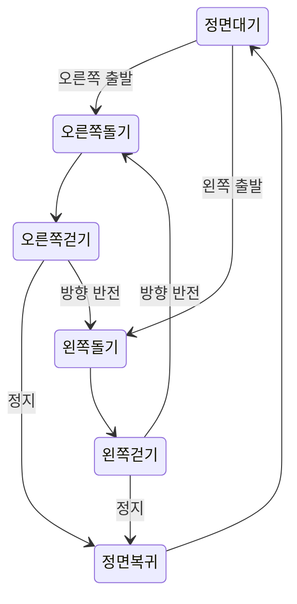

[English](../en/DIRECTIONAL-ANIMATION.md) | [한국어](../ko/DIRECTIONAL-ANIMATION.md) · [애니메이션 실험](ANIMATION-EXPERIMENT.md)

# 이동 방향에 맞는 걷기와 입체감

소스 업데이트: [실험용 8GB 포즈 추정 보조 3D 움직임](3D-MOTION.md)이 승인한 그림을 실제 앱에 연결합니다. 아래 이전 릴리스·실험 설명은 당시 범위를 유지합니다.

다음 준비 계약: [일관된 프레임과 그림·복원·리깅 작업의 순차 실행](STAGED-CHARACTER-PIPELINE.md).

**2026-11-03, Asia/Seoul** 추가 요구사항입니다. 캐릭터가 수평 이동할 때는 측면이 보여야 하고, 멈추었을 때는 정면을 사용할 수 있습니다. 정면·사선·측면 전환에서 부피감이 유지되어야 합니다. 설계·실험 기록이며 0.3.0에 구현된 기능이 아닙니다.

앞선 정면 [메쉬·표정 시험](ANIMATION-EXPERIMENT.md)만으로 이 요구를 충족했다고 할 수 없습니다. 현재 Pawzura는 그림을 좌우 반전해 방향을 표현합니다. 반전이나 정면 텍스처의 폭 조절만으로 머리·몸통·옷의 가려진 측면이 생기지는 않습니다.

## 눈으로 확인할 동작

| 상태 | 몸 방향·모션 |
| --- | --- |
| 대기·정지 | 지지하던 발을 딛고 사선을 거쳐 정면으로 돌기, 이후 깜빡임·호흡·반응 |
| 오른쪽 걷기 | 이동 방향을 향한 오른쪽 측면 또는 측면에 가까운 사선, 팔·다리 교차 |
| 왼쪽 걷기 | 이에 대응하는 왼쪽 방향 모습과 걷기 |
| 출발·정지 전환 | 정면 ↔ 사선 ↔ 측면 회전 뒤 알맞은 보행 시작·복귀 |
| 이동 방향 반전 | 짧게 몸을 돌린 뒤 반대 보행 시작. 정면 그림을 즉시 뒤집는 방식으로 처리하지 않음 |
| 커서 인사 | 멈추고 필요하면 보는 쪽으로 몸을 돌린 뒤 반응 |
| 깨물기·착지 | 대상 방향에 맞는 클립·입 접촉점을 사용하고 적절한 대기·보행으로 복귀 |

몸 방향과 눈의 시선은 별도 제어입니다. 커서를 보더라도 걷는 몸 전체가 계속 정면을 응시해서는 안 됩니다. 확장 모니터 경계를 넘는 것 자체가 이동 방향 반전은 아닙니다.

### 걷기·잠깐 멈추기·표정의 흐름

사용자 보완 요청: 잠깐 의도적으로 멈출 때도 정면으로 돌고, 옆으로 걷는 동안에도 표정·팔다리가 자연스럽게 움직여야 합니다. 렌더링 프레임이 느려진 것을 의도적인 멈춤으로 판단해 몸을 돌려서는 안 됩니다.

흐름은 **정면 대기 → 진행 방향으로 돌기 → 측면 걷기 → 발을 딛으며 감속 → 정면으로 돌기 → 대기·반응**입니다. 다시 움직일 때는 진행 방향으로 몸을 돌린 뒤 가속합니다. 정지·회전 중 지지하는 발을 유지해 두 발이 미끄러지거나 방향이 갑자기 바뀌지 않게 합니다. 회전 도중 새 이동 요청이 오면 정면부터 다시 시작하지 않고 현재 몸 방향에서 이어갑니다.

보행에는 골반·무릎·발목 관절, 교차하는 팔, 절제된 머리·몸의 무게 이동, 앞뒤 팔다리의 올바른 가림이 필요합니다. 깜빡임·작은 미소·귀나 장식의 뒤따르는 움직임은 보행과 별도 트랙으로 두고 매 걸음 같은 표정을 반복하지 않습니다. 측면에서는 보이는 눈·눈썹·입에 맞게 표정을 표현하며 양눈 정면 얼굴을 옆면에 붙이지 않습니다. 커서를 보거나 큰 반응을 할 때는 먼저 멈출 수 있습니다. 애니메이션 요구사항이며 현재 복원 자산에 필요한 관절·표정 제어가 있다는 근거는 아닙니다.

## 필요한 그림과 입체 단서

일관된 정면·좌우 사선·좌우 측면을 준비해야 합니다. 머리뿐 아니라 **몸통**, 팔·다리의 겹침, 귀·코 실루엣, 옷의 옆면도 확인합니다. 상황에 따라 먼 쪽 눈·팔이 가려져야 하며 양눈 얼굴의 폭을 줄이는 것만으로는 부족합니다. 비대칭 장식은 올바른 쪽에 유지하고 좌우 스프라이트를 항상 반전해서 쓸 수 있다고 가정하지 않습니다.

회전 클립에는 실제 중간 시점이나 검증된 3D 표현이 필요합니다. 서로 다른 정면·측면을 투명도로 섞기만 하면 얼굴이 두 개로 보일 수 있습니다. 한 장에는 뒷면·귀 모양·가려진 옷 정보가 없으므로 추정·제작 후 검토해야 합니다.

시점 사이에서 크기·발 접지·몸의 부피감을 유지합니다. 관련 클립·프레임마다 입 접촉점을 저장합니다. 방향 재생은 감시 기능의 대상·상태 검사와 분리하며 종료 콜백을 실행하거나 되살려서는 안 됩니다. 앞으로의 통합 기준이며 현재 종료 동작 변경은 아닙니다.

## 별도 동작으로 만드는 깨물기

제안하는 순서는 **발 딛기 → 대상 쪽으로 몸 돌리기 → 웅크려 준비 → 다리를 접으며 점프 → 입 벌리기 → 접촉하며 턱 닫기 → 반동 → 무릎을 굽히며 착지 → 정면 대기 또는 이전 진행 방향으로 복귀**입니다. 접촉 도중 정면으로 돌기보다 대상 위치에 맞는 측면·사선을 유지합니다. 잠깐 눈을 찡그리고 팔을 움직이면 힘주는 느낌을 보탤 수 있습니다. 균열은 접촉점에서 시작하고 별도로 서서히 사라집니다. 이번 시험에서 생성한 동작이 아닌 클립 구성 제안입니다.

현재 `pet.py`의 이미지 캐릭터는 입 좌표 하나에 작은 타원을 그리며 `bite()`는 그 좌표를 방향에 따라 반전해 도착 위치를 계산합니다. 회전하며 관절로 움직이는 머리에는 부족합니다. 이후 자산에는 실제 턱·얼굴 제어 또는 입술·치아 가림이 맞는 시점별 입 벌림·닫힘 프레임이 필요합니다. TripoSR 정지 장면에는 움직이는 턱이나 입 안쪽이 없으므로 메쉬 준비·리깅이나 직접 만든 보정 프레임이 추가로 필요합니다. 정면 THA3 결과만으로 측면 입 제어가 된다고 할 수 없습니다.

접촉 프레임마다 검증된 입 접촉점과 시점·크기 변환을 보관합니다. 캐릭터 그림의 중심이 아니라 변환된 입 접촉점이 대상에 맞아야 합니다. 접근 도중 턱이 벌어질 때 접촉점을 보간해 위치가 갑자기 튀지 않게 합니다. 접촉은 한 번만 발생하는 애니메이션 이벤트입니다. 허용된 앱 종료도 기존의 최종 창·프로세스 검사를 거치고, 브라우저는 별도 표식과 여전히 일치하는 정확한 탭을 사용하며 네이티브 브라우저 X 위치를 추측하지 않습니다. 미리보기는 같은 연출을 보여도 종료 요청을 만들지 않아야 합니다.

취소·대상 변경·디스플레이 변경·캐릭터 교체 시 대기 중인 접촉 이벤트를 무효화합니다. 입 접촉점이 없거나 잘못됐다고 화면 구석을 추측하는 방식으로 대체해서는 안 됩니다. 중단 후에는 현재 모니터 작업 영역으로 복구하고 오래된 종료 콜백을 다시 실행하지 않습니다. 통합 수용 기준이며 이 문서가 현재 앱 동작을 바꾸지는 않습니다.

## 구현 경로 후보

| 경로 | 가능한 것 | 남은 검증 |
| --- | --- | --- |
| 시점별 2D 애니메이션 묶음 | 각 시점의 그림을 생성·검토하고 리깅 또는 동작 생성 후 가벼운 Qt 재생용 프레임 저장 | 시점별 외형 일치, 측면 팔다리 가림, 측면에 맞는 표정 |
| 복원한 3D 캐릭터 | 공유하는 부피로 실제 중간 시점을 만들고 이후 뼈대·스키닝으로 전신 움직임 제어 | 복원 품질, 가려진 면, 실제 뼈대·가중치, 보행·표정 제어와 프레임 저장 |

실행 중에는 저장된 프레임 재생을 우선합니다. 준비 과정에서 3D를 사용해도 데스크톱 앱에서 3D 모델을 계속 실행할 필요는 없습니다. 정지 회전이나 정면 깜빡임 성공만으로 어느 경로든 합격한 것은 아닙니다.

## 현재 실험의 경계

기존 THA3 `standard_half`에 정규화된 `head_y` 값 −1·−0.5·0·0.5·1을 각각 단독·`body_y` 결합으로 입력했습니다. 모델 제어값이지 **카메라 각도 단위가 아닙니다.** 열 프레임 모두 유한값이었습니다. 눈으로 확인한 결과는 여전히 양눈이 보이는 정면·사선이며 전신 측면은 아니었습니다. 이 입력·모델 조합은 방향성 걷기를 충족하지 않습니다.

격리된 [TripoSR](https://github.com/VAST-AI-Research/TripoSR) 시험에서 같은 독창적 QA 그림으로 3D 장면을 복원하고 15° 간격으로 **실제 카메라 24시점**을 렌더링했습니다. 측면 실루엣, 먼 쪽 눈·팔의 가림, 추정한 옆면·뒷면이 나타나는 것을 확인했습니다. 얼굴 세부는 단순해지고 그림체는 3D 장난감처럼 재해석됐습니다. 원화나 보이지 않던 면의 정확한 복원이 아닙니다. 원본 2D 정면 대기와 복원한 측면을 섞으면 그림체가 갑자기 바뀔 수 있습니다.

| 측정 단계·자원 | 결과 |
| --- | --- |
| 환경 | Windows, Python 3.12.14, Torch 2.7.1+cu118, RTX 2070 Max-Q 8 GiB, float32 |
| 로딩·장면 인코딩 | 12.453초·1.203초 |
| 256 × 256, 24시점 렌더링 | 177.328초, 로딩·인코딩 포함 총 192.047초 |
| 최대 Torch 할당·예약 VRAM | 2,224.85·2,604 MiB |
| 실제 추론 프로세스 최대 작업 집합 RAM | 3,956.86 MiB |

로컬 영문·한글 보고서에는 양방향 정면→측면 전환, 다섯 시점 비교와 144픽셀 미리보기가 있습니다. **정지 포즈의 카메라 시점 변화**이며 걷기·리깅·측면 표정이 아닙니다. 원래 출력은 흰 배경이고 투명 캐릭터 재생은 시험하지 않았습니다. 한 캐릭터·설정의 결과로 2/4/6 GB 지원 등급을 정할 수 없습니다. 저장 프레임 재생 속도는 추론 속도와 별개입니다.

출처: 원본 소스 `107cefdc244c39106fa830359024f6a2f1c78871`, [공식 MIT 모델](https://huggingface.co/stabilityai/TripoSR) 리비전 `5b521936b01fbe1890f6f9baed0254ab6351c04a`. 격리된 복제본에서 사용하지 않는 선택 의존성 `torchmcubes`·`rembg` 두 import만 지연했습니다. 학습 모델·볼륨 렌더러는 그대로이며 메쉬 추출·배경 제거는 실행하지 않았습니다. DINO 구조 설정은 `facebook/dino-vitb16` 리비전 `f205d5d8e640a89a2b8ef0369670dfc37cc07fc2`로 고정했고 별도 DINO 가중치는 받지 않았습니다. 원시 출력·해시·명령·자원 기록은 추적하지 않는 로컬 실험 증거에 보관합니다. Pawzura의 지원 모델이나 배포물에는 추가하지 않았습니다.

Zero123++도 다중 시점 연구와 관련이 있지만 [공식 README](https://github.com/SUDO-AI-3D/zero123plus#license)는 Apache-2.0 코드와 CC BY-NC 4.0 가중치를 구분합니다. 자유로운 제품 이용용 모델 경로에는 선정하지 않습니다. 앱이 MIT여도 모델·전체 의존성 조건은 따로 확인해야 합니다.

## 후속: 수동 리깅 동작 데모

사용자가 요청한 후속 시험은 다른 모델·패키지를 받지 않고 기존 장면 캐시를 재사용합니다. 직접 만든 marching tetrahedra 추출기로 96³ 밀도 격자를 임계값 25에서 추출해 **정점 18,682개, 삼각형 37,336개, 촘촘한 표면 표본 168,016개**를 얻었습니다. 앞선 카메라 24시점의 색상을 투영하고 머리·부츠 가장자리에 섞인 흰 배경색을 국소적으로 보정했습니다. 같은 시험 장비에서 추출에 22.531초, 최대 Torch 할당 VRAM 1,648.16 MiB, 실제 추론 프로세스 최대 작업 집합 RAM 3,776.63 MiB를 사용했습니다. 앞서 시험하지 않았던 원본 메쉬 내보내기 기능이 아닌 별도의 추출 경로입니다.

이 캐릭터 하나에 **뼈대 12개와 스킨 가중치를 직접 맞췄습니다.** 직접 만든 다리 IK·선형 혼합 스키닝으로 팔다리를 움직이고, 국소적인 절차적 보정으로 깜빡임·미소·턱 벌림을 제어합니다. 휘어진 입·치아·혀 표면도 직접 구성했습니다. 학습된 애니메이션·표정 모델의 출력이 아니며 새로운 캐릭터를 자동으로 리깅하는 기능도 아닙니다. 깊이를 검사하는 표면 점 렌더링으로 시점에 따른 앞뒤 가림을 유지합니다. 준비 과정은 모두 앱 밖에서 실행합니다.

12초·288프레임 시퀀스에는 좌우 측면 걷기, 정면으로 잠깐 멈추기, 인사, 준비·점프·턱 벌림, 가상 대상 접촉·균열, 반동·착지가 있습니다. 로컬 영문·한글 플레이어에서 재생·일시정지, 처음부터, 재생 위치 변경, 걷기·깨물기 구간 이동을 지원하고 GIF·얼굴 확대도 제공합니다. 작은 미리보기의 캐릭터 높이는 약 144픽셀입니다. GIF는 40/50 ms를 조합해 평균 24 FPS·총 12초로 재생하며 실시간 추론이 아닙니다. GIF 반복은 데모 전체를 다시 시작하는 것이며 자연스럽게 이어지는 상시 대기 루프의 검증이 아닙니다.

회귀 검사에는 팔 교차·무릎 관절·뼈 길이, 일정 속도 보행의 지지 발목 접지, 방향 상태, 국소 깜빡임·미소·턱 제어, 입 접촉점 정렬과 가상 접촉 1회 실행을 포함합니다. 첫 리깅에서는 큰 보폭에 짧은 다리가 늘어났고 보행 골반을 낮춰 도달 범위 문제를 수정했습니다. 반올림한 보폭 상수로 생긴 작은 발목 미끄러짐은 속도·주기·렌더 크기에서 보폭을 계산하도록 고쳤습니다. 정면 눈 표본의 높이 압축 검사를 통과해도 측면 눈은 열려 보였습니다. 눈으로 확인한 뒤 곡면의 눈꺼풀 색상을 보정하고 어두운 눈 영역의 높이와 실제 눈 벌림·감김 비교를 함께 검사했습니다. 취소·잘못된 입 좌표·대상 변경 후에는 가상 접촉이 뒤늦게 실행되지 않습니다. 이 데모에는 네이티브 창·브라우저 종료 API가 없습니다.

남은 한계: 표면·텍스처 이음새, 근사적인 옷·스킨 가중치, 절차적 입 모양과 표정 품질, 정지·회전 중 발 접지, 일반 캐릭터 맞춤이 있습니다. 시선·실제 모니터 이동·제품 취소와 복구·통합은 검증하지 않았습니다. 기존 앱 동작과 0.3.0 배포물은 그대로입니다. 정해진 시퀀스의 데모 성공만으로 아래 통합 기준을 모두 충족하지는 않습니다.

## 데모 이후 실제 앱 검사

2026-11-03 소스 앱의 실제 그림 생성 창, 로컬 이미지·검사 모델, 캐릭터 사용·설정 저장, `Companion`·`Pet`을 임시 설정으로 실행했습니다. 감시 타이머를 멈추고 네이티브 종료 호출을 차단했습니다. 새 EXE 배포본이나 Windows 11 시험은 아닙니다.

SDXL 생성 두 번은 작업 표시줄 재생까지 도달했습니다. 보행 표본 34개가 주 모니터의 현재 작업 영역 바닥에 있었고, 논리 좌표 125픽셀 이동·가상 깨물기 접촉 1회·취소 뒤 접촉 0회를 기록했습니다. 하지만 눈으로 보니 첫 결과는 여러 인물이 있는 시트라 부적합했고, 두 번째에도 불필요한 분리 장식이 남았습니다. 단일 인물 생성 안내와 투명도 성분·비전 응답 검사를 추가해 원래의 다중 인물 그림은 이제 거부합니다. 비전 모델의 단일 캐릭터 플래그만으로는 이 예시를 놓쳤으므로 어느 검사도 정확한 의미 기반 인물 계수라고 안내하지 않습니다.

SD 1.5 배달부 예시는 적용 후 논리 좌표 67픽셀 이동했지만 자동 손발 추정이 리깅을 반환하지 못했습니다. 따라서 관절 움직임 수용 기준은 **실패**입니다. 그림 전체의 대체 움직임을 손발 애니메이션 성공으로 보지 않습니다. 추가 SDXL 배달부 시험은 GPU 메모리 점유가 높은 상태에서 진행이 느려 중단했습니다. 자원 경쟁이 의심되지만 원인으로 확정하지 않았으며 부분 출력을 생성 성공으로 계산하지 않습니다.

**실제 앱은 아직 3D 데모를 재현하지 못합니다.** 자동 시점·리깅 준비, 측면 표정, 움직이는 턱이 이미지 생성에 연결되어 있지 않습니다. 새 그림 예시는 적절한 입력 요청을 돕지만 없는 파이프라인을 대신하지 못합니다. 현재 모니터 바닥만 시험했고 다른 모니터 작업 영역을 열거한 것은 모니터 간 이동·혼합 DPI 재생 검증이 아닙니다. 원시 QA 그림·오류·실행 기록은 추적하지 않는 로컬 폴더에 보관하며 개인 프로필·사진은 사용하지 않았습니다.

## 앱 통합 전 수용 기준

1. 정면·양쪽 사선·양쪽 측면에서 동일한 캐릭터를 보이며 얼굴 중복·장식 모순이 없어야 합니다.
2. 발 접지와 앞·뒤 팔다리 겹침을 유지하는 좌우 측면 걷기를 재생해야 합니다. 정지한 캐릭터의 카메라 회전은 이 검사를 통과하지 못합니다.
3. 실제 캐릭터 크기 144픽셀에서 돌기→출발→걷기→정지→정면 복귀를 보여야 합니다. 방향 반전·모니터 변경도 포함합니다.
4. 지원하는 각 시점의 보이는 얼굴 부위에 시선·깜빡임·미소가 맞아야 합니다. 정면 표정 성공이 측면 지원의 근거는 아닙니다.
5. 반복·전환 연속성, 범위가 검증된 프레임별 접촉점, 메모리·준비 비용, 취소와 이전 캐릭터 보존을 검증합니다. 감시·미리보기·브라우저 보호를 유지합니다.
6. 잠깐 멈춰 정면으로 돌아오고 양쪽 측면 보행으로 다시 출발하는 모습을 보여야 합니다. 측면 깜빡임·표정과 발을 딛는 정지가 보여야 하며 그림 전체의 들썩임을 팔다리 애니메이션으로 인정하지 않습니다.
7. 깨물기 준비, 측면 턱의 벌림·닫힘, 입이 맞닿는 접촉, 반동·착지를 보여야 합니다. 가상 대상으로 접촉 전 취소·중복 접촉 억제·잘못된 접촉점·대상 변경을 검사하며 사용자 바탕화면에 실제 감시 기능을 실행하지 않습니다.

이 기준을 통과하기 전에는 결과물을 외형·모션 실험으로 설명하고 방향성 걷기를 완성했다고 표시하지 않습니다.
