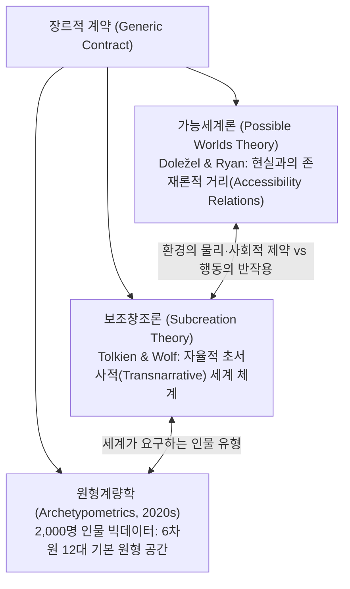
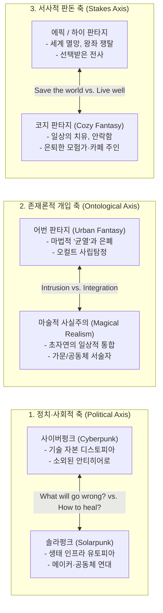

[English](../en/LITERARY-WORLDBUILDING-AND-CHARACTERS.md) | [한국어](../ko/LITERARY-WORLDBUILDING-AND-CHARACTERS.md) · [문서](../README.ko.md) · [창작 그림](CREATIVE-ART.md) · [3D 움직임](3D-MOTION.md)

# 문학 분야별 세계관(Worldbuilding) 및 캐릭터 구성(Character Configurations) 종합 연구 총람

> **고전 문학(Project Gutenberg) 및 현대·동시대 사변 문학 학술 연구(Liner Scholar 92편 및 비교문학 이론) 종합 분석**

---

## 1. 서론: 세계관과 캐릭터 구성의 3대 이론적 기초

비교문학(Comparative Literature)과 현대 서사학(Narratology)은 세계관(Worldbuilding)과 캐릭터 구성(Character Configuration)을 분리된 창작 요소가 아닌 **"동일한 장르적 계약(Generic Contract)의 양면"**으로 규정합니다.

1. **가능세계론 (Possible Worlds Theory - Lubomír Doležel, Marie-Laure Ryan)**:
   - 문학적 허구는 현실 세계(Actual World)와의 '접근 가능성 관계(Accessibility Relations)'—물리 법칙, 생물학적 호환성, 도덕적 인과율—의 거리에 따라 분류됩니다.
   - 돌레젤의 *Heterocosmica*는 허구를 **"세계 구축 프로젝트의 가장 활발한 실험실"**로 명명합니다.
2. **보조창조와 2차 세계 (Subcreation & Secondary Worlds - J.R.R. Tolkien, Mark J.P. Wolf)**:
   - 세계관은 플롯에 종속된 일회성 배경이 아니라, 개별 서사와 독립적으로 존재하는 **초서사적(transnarrative), 초매체적(transmedial), 초작가적(transauthorial)** 독립 시스템입니다.
3. **실증적 원형계량학 (Archetypometrics, 2020s)**:
   - 341편의 스토리와 2,000명의 인물 데이터를 464개 의미 차원으로 분석한 최신 계산서사학 연구에 따르면, 문학 속 캐릭터는 인간의 Big Five 성격 특성과 질서/무질서, 강함/약함의 축을 따르는 **12대 기본 원형**으로 수렴합니다.

---

## 2. 현대 사변 문학의 3대 진화 축 (The 3 Contemporary Axes)

1980년대 이후 40년간 현대 사변 문학은 다음 세 가지 핵심 대립축을 중심으로 진화하며 수많은 하위 장르를 분화시켰습니다:

---

## 3. 문학 분야별 세계관 법칙 및 캐릭터 구성 체계

### [분야 1] 사이버펑크 & 포스트사이버펑크 (Cyberpunk & Post-Cyberpunk)
* **대표 작가 및 명작**: 윌리엄 깁슨 (*Neuromancer, Sprawl 3부작*), 닐 스티븐슨 (*Snow Crash*), 필립 K. 딕 (*안드로이드는 전기양의 꿈을 꾸는가?*), 브루스 스털링
* **세계관 구축 법칙 (High-Tech, Low-Life)**: 초거대 기업의 봉건주의(Corporate Feudalism), 사이버스페이스의 신화화(The Matrix as Terra Incognita), 신체의 상품화와 도시 쇠락.
* **캐릭터 구성 패턴**:
  - **콘솔 카우보이 / 넷러너 해커 (The Console Cowboy / Netrunner)**: 사회 변두리에서 덱과 바이저를 통해 시스템 방화벽을 돌파하는 안티히어로 → **Pawzura 프리셋: `사이버펑크 넷러너 해커 (사이버펑크)`**.
  - **스트리트 사무라이 (The Street Samurai)**: 강화된 반사신경과 개인적 계약 코드에 따라 행동하는 전사.
  - **각성 인공지능 / 컨스트럭트**: 육체를 넘어 네트워크 공간에서 자아를 각성하는 지능체.

### [분야 2] 마술적 사실주의 (Magical Realism)
* **대표 작가 및 명작**: 가브리엘 가르시아 마르케스 (*백년 동안의 고독*), 호르헤 루이스 보르헤스 (*픽션들*), 살만 루슈디 (*한밤의 아이들*), 무라카미 하루키 (*태엽 감는 새*)
* **세계관 구축 법칙 (Integration, Not Intrusion)**: 초자연적 현상이 발생해도 작중 인물 누구도 경악하지 않고 자연스러운 일상의 일부로 수용하는 모순의 완전한 해소(Amaryll Chanady).
* **캐릭터 구성 패턴**: 대물림되는 가모장/가부장, 세상의 비밀이 담긴 양피지를 해독하는 고독한 연대기 기록자(The Solitary Chronicler), 마을 전체의 구전을 대변하는 공동체적 서술자.

### [분야 3] 현대 어번 판타지 (Urban Fantasy)
* **대표 작가 및 명작**: 닐 게이먼 (*네버웨어*, *신들의 전쟁*), 짐 부처 (*드레스덴 파일*), 세르게이 루키야넨코 (*나이트 워치*), 차이나 미에빌 (*도시와 도시*)
* **세계관 구축 법칙 (The Supernatural Breach & The Hidden City)**: 현대 대도시의 평범한 일상 이면(베일 뒤편)에 마법 협회와 야경꾼이 공존하는 이중 구조(Stefan Ekman, 2024).
* **캐릭터 구성 패턴**:
  - **야경 오컬트 탐정 (The Occult P.I. / Night-Watch Investigator)**: 현대적인 탐정 재킷과 은색 나침반·룬 문장을 지니고 인간 세계와 이면 세계의 경계를 순찰하는 중재자 → **Pawzura 프리셋: `야경 오컬트 탐정 (어번 판타지)`**.

### [분야 4] 솔라펑크 (Solarpunk: Ecological Utopian Imaginary)
* **대표 작가 및 명작**: 베키 챔버스 (*A Psalm for the Wild-Built*), 킴 스탠리 로빈슨 (*The Ministry for the Future*), 어슐러 르 귄 (*Always Coming Home*)
* **세계관 구축 법칙 (Infrastructural Symbiosis)**: 기후 위기 이후의 생태 복원, 분산형 태양광 마이크로그리드와 아르누보(Art Nouveau) 스테인드글라스 양식의 융합, 상호부조 공동체.
* **캐릭터 구성 패턴**:
  - **메이커 / 태양광 생태 수리공 (The Maker / Eco-Tinker)**: 무기 대신 수리 도구와 스테인드글라스 태양 잎사귀 브로치를 달고 공동체 인프라를 고치는 기술자 → **Pawzura 프리셋: `솔라펑크 태양광 수리공 (솔라펑크)`**.

### [분야 5] 코지 판타지 & 슬라이스 오브 라이프 (Cozy Fantasy)
* **대표 작가 및 명작**: 트래비스 발드리 (*Legends & Lattes*, *Bookshops & Bonedust*), T.J. 클룬 (*The House in the Cerulean Sea*), 세라 베스 더스트 (*The Spellshop*)
* **세계관 구축 법칙 (Low Stakes, High Comfort)**: 세계 멸망 같은 거대 판돈을 걷어내고(De-escalation of Stakes), 따뜻한 카페·책방·온실 같은 가정적 미시 세계에서 일상의 평화와 환대를 구현.
* **캐릭터 구성 패턴**:
  - **은퇴한 모험가 카페 바리스타 (The Retired Adventurer Barista)**: 거친 전장을 떠나 커피잔 배지가 달린 앞치마를 두르고 따뜻한 음료를 내리는 인물 → **Pawzura 프리셋: `은퇴 모험가 카페 바리스타 (코지 판타지)`**.

### [분야 6] 뉴 위어드 & 스페이스 오페라 (New Weird & Space Opera)
* **대표 작가 및 명작**: 차이나 미에빌 (*Perdido Street Station*), 제프 밴더미어 (*Annihilation*), 프랭크 허버트 (*Dune*), 어슐러 르 귄 (*어둠의 왼손*)
* **세계관 및 캐릭터**: 비유클리드 생태 지대를 기록하는 현장 생물학자, 행성 생태학과 성간 항로를 계산하는 항법사·천문학자 → **Pawzura 프리셋: `작은 SD 천문학자`**.

### [분야 7] 고전 명작 장르군 (Project Gutenberg & 고전 환상문학 캐넌)

| 고전 장르 | 대표 명작 | 세계관 특성 (Worldbuilding) | 핵심 캐릭터 구성 및 Pawzura 연계 |
| :--- | :--- | :--- | :--- |
| **고전 환상·은하 기행** | 미야자와 켄지 (*은하철도의 밤*), 생텍쥐페리 (*어린 왕자*) | 밤하늘 성좌와 은하 정거장을 잇는 서정적·철학적 2차 세계 | 별빛 정거장과 열차를 안내하는 **은하철도 별빛 차장** (`conductor_prompt`) |
| **고딕 & 초기 SF** | *프랑켄슈타인*, *지킬과 하이드*, *드라큘라* | 폭풍우 고성, 실험실, 이성 vs 광기의 심연 | 프로메테우스적 창조자 ↔ 소외된 피조물 |
| **탐정·추리 미스터리** | *셜록 홈즈*, *오귀스트 뒤팽*, *월석* | 안개 낀 도시, 합리적 질서 속의 미스터리 | 초합리주의 탐정 ↔ 온정적 조력자(왓슨) |
| **포털·생태 모험** | *이상한 나라의 앨리스*, *오즈의 마법사*, *보물섬* | 문턱을 넘어선 신비한 자연과 모험 세계 | **숲속 배달부** (`courier_prompt`), **태엽 정원사** (`gardener_prompt`), **숲 탐험가 수달** (`otter_prompt`) |

---

## 4. 고전과 현대 문학의 세계관·캐릭터 진화 비교 매트릭스

| 비교 항목 | 고전 문학 (Classics) | 20세기 사변 (Cyberpunk / Modern) | 21세기 동시대 (Solarpunk / Cozy) |
| :--- | :--- | :--- | :--- |
| **핵심 갈등** | 인간 vs 가혹한 자연 / 내면의 악 | 개인 vs 통제 불능의 초거대 시스템 | 상처 입은 개인 vs 번아웃 / 생태적 위기 |
| **서사적 판돈** | 생존, 복수, 진실 규명, 명예 | 디스토피아 속 미시적 생존, 탈출 | **정서적 치유, 일상의 평화, 상호 환대** |
| **세계관 성격** | 미지의 프론티어, 은하 철도, 고성 | 네온 메가시티, 냉혹한 데이터 매트릭스 | **인프라 공존, 따뜻한 찻집, 생태 공동체** |
| **주인공 원형** | 탐험가, 탐정, 차장, 창조자 | 고독한 늑대(Lone Wolf), 넷러너 해커 | **메이커(Maker), 돌봄자(Caretaker), 바리스타** |
| **동행자 형태** | 충직한 조력자 (왓슨, 산초, 프라이데이) | 거래 기반의 임시 크루 | **대안적 유사 가족 (Found Family)** |

---

## 5. Pawzura에 탑재된 문학 장르 기반 3D 캐릭터 생성 프리셋 매핑

`설정 → 캐릭터 → 창작 그림 만들기…`의 **움직임에 적합한 그림 예시**에 직접 탑재되어 원클릭으로 삽입·생성할 수 있는 문학 장르 프리셋입니다:

| 문학 장르 | Pawzura 프리셋 이름 | 시각적 형태 언어 및 10% 상징 포인트 | 3D 리깅 최적화 설계 |
| :--- | :--- | :--- | :--- |
| **사이버펑크** | `사이버펑크 넷러너 해커 (사이버펑크)` | 분홍 단발 + 이마의 청록 바이저 고글 + 회로 라인 테크 재킷 | 짧은 테크 재킷과 하이탑 부츠로 팔다리 관절 완전 노출 |
| **솔라펑크** | `솔라펑크 태양광 수리공 (솔라펑크)` | 구릿빛 웨이브 머리 + 스테인드글라스 태양 잎사귀 브로치 | 걷어 올린 소매와 짧은 이끼색 작업 조끼로 손목·골반 분리 |
| **코지 판타지** | `은퇴 모험가 카페 바리스타 (코지 판타지)` | 은색 땋은 머리 + 작은 뿔 + 커피잔 배지 앞치마 조끼 | 긴 치마 대신 짧은 앞치마 조끼와 바지로 다리 간섭 배제 |
| **어번 판타지** | `야경 오컬트 탐정 (어번 판타지)` | 금빛 머리 + 호박색 눈 + 은색 나침반 배지 볼레로 재킷 | 발목을 가리는 롱코트 대신 짧은 탐정 볼레로 재킷 적용 |
| **고전 환상문학** | `은하철도 별빛 차장 (고전 환상문학)` | 남색 머리 + 금빛 눈동자 + 황동 검표 배지 차장 제복 | 단정한 제복 상의와 크림색 바지·부츠 색상 대비로 리깅 정확도 확보 |

- 연계 문서: [독창적 캐릭터 제작 방법론](CHARACTER-DESIGN-METHODOLOGY.md) · [현대 특수문학(라이트노벨·웹소설·서브컬처) 서사학 총람](SUBCULTURAL-LITERATURE-AND-LIGHT-NOVELS.md) · [연구 문헌 총괄 서지 목록](CHARACTER-AND-LITERATURE-BIBLIOGRAPHY.md)
