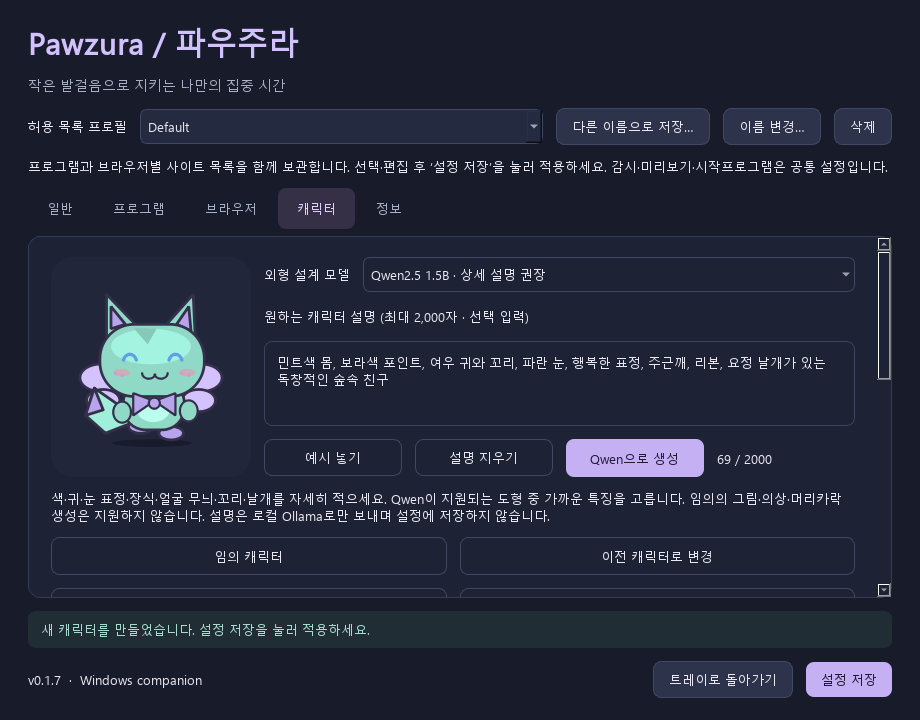

[English](../en/MODELS.md) | [한국어](../ko/MODELS.md) · [문서 목록](../README.ko.md)

# 모델과 캐릭터 생성

실루엣·의상·머리카락이 다른 실제 그림은 **캐릭터 → 창작 그림 만들기…**를 이용하세요. 별도 GPU 실행환경·콘텐츠 검사·모델 라이선스 확인이 필요한 선택 기능입니다. [창작 그림 안내](CREATIVE-ART.md)를 참고하세요. 아래 내용은 기존 도형 설계에 대한 설명입니다.

**Ollama가 실행 중이고 선택한 모델이 다운로드되어 있어야 합니다. 가중치와 추가 실행 메모리를 위한 가용 RAM·VRAM을 확보하세요.** 임의/직접 선택 캐릭터에는 필요 없습니다. **고급 → VRAM 2·4·6·8GB 기준**의 Qwen3 추가 모델·라이선스는 [고급 모델과 메모리](ADVANCED-MODELS.md)를 참고하세요. 설명 해석 모델 선택을 늘리며 벡터 그림의 표현 범위는 같습니다.

## 사용하는 모델

| 역할 | 식별자 | 라이선스 | 사용 방식 |
| --- | --- | --- | --- |
| 외형 설계 sLLM | `Qwen/Qwen2.5-0.5B-Instruct` | Apache-2.0 | 원본 모델의 계보·고지. 직접 Transformers를 설치하지 않음 |
| 실제 추론 가중치 | `Qwen/Qwen2.5-0.5B-Instruct-GGUF`, `qwen2.5-0.5b-instruct-q4_k_m.gguf` | Apache-2.0 | Hugging Face 공식 Qwen 저장소에서 Ollama로 내려받음 |
| 상세 설명용 선택 모델 | `Qwen/Qwen2.5-1.5B-Instruct-GGUF`, Q4_K_M | Apache-2.0 | 캐릭터 탭에서 선택하는 더 큰 로컬 모델. EXE에 포함하거나 자동 다운로드하지 않음 |
| 추론 서버 | Ollama (사용자 별도 설치) | MIT (본체; 개별 포함 구성요소는 별도) | `127.0.0.1:11434/api/generate` |
| 모션 모델 | 없음 | 해당 없음 | 자체 절차적 애니메이션 |
| 도형 모드의 이미지/배경 제거 모델 | 없음 | 해당 없음 | 자체 벡터 도형, 투명 Qt 창 |
| 선택형 그림·검사·배경 제거 | SD 1.5, SDXL, Qwen3-VL, Falconsai ViT, U2NetP | 개별 조건 | [별도 카탈로그·절차](CREATIVE-ART.md) |

모델 카드: https://huggingface.co/Qwen/Qwen2.5-0.5B-Instruct-GGUF

원본 카드: https://huggingface.co/Qwen/Qwen2.5-0.5B-Instruct

GGUF 사용 안내: https://huggingface.co/docs/hub/en/ollama

Ollama API: https://docs.ollama.com/api/generate

## 선택 기능 사용하기

Ollama를 설치·실행한 뒤 한 번 내려받으세요.

```powershell
ollama pull hf.co/Qwen/Qwen2.5-1.5B-Instruct-GGUF:Q4_K_M
```

1. **캐릭터** 탭에서 상세 설명용 **Qwen2.5 1.5B**(약 1.12 GB)를 선택하고 옆의 **명령 복사**를 누르세요. PowerShell에 붙여넣고 Enter → `success`까지 기다립니다. 가벼운 **0.5B**는 약 491 MB이지만 상세한 한글·영문 요청을 자주 놓칩니다. **모델 준비 안내**에 모든 VRAM별 정확한 명령과 순서가 있습니다. 기존 0.5B 캐릭터의 모델 기록은 유지됩니다.
2. 설명을 직접 입력하거나 **예시 넣기**를 누르세요. 최대 2,000자이며 비워 두면 임의로 설계합니다.
3. **직접 고르는 외형 옵션**에서 필요한 색상·특징을 지정하세요. 직접 고른 값은 프롬프트와 모델 결과보다 우선합니다. **자동**·빈 색상은 Qwen이 정합니다.
4. **Qwen으로 생성** → 미리보기 확인 → **설정 저장**을 누르세요. 생성 오류가 나면 현재 외형을 유지합니다.

예시: “민트색 몸, 보라색 포인트, 여우 귀와 꼬리, 파란 눈, 행복한 표정, 주근깨, 리본, 요정 날개가 있는 독창적인 숲속 친구”. 기존 캐릭터 이름 대신 원하는 일반적인 특징을 설명하세요.

## 모델 없이 직접 커스텀하기



예시는 색·특징을 수동으로 지정했습니다. 모델이 모든 단어를 정확히 따른다는 의미는 아닙니다.

옵션을 고르고 **옵션 적용 (모델 불필요)** → 미리보기 확인 → **설정 저장**을 누르세요. 이 모드에서 선택하지 않은 항목은 현재 외형을 유지합니다. 색상은 `#RRGGBB`로 입력하거나 **색 선택…**으로 고릅니다. **이전 캐릭터로 변경**은 이전 외형을, **기본 외형으로 초기화**는 기본 디자인을 복원합니다.

| 항목 | 지원 값 |
| --- | --- |
| 몸·포인트·눈 색상 | 임의의 `#RRGGBB` 색상 |
| 귀 | 토끼, 고양이, 곰, 여우, 없음 |
| 장식 | 목도리, 별, 나뭇잎, 리본, 방울, 없음 |
| 눈 표정 | 동그란 눈, 졸린 눈, 웃는 눈 |
| 얼굴 무늬 | 없음, 주근깨, 줄무늬, 반점 |
| 꼬리 | 방울, 고양이, 여우, 없음 |
| 날개 | 없음, 요정, 박쥐 |

설명을 위 도형으로 표현하는 방식입니다. 임의의 일러스트·의상·머리카락·신체 비율이나 참조 이미지 생성은 지원하지 않습니다. 특히 0.5B는 요청을 놓칠 수 있으므로 정확해야 할 특징·색은 직접 선택하세요. 날개·꼬리는 기존 절차적 애니메이션과 함께 움직입니다.

## 처리 흐름

1. 현재 창의 설명과 검증된 수동 옵션을 읽고 seed를 선택합니다. 지정하지 않은 부분은 달라질 수 있습니다.
2. 고유 캐릭터와 일반적인 특징을 설계하도록 안내하고, 선택한 Qwen에 로컬 Ollama로만 요청합니다. 임의 모델명·외부 서버 주소는 받지 않습니다.
3. 몸·포인트·눈 색상과 귀·장식·눈 표정·얼굴 무늬·꼬리·날개의 9개 필드를 스키마로 제한합니다.
4. 모델 출력은 실행·eval·동적 SVG/HTML로 해석하지 않습니다. 부적절한 필드는 해당 seed의 로컬 난수 값으로 보정합니다. JSON 자체가 손상되거나 필수 키가 없으면 오류를 표시하고 기존 캐릭터를 유지합니다.
5. 직접 선택한 옵션을 마지막에 덮어쓰고 프로그램 고유 QPainter 도형으로 그립니다. 모델이 다른 값을 내도 수동 지정값을 우선합니다.
6. 설정에는 seed·외형·모델 식별자만 보관하며 최근 캐릭터 20개를 복원할 수 있습니다. 프롬프트는 현재 설정 창에만 남고 설정·외형 이력에 저장하거나 로그·외부 서비스로 전송하지 않습니다. **설명 지우기**로 비울 수 있습니다. 별도 설치한 Ollama 자체의 동작은 해당 서비스에 따릅니다.

다운로드는 사용자가 명령으로 명시적으로 수행합니다. 앱은 모델을 자동 설치하지 않고, 모델 가중치를 EXE에 포함하지 않습니다. 최초 다운로드 이후 추론에는 인터넷이 필요하지 않습니다. 생성 오류가 발생해도 기존 캐릭터와 감시는 계속 동작합니다. UI 스레드와 추론 스레드를 분리하며 생성 중에는 프로세스 종료를 잠시 보류합니다.

## 왜 별도 모션 모델을 쓰지 않는가

144×146 논리 픽셀 크기의 캐릭터는 머리·귀·발·장식을 앱이 각각 그립니다. 발과 귀는 sin/cos, 이동은 시간차 기반 보간, 점프는 포물선에 가까운 곡선으로 표현합니다. 프레임 간 외형 일관성이 보장되고 비디오 생성 모델의 VRAM·지연·라이선스 부담이 없습니다. `draw_character`, `Pet`, `Crack`이 구현 위치입니다. 모션 모델을 추가하는 경우 모델 카드·라이선스·다운로드 크기·사용 방식·고지를 이 문서와 THIRD-PARTY-NOTICES에 먼저 추가해야 합니다.

## 권리 및 버전 관리

[캐릭터 정책과 제작 이력](CHARACTER-RIGHTS.md)에 기본 외형·소스 해시와 독점 주장에 대한 반대 의사를 기록했습니다. 기존 MIT 허가는 유지하며 이 정책만으로 제3자의 출원을 자동 차단할 수는 없습니다.

기본 캐릭터는 AI 지원으로 작성한 자체 벡터 도형 코드이며 외부 마스코트를 라이선스 받아 가져온 것이 아닙니다. 정식 상표·이미지 유사성 조사를 완료하지 않았으므로 독립적으로 그렸다는 사실만으로 기존 권리와의 충돌이 없다고 보장하지 않습니다. 저작권과 상표권은 별개이며 AI 관여 산출물의 독점적 저작권은 적용 법과 인간의 창작적 기여에 대한 검토가 필요합니다. 브랜드·상업 배포 전에 제작 기록을 보존하고 권리 검토를 받는 편이 좋습니다. [공식 AI 저작권 안내](https://www.kipo.go.kr/ko/kpoBultnDetail.do?aprchId=BUT0000029&menuCd=SCD0200618&ntatcSeq=21075&sysCd=SCD02), [상표권 범위](https://www.kipo.go.kr/ko/kpoContentView.do?menuCd=SCD0200242).

오픈 모델의 Apache-2.0은 가중치의 사용 조건입니다. 생성물의 독창성, 저작권 성립 또는 비침해를 보증하지 않습니다. 고유한 일반 특징을 요청하고 자체 도형만 그리지만 자동 독창성 검사 기능은 아닙니다. 외부 참조 이미지는 지원하지 않으며, 자유로운 텍스트 설명은 0.1.7부터 지원합니다.

참고: [0.5B 모델 카드](https://huggingface.co/Qwen/Qwen2.5-0.5B-Instruct-GGUF), [1.5B 모델 카드](https://huggingface.co/Qwen/Qwen2.5-1.5B-Instruct-GGUF), [Ollama 구조화 출력](https://docs.ollama.com/capabilities/structured-outputs).

모델 태그는 upstream 변경 가능성이 있으므로 재현성이 필요한 배포는 `ollama show --modelfile` 및 `ollama list`의 digest도 별도 기록해야 합니다. 모델은 제품 소스 라이선스인 MIT로 재라이선스하지 않습니다. 원문은 `licenses/upstream/Qwen-LICENSE.txt`에 보관합니다.

1.5B 검증 모델의 크기와 해시는 [제작 기록](../../artifacts/model-provenance-1.5B.json)에, 원문 라이선스는 [별도 파일](../../licenses/upstream/Qwen-1.5B-LICENSE.txt)에 남겼습니다. 실제 예시 시험에서 대부분의 특징을 따랐지만 눈 색과 꼬리 종류는 놓쳤으므로 1.5B도 설명을 완벽히 지킨다고 보장하지 않습니다. 수동 선택은 추론 뒤 반드시 적용합니다.
