[English](../en/STAGED-CHARACTER-PIPELINE.md) | [한국어](../ko/STAGED-CHARACTER-PIPELINE.md) · [방향성 애니메이션](DIRECTIONAL-ANIMATION.md)

# 일관된 프레임과 순차 모델 준비

2026-11-03 사용자 지정 구조입니다. 첫 [8GB 포즈 추정 보조 연결](3D-MOTION.md)을 소스 앱에 구현·확인했습니다. 승인한 그림 하나를 재사용하고 공유 TripoSR 장면에서 시점·메쉬를 만든 뒤 CPU 포즈·가중치 추정과 프레임 저장을 별도 프로세스에서 수행합니다. 아래의 독립적인 여러 그림 → 전문 학습형 3D 리깅 계획 전체를 구현한 것은 아닙니다. 기존 0.3.0 릴리스는 바꾸지 않았으며 새 EXE가 만들어졌다는 뜻도 아닙니다. 나머지는 더 큰 목표와 제약을 설명합니다.

## 단계 순서

```mermaid
flowchart LR
    A[승인한 기준 캐릭터] --> B[일관된 그림 프레임]
    B --> C[검토하고 프레임 묶음 저장]
    C --> D[그림 작업 프로세스 해제]
    D --> E[텍스처가 있는 3D 메쉬 복원]
    E --> F[복원 작업 프로세스 해제]
    F --> G[뼈대와 스킨 가중치 추정]
    G --> H[리깅 작업 프로세스 해제]
    H --> I[동작과 표정 제어 맞춤]
    I --> J[투명 동작 클립 저장·검토]
    J --> K[검증된 묶음을 Qt 캐릭터에 적용]
```

**3D 복원과 리깅은 입력·출력이 다릅니다.** 복원은 지원하는 이미지 입력에서 메쉬·재질을 만듭니다. 리깅은 그 메쉬에 뼈대와 스킨 가중치를 붙입니다. 리깅만으로 2D 그림을 3D 캐릭터로 바꾸지는 않습니다. 뼈대만 생겨도 걷기·깜빡임·턱 벌림이 자동으로 생기는 것은 아닙니다.

## 수량보다 일관성이 먼저

먼저 기준 캐릭터 하나를 생성·승인합니다. 이후 그림은 그 기준 이미지를 조건으로 사용해 신체 비율·얼굴·색·의상·비대칭 장식의 위치를 유지합니다. 같은 프롬프트나 난수 시드만 사용하는 것은 외형 고정 수단으로 충분하지 않습니다. 제품 선택지에 넣기 전에 기준 이미지 조건부 생성의 일관성을 입증해야 하며, 이 문서에서 새 그림 모델을 확정하지는 않습니다.

프레임은 두 묶음으로 명확히 구분합니다.

| 묶음 | 목적·조건 |
| --- | --- |
| 기본 자세의 시점 묶음 | 정면·양쪽 사선·양쪽 측면·뒷면. 자세·크기·조명·전신 실루엣을 유지합니다. 해당 시점을 지원하는 복원 모델에만 입력합니다. |
| 표정·모션 참고 | 필요에 따라 깜빡임·미소·입 벌림·보행·접촉 자세. 이후 표정 제어·모션 전달·시각 검사에 사용하며, 다른 자세를 정지 물체의 추가 카메라 시점으로 취급하지 않습니다. |

팔다리 자세가 달라지는 그림을 정적 다중 시점 복원 입력과 섞지 않습니다. 모든 시점을 캐릭터 시트 한 장으로 합쳐 현재 단일 인물 생성·앱 경로에 넣지도 않습니다. 프레임마다 별개의 메쉬·리깅을 만들지 않고 하나의 공유 메쉬·리깅으로 동작 전체의 외형을 유지합니다.

요청한 시점 이름은 측정된 카메라 보정값이 아닙니다. 카메라 내부·외부 파라미터가 필요한 복원 모델에는 실제 값이나 검증한 추정값을 제공해야 합니다. 텍스트로 요청한 측면 그림이 자동으로 정확한 90° 관측이 되는 것은 아닙니다. 가려진 면은 추정이므로 정답으로 취급하지 말고 검토해야 합니다.

각 그림의 외형 변화·추가 인물이나 팔다리·실루엣 연결·장식 일치·보이는 손발을 확인하고 시점 묶음 전체도 비교합니다. 자동 유사도나 기존 단일 인물 검사는 오류를 놓칠 수 있습니다. 마지막 승인 묶음을 보존하고 같은 기준 이미지를 사용해 거부한 프레임만 다시 생성합니다. 개인 설명은 세션에만 두고 설정·로그·캐시 목록에 넣지 않습니다.

## 모델 역할과 현재 근거

| 역할 | 후보·근거 | 경계 |
| --- | --- | --- |
| 일관된 그림 | 현재 SD 1.5·SDXL은 단일 그림을 생성하고 기존 라이선스를 따릅니다. | 현재의 독립 생성이나 예시 선택 UI가 다중 시점의 외형 유지를 입증하지는 않습니다. 모델 선정은 미정입니다. |
| 3D 복원 | [TripoSR](https://github.com/VAST-AI-Research/TripoSR), [공식 MIT 모델](https://huggingface.co/stabilityai/TripoSR). 격리된 단일 이미지 시험에서 실제 새 시점을 얻었습니다. | 공식 인터페이스는 단일 이미지 복원이며 다중 시점 융합 모델이 아닙니다. 이미지 목록을 넣으면 하나로 융합하는 대신 별도 장면을 만듭니다. 앞선 QA 수동 리깅은 자동 리깅이 아닙니다. |
| 뼈대·스킨 가중치 | [UniRig](https://github.com/VAST-AI-Research/UniRig), [공식 MIT 모델 카드](https://huggingface.co/VAST-AI/UniRig). | 후보일 뿐 여기서 설치·실행하지 않았습니다. 카드가 **VRAM 8GB 초과**를 요구하므로 순차 실행만으로 8GB 구성이 입증되지 않습니다. 뼈대·스키닝 출력 모두 확인해야 합니다. |
| 표정·동작 제어 | 턱·눈 제어, 블렌드 셰이프나 검토한 보정 자산, 전달한 모션. | 몸 자동 리깅 성공만으로 이 출력이 존재한다고 할 수 없습니다. 눈·턱 제어가 없으면 표정 애니메이션을 지원한다고 안내하지 않습니다. |

출처 확인일은 2026-11-03입니다. UniRig 저장소는 뼈대·스키닝 구성요소 공개를 설명하지만 모델 카드에는 일부 구성요소가 추후 공개된다는 문구가 남아 있습니다. 선정 전에 정확한 체크포인트·설정을 고정하고 확인해야 합니다. 원본은 Python 3.11과 네이티브·Blender 의존성을 안내하며 Windows 호환성·설치 구성요소 조건·실제 추론 메모리는 미검증입니다. 학습 메모리 수치를 추론 요구량으로 옮겨 쓰지 않습니다. Pawzura의 Python 3.12+ GUI와 개별 검증한 선택형 작업 런타임은 분리합니다.

모델·의존성은 각자 라이선스를 따르고 앱 코드는 MIT를 유지합니다. 설계에 등장한 것만으로 지원 모델·다운로드 버튼·배포 가중치에 추가하지 않습니다.

## ‘이전 모델을 끈다’의 의미

무거운 단계는 이 작업이 소유한 별도 프로세스로 실행하는 방식을 우선합니다. 출력을 저장·검증하고 해당 프로세스의 종료와 파이프·핸들 해제를 확인한 뒤 다음 무거운 작업을 시작합니다. 살아 있는 프로세스에서 `del`·가비지 컬렉션·CUDA 캐시 비우기를 호출하는 것은 프로세스 종료 확인과 같지 않습니다. 구현한 8GB 제어기는 별도 작업 프로세스와 검증한 단계 캐시를 사용합니다. 위 사용 안내를 참고하세요.

창마다 순차 반복문을 두는 데 그치지 않고 앱 전체에서 자체 GPU 준비 작업을 하나만 허용합니다. 이전 작업의 프로세스 해제가 끝나기 전에 두 번째 준비를 시작하지 않습니다. 단계 결과에 작업·세대 식별자를 전달하고 취소·입력 변경 뒤의 결과는 폐기합니다. 늦게 끝난 작업이 예전 준비를 되살리거나 다른 캐릭터에 적용되어서는 안 됩니다.

이 작업이 소유한 모델·프로세스만 해제합니다. 사용자 Ollama 서비스나 다른 GPU 앱을 종료하지 않습니다. 기존 로컬 검사는 `keep_alive: 0`을 요청하며 다음 GPU 단계 전에 검사 모델의 사용도 고려합니다. 공유 서비스의 소유권·정리 기준을 명확히 해야 합니다.

Windows와 다른 앱이 VRAM을 사용하므로 전체 사용량이 0이 될 때까지 기다리지 않습니다. 다음 단계에 필요한 실제 여유 공간과 측정한 요구량을 확인합니다. 하나씩 로딩하면 동시 점유는 줄지만 모델 하나가 너무 크면 여전히 들어가지 않습니다. 종료·정리 시간 초과, 메모리 부족, 모델 오류가 발생하면 준비를 멈추고 기존 캐릭터를 유지합니다. 현재 단계·실제 제공되는 진행률·경과 시간·다음 행동을 보여주고 전체 퍼센트나 남은 시간을 꾸며내지 않습니다.

## 단계별 저장 결과와 복구

| 경계 | 필요한 승인 출력 |
| --- | --- |
| 그림 완료 | 개별 검증한 시점·참고 이미지, 승인한 묶음 구분, 해시, 제한된 크기, 관련 카메라·자세 정보. 개인 프롬프트 원문 제외. |
| 복원 완료 | 승인 입력 해시에 연결된 메쉬·재질 하나. 제한된 크기·호환되는 구조·크기 단위, 검토한 옆면·뒷면. |
| 리깅 완료 | 유한한 관절 값, 순환 없는 부모 관계, 유효한 정점 영향 인덱스, 메쉬와 일치하는 정규화된 비음수 스킨 가중치. |
| 모션 준비 완료 | 보행·접촉 자세와 실제 눈·턱·표정 제어. 렌더 결과에 맞는 발·입 접촉점. |
| 적용 준비 완료 | 제한된 시간·프레임 수와 프레임별 접촉점을 가진 투명 방향별 클립, 반복·전환 검사, 144픽셀 검토. |

각 단계는 임시 결과에 쓰고 검증이 끝난 뒤에만 원자적으로 승인 결과로 전환합니다. 캐시는 승인 이미지·메쉬 해시, 모델 리비전, 설정으로 구분합니다. 입력이 바뀌면 그 이후 결과를 무효화합니다. 실패 뒤에는 호환되는 마지막 승인 단계에서 재개하고 완료한 그림 단계를 불필요하게 다시 돌리지 않습니다. 파일이 있다는 것만으로 성공으로 판단하지 않습니다.

승인한 리깅 하나에 동작을 적용해 가벼운 클립으로 저장하고, 최종 수용 화면은 기존 Qt 캐릭터를 사용합니다. 측면 걷기·발 딛기·정지 시 정면 전환·커서와 클릭 반응·턱이 맞닿는 가상 깨물기를 확인한 뒤 통합을 시험합니다. 모니터 좌표·취소·기존 감시와 브라우저 경계는 별도 요구사항입니다. 미리보기가 실제 종료 요청이 되어서는 안 됩니다.

검토·검증을 통과한 뒤에만 새 묶음을 적용합니다. 준비 실패 시 기존 캐릭터를 유지합니다. 2D 대체 동작은 명확히 표시하고 3D 준비 성공으로 계산하지 않습니다. 일상적인 캐릭터 재생에 그림·복원·리깅 모델을 계속 메모리에 유지할 필요가 없어야 합니다.
