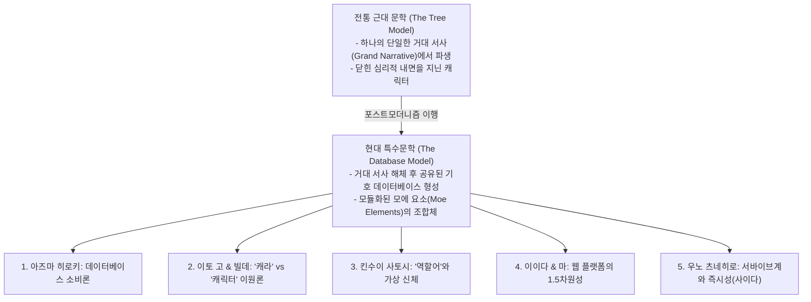
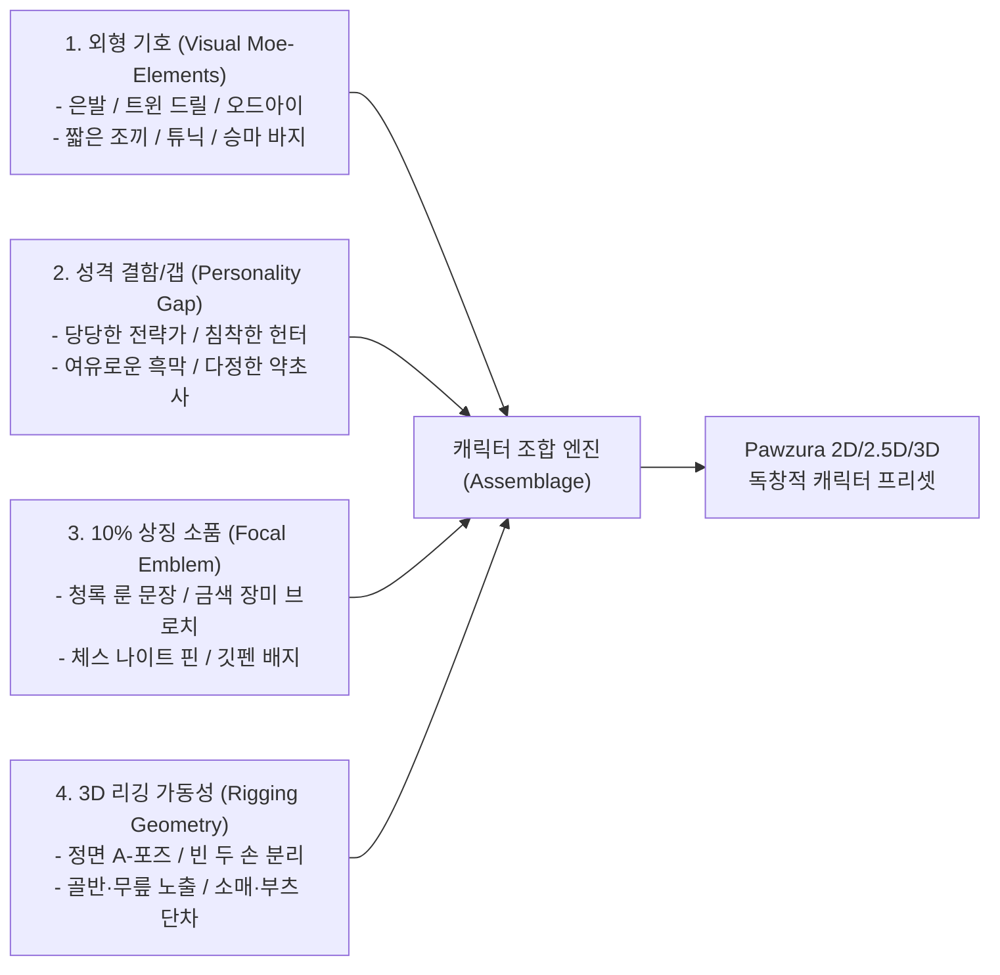

[English](../en/SUBCULTURAL-LITERATURE-AND-LIGHT-NOVELS.md) | [한국어](../ko/SUBCULTURAL-LITERATURE-AND-LIGHT-NOVELS.md) · [문서](../README.ko.md) · [창작 그림](CREATIVE-ART.md) · [3D 움직임](3D-MOTION.md)

# 현대 특수문학(라이트노벨·웹소설·서브컬처) 세계관 및 캐릭터 서사학 총람

> **데이터베이스 소비론, 캐라(Kyara) 기호학, 역할어(役割語), 플랫폼 미디어 생태학 및 이세계·LitRPG 학술 연구 종합 분석 · Pawzura 3D 캐릭터 프리셋 연계**

---

## 1. 서론: 특수문학의 정의와 서사학적 패러다임 전환

라이트노벨(Light Novel, LN), 웹소설(Web Novel, WN), 서브컬처 문학은 전통 순수문학의 선형적 인과율이나 근대적 사실주의 소설과는 완전히 다른 **미디어 생태학(Media Ecology), 기호론(Semiotics), 게임학(Ludology)**의 교차점에서 탄생한 **현대 특수 서사 체계**입니다.

---

## 2. 5대 핵심 이론적 프레임워크

### (1) 아즈마 히로키(東浩紀): 데이터베이스 소비론 (Database Consumption)
* **거대 서사의 붕괴와 심층 데이터베이스**:  
  아즈마 히로키(*동물화하는 포스트모던*, 2001)에 따르면, 포스트모더니즘에서 사회 전체를 지배하는 단일 거대 서사가 해체되면서, 독자들은 개별 작품의 줄거리 자체보다 배후에 축적된 **‘설정 및 모에 요소의 데이터베이스’**를 직접 소비합니다.
* **캐릭터의 모듈화 (Modular Assemblage)**:  
  캐릭터는 닫힌 인격체가 아니라 `은빛 머리 + 붉은 눈동자 + 청록색 룬 문장 + 짧은 헌터 조끼`처럼 기호화된 데이터베이스 조각들의 조합체로 설계됩니다.

### (2) 이토 고(伊藤剛) & 루카스 빌데(Lukas Wilde): ‘캐라(Kyara)’ vs ‘캐릭터(Kyarakutā)’
* **서사적 등장인물(Character)과 원초적 기호체(Kyara)의 분리**:
  - **캐릭터 (Kyarakutā)**: 소설의 특정 줄거리와 세계관 인과율에 묶여 있는 디제틱(Diegetic) 인물.
  - **캐라 (Kyara)**: 이야기로부터 탈맥락화되어 단독으로 바탕화면 동반자, 일러스트, 굿즈로 생명력을 갖는 **원초적 시각·상징 기호체**.
* **Pawzura와의 연결성**: 바탕화면 위를 걸어 다니며 반응하는 Pawzura의 동반자는 전형적인 **‘살아 움직이는 캐라(Kyara)’**로서, 한눈에 읽히는 기호성과 실루엣을 갖추어야 합니다.

### (3) 킨수이 사토시(金水敏) & 티안윈 양(Tianyun Yang): ‘역할어(役割語, Yakuwarigo)’
* **언어학적 가상 신체 (Virtual Body)**: 특정 어미·호칭·태도가 독자의 뇌 속 서브컬처 데이터베이스와 공명하여, 텍스트 설명만으로도 특정 캐릭터 원형(악역 영애, 흑막 학도, 약초사, 헌터)의 자세와 비주얼을 즉각 환기시킵니다.

### (4) 이이다 & 마(Iida & Ma, 2024): 웹소설 플랫폼의 ‘1.5차원성’
* 순수 1차 창작과 2차 창작의 경계가 흐려진 영역에서, 공유된 장르 문법(상태창, 이세계 공방, 파멸 플래그 회피, 파티 추방 후 슬로우 라이프)을 독창적인 시각 기호로 변주합니다.

### (5) 우노 츠네히로(宇野常寛) & 체르벨리(Cervelli, 2025): ‘서바이브계(Survive-kei)’와 ‘사이다(Immediacy)’
* 시스템의 규칙을 분석해 자립하는 ‘옵티마이저/메이커’형 주인공과 즉각적 효능감(사이다)의 시각적 구현.

---

## 3. 특수문학 5대 핵심 서브장르별 세계관 법칙 및 캐릭터 구성

### [장르 A] 이세계 전생·공방 개척물 (Isekai / Artisan Reincarnation)
* **대표작**: *책벌레의 하극상*, *무직전생*, *전생했더니 슬라임이었던 건에 대하여*
* **세계관 법칙**: 폴 프라이스(Paul Price)의 4대 유형학 및 현대 기술·지식(인쇄술, 제본, 수공예, 약학)이 판타지 생태계에서 독보적 가치를 발휘하는 메이커 세계관.
* **캐릭터 원형 → Pawzura 프리셋: `이세계 책공방 장인 (이세계 전생물)` (`artisan_prompt`)**:
  - 금색 머리핀을 꽂은 짧은 남색 머리, 걷어 올린 크림색 소매, 깃펜 배지가 달린 짧은 호박색 가죽 앞치마 조끼, 남색 바지, 갈색 부츠.

### [장르 B] 헌터물·게이트물 & 탑등반물 (LitRPG / System Apocalypse)
* **대표작**: *나 혼자만 레벨업*, *전지적 독자 시점*, *튜토리얼 탑의 고인물*
* **세계관 법칙**: 레벨·스탯·룬 상태창이 객관적 물리 법칙으로 작동하는 디제틱 게임 시스템(Diegetic System).
* **캐릭터 원형 → Pawzura 프리셋: `상태창 그림자 헌터 (헌터물·LitRPG)` (`hunter_prompt`)**:
  - 짧은 은빛 머리, 붉은 눈동자, 차콜색 긴 소매, 청록색 룬 문장 배지가 달린 짧은 남색 헌터 조끼, 슬레이트 바지, 검정색 전술 부츠.

### [장르 C] 악역 영애물 & 로맨스 판타지 (Villainess Otome Isekai / RoPan)
* **대표작**: *악역의 엔딩은 죽음뿐*, *겸허, 견실을 모토로 살아가고 있습니다!*, *그녀가 공작저로 가야 했던 사정*
* **세계관 법칙**: 정해진 파멸 엔딩을 지략과 실용적 자립으로 돌파하는 귀족 사교계 정보전 세계관.
* **캐릭터 원형 → Pawzura 프리셋: `전략가 악역 영애 (로맨스 판타지)` (`villainess_prompt`)**:
  - 짧은 연보라 트윈 드릴 롤머리, 당당한 미소, 크림색 프릴 긴 소매, 금색 장미 브로치가 달린 짧은 진홍색 벨벳 조끼, 단정한 자주색 승마 바지(3D 다리 관절 분리를 위해 발목을 가리는 롱드레스 대신 귀족 승마복 채택), 상아색 부츠.

### [장르 D] 착각계 & 먼치킨 풍자 (Misunderstanding & Satirical Mastermind)
* **대표작**: *오버로드*, *어둠의 실력자가 되고 싶어서!*
* **세계관 법칙**: 정보의 비대칭성과 심오한 착각이 맞물려 주인공의 일거수일투족이 거대한 지략으로 해석되는 세계관.
* **캐릭터 원형 → Pawzura 프리셋: `착각계 흑막 마도학도 (착각계)` (`mastermind_prompt`)**:
  - 짧은 검정색 머리, 금색과 보라색 오드아이, 여유로운 미소, 은색 테두리의 단정한 검정색 튜닉 상의, 체스 나이트 옷깃 핀, 차콜색 바지, 진홍색 부츠.

### [장르 E] 추방물 & 파티 이탈 슬로우 라이프 (Banished Support / Slow-Life)
* **대표작**: *진정한 동료가 아니라고 용사 파티에서 추방당해서, 시골에서 슬로우 라이프를 보내기로 했습니다*
* **세계관 법칙**: 전투 딜러 중심의 오만한 파티에서 벗어나, 약초학·연금술·물류 관리 같은 비전투 지원 가치의 진가를 변방에서 꽃피우는 치유 세계관.
* **캐릭터 원형 → Pawzura 프리셋: `추방된 만능 약초사 (추방·슬로우라이프)` (`supporter_prompt`)**:
  - 짧은 초록색 머리, 온화한 미소, 크림색 린넨 긴 소매, 작은 약초 주머니 벨트와 짧은 밤색 다용도 조끼, 올리브 바지, 적갈색 가죽 부츠.

---

## 4. 데이터베이스 기반 캐릭터 조형 매트릭스 (Recombinant Matrix)

---

## 5. Pawzura에 탑재된 서브컬처·라이트노벨 3D 캐릭터 프리셋 요약표

| 서브컬처 장르 | Pawzura 예시 선택기 이름 | 핵심 모에 기호 조합 (Azuma Matrix) | 영문 프롬프트 (`pawzura/art_ui.py`) |
| :--- | :--- | :--- | :--- |
| **헌터물·LitRPG** | `상태창 그림자 헌터 (헌터물·LitRPG)` | 은발 + 적안 + 청록색 룬 문장 배지 + 남색 헌터 조끼 | `Solo single chibi shadow hunter ... Short silver hair, ruby eyes ... cropped midnight-blue hunter vest with glowing cyan rune emblem ...` |
| **로맨스 판타지** | `전략가 악역 영애 (로맨스 판타지)` | 연보라 트윈 드릴 롤머리 + 금색 장미 브로치 + 진홍색 벨벳 조끼 + 자주색 승마 바지 | `Solo single chibi villainess noble lady ... Short lavender twin drill curls ... cropped crimson velvet waistcoat with gold rose brooch, tailored dark plum breeches ...` |
| **이세계 전생물** | `이세계 책공방 장인 (이세계 전생물)` | 남색 머리 + 금색 머리핀 + 깃펜 배지 + 호박색 가죽 앞치마 조끼 | `Solo single chibi bookshop artisan ... Short deep-blue hair with gold hairpin ... cropped amber leather apron vest with quill badge ...` |
| **추방·슬로우라이프** | `추방된 만능 약초사 (추방·슬로우라이프)` | 초록 머리 + 약초 주머니 벨트 + 밤색 다용도 조끼 | `Solo single chibi herbalist supporter ... Short sage-green hair ... cropped chestnut utility vest with herb pouch belt ...` |
| **착각계·다크판타지** | `착각계 흑막 마도학도 (착각계)` | 흑발 + 금/보라 오드아이 + 체스 나이트 옷깃 핀 + 은테 검정 튜닉 | `Solo single chibi mastermind scholar ... gold and violet heterochromia eyes ... fitted silver-trimmed black tunic, antique chess knight lapel pin ...` |

- 연계 문서: [독창적 캐릭터 제작 방법론](CHARACTER-DESIGN-METHODOLOGY.md) · [문학 분야별 세계관 및 캐릭터 구성 총람](LITERARY-WORLDBUILDING-AND-CHARACTERS.md) · [연구 문헌 총괄 서지 목록](CHARACTER-AND-LITERATURE-BIBLIOGRAPHY.md)
